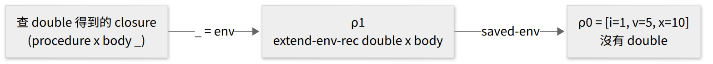
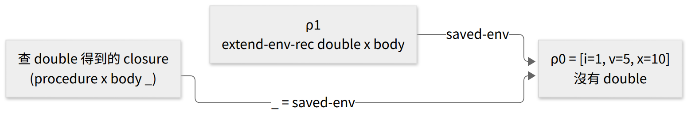
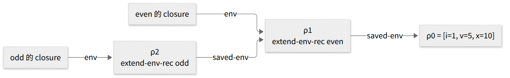

<!-- _class: lead -->

# 程式語言
## Programming Languages — Class 7

政大資碩 115-1　陳家宏

---

# 今天三堂課

| 時段 | 內容 |
|---|---|
| 第 1 堂 | §3.4 LETREC 的規格（pp.82–85） |
| 第 2 堂 | Figure 3.12 的實作與現場跑（p.83、p.86） |
| 第 3 堂 | 隨堂演練、mutual recursion、為什麼改 `let` 而不是 `proc` |

<!-- 講者備註：
第 1 堂：概念 5 個、停下來想 4 處（第 5、16、17、21 張）、約 50 分鐘
第 2 堂：概念 3 個、停下來想 2 處（第 28、29 張）、約 35–40 分鐘
第 3 堂：概念 4 個、停下來想 3 處（第 40、43、45 張）、約 50 分鐘 -->

---

# 上週停在哪裡？

class 6 最後一張，用 PROC 跑：

```racket
> (run "let double = proc (x) if zero?(x)
                             then 0
                             else -((double -(x,1)), -2)
        in (double 6)")
apply-env: No binding for double
```

問題：`proc` 的 body 裡出現 `double` 時，它的環境裡為什麼沒有 `double`？

---

# 在 REPL 裡跑 `run` 的兩種做法

今天用 `eopl3/chapter3/letrec-lang/` 目錄裡的 `top.scm`。

<!-- 口頭補充：上週的 PROC 在 chapter3/proc-lang/ 底下的 ds-rep、proc-rep，操作方式相同。 -->

**DrRacket**

1. 開啟 `chapter3/letrec-lang/top.scm`
2. 按 **Run**
3. 在下方的 REPL 輸入 `(run "...")`

**終端機**

```bash
cd eopl3/chapter3/letrec-lang
racket -i -t top.scm    # -t: load top.scm, -i: then start the REPL
```

兩種做法印出的結果都是 constructor 形式，例如 `(num-val 12)`。

---

# `double` 的 closure 存了哪個環境？

用 class 6 的兩條等式（p.67、p.76）：

```
(value-of (let-exp var exp1 body) ρ)
  = (value-of body [var=(value-of exp1 ρ)]ρ)

(value-of (proc-exp var body) ρ)
  = (proc-val (procedure var body ρ))
```

**停下來想**：設初始環境為 ρ0。

1. （看第一條）`proc (x) ...` 在哪個環境裡求值？
2. （看第二條）procedure 建立的 closure，第三個欄位是什麼？
3. （看第一條）第 2 題的 closure，第三個欄位存的環境裡有 `double` 嗎？

<!-- 答案：1. ρ0  2. ρ0  3. 沒有。[double=...]ρ0 是在 closure 建好之後才建的，closure 裡存的是 ρ0。 -->

---

# Racket 的 `let` 與 `letrec`

（課外補充，DrRacket 可以直接試。）

```racket
(let ([double (lambda (x) (if (zero? x) 0 (- (double (- x 1)) -2)))])
  (double 6))
;; double: unbound identifier

(letrec ([double (lambda (x) (if (zero? x) 0 (- (double (- x 1)) -2)))])
  (double 6))
;; 12
```

Racket 用兩個不同的關鍵字區分這兩種情況。

**為什麼這個語言需要遞迴？**

p.82 開頭說，LETREC 的作用是為語言加上遞迴。翻一下 LETREC 之前的 grammar，裡面沒有迴圈語法，要重複計算就得讓程序呼叫自己。

---

<!-- _class: small -->

# LETREC 的規格，四個角度各改了什麼？

延續 class 6 的整理，多加一欄 LETREC。

| 角度 | LET（§3.2） | PROC（§3.3） | LETREC（§3.4） |
|---|---|---|---|
| syntax | Figure 3.2（3.2.1, p.60） | 加 `proc-exp`、`call-exp`（p.75） | 加 `letrec-exp`（p.82） |
| values | Int + Bool（3.2.2, p.61） | 加上 Proc；Proc 是 ADT（p.75） | 沒有改：§3.4 沒有重新定義 ExpVal、DenVal（我的推論；官方 repo 的 `expval` 也和 PROC 相同） |
| environments | `empty-env`、`extend-env`、`apply-env`（3.2.3, p.61） | 沒有新增操作 | 加 `extend-env-rec`，用 `apply-env` 的兩條規則規定（p.83） |
| behavior | 3.2.4–3.2.7（pp.62–67） | 三條等式（p.76） | letrec-exp 一條等式（p.83） |

---

# LETREC 的新 production（p.82）

```
Expression ::= letrec Identifier (Identifier) = Expression in Expression
               letrec-exp (p-name b-var p-body letrec-body)
```

p.82：PROC 的程序只收一個參數，所以 `letrec` 也只宣告**一個單參數程序**，讓事情簡單一點。

p.82：左手邊是遞迴程序的名字與它的 bound variable；`=` 右邊是程序的 body。

---

# 四個欄位各對應哪一段？

```
letrec double(x)
         = if zero?(x) then 0 else -((double -(x,1)), -2)
in (double 6)
```

| 欄位 | 這個程式裡的值 |
|---|---|
| `p-name` | `double` |
| `b-var` | `x` |
| `p-body` | `if zero?(x) then 0 else -((double -(x,1)), -2)` |
| `letrec-body` | `(double 6)` |

---

# `let` 與 `letrec` 的等式（p.67、p.83）

`let`（p.67；第二個等號是我依 p.61 的縮寫 `[var=val]ρ` = `(extend-env var val ρ)` 展開的）：

```
(value-of (let-exp var exp1 body) ρ)
  = (value-of body
              [var=(value-of exp1 ρ)]ρ)
  = (value-of body
              (extend-env var (value-of exp1 ρ) ρ))
```

`letrec`（p.83）：

```
(value-of (letrec-exp proc-name bound-var proc-body letrec-body) ρ)
  = (value-of letrec-body
              (extend-env-rec proc-name bound-var proc-body ρ))
```

---

# `let` 與 `letrec` 交給環境的各是什麼？

| | 交給環境的是什麼 | 誰先算 |
|---|---|---|
| `let` | `(value-of exp1 ρ)` 算出來的**值** | 先在 ρ 裡算出 `exp1` 的值，再擴充環境 |
| `letrec` | `proc-name`、`bound-var`、`proc-body` 三個**還沒求值的片段** | 先擴充環境，`proc-body` 不先求值，closure 留給環境去組 |

等式出處：`let` p.67；`letrec` p.83。（對照表是我整理的。）

---

# letrec 的值是什麼？（p.83）

p.83：letrec 的值，就是 letrec-body 在「具有我們想要的行為」的環境裡求出的值。

為了這個，環境的介面多了一個 constructor：`extend-env-rec`。

p.83 接著問：`(extend-env-rec proc-name bound-var proc-body ρ)` 應該有什麼行為？

---

# `extend-env-rec` 該有什麼行為？（p.83）

p.83 的作法：令 ρ1 = `(extend-env-rec proc-name bound-var proc-body ρ)`，
然後只回答一個問題：

```
(apply-env ρ1 var) 應該回傳什麼？
```

class 3 看過 p.40：環境的介面**恰好只有一個 observer**，`apply-env`。

我的解讀：既然觀察環境只能透過 `apply-env`，把 `apply-env ρ1` 對每個變數的回答都規定好，ρ1 的行為就完全確定了。

p.83 分成兩種情況。

---

# 規則 1：查 proc-name（p.83）

如果 `var` 就是 `proc-name`，`apply-env` 應該回傳一個 closure：

- bound variable 是 `bound-var`
- body 是 `proc-body`
- 環境裡，`proc-name` 要綁到**這個程序本身**

p.83：這樣的環境我們已經有了，就是 ρ1 本身。所以

```
(apply-env ρ1 proc-name)
  = (proc-val (procedure bound-var proc-body ρ1))
```

---

# 規則 2：查其他變數（p.83）

如果 `var` 不是 `proc-name`：

```
(apply-env ρ1 var) = (apply-env ρ var)
```

兩條規則並排：

| 查的變數 | 結果 |
|---|---|
| `proc-name` | `(proc-val (procedure bound-var proc-body ρ1))` |
| 其他 `var` | `(apply-env ρ var)` |

---

# ρ1 出現在等號兩邊，會不會無限展開？

```
(apply-env ρ1 proc-name)
  = (proc-val (procedure bound-var proc-body ρ1))
                                            ↑
                                         又是 ρ1
```

**停下來想**：

1. 照這條規則實作的話，建立 ρ1 時需要先把 closure 算好嗎？
2. 寫下你的預測。

第 2 堂用 Figure 3.12 的程式碼回答。

---

# `p-name` 與 `b-var` 的 scope 各涵蓋哪裡？

**停下來想**：初始環境是 `[i=1,v=5,x=10]`（p.63）。這個程式的值是多少？

```
letrec f(x) = -(x,1)
in x
```

<!-- 先讓學生預測，再執行：
> (run "letrec f(x) = -(x,1) in x")
(num-val 10)
-->

---

# `p-name` 與 `b-var` 的 scope：對答案

```racket
> (run "letrec f(x) = -(x,1) in x")
(num-val 10)
```

從兩條規則推回去（我的解讀）：

| 名字 | 在哪裡有效 | 根據 |
|---|---|---|
| `p-name` | `p-body` 與 `letrec-body` | ρ1 查得到 `p-name`，而 `p-body` 又在 ρ1 的延伸裡求值 |
| `b-var` | 只在 `p-body` | ρ1 本身沒有綁 `b-var`，呼叫程序時才由 `apply-procedure` 綁上 |

所以 `in x` 的 `x` 往外找，找到初始環境的 `x = 10`。

---

<!-- _class: small -->

# Figure 3.10 用等式算（p.84）

（節錄。⌈6⌉ 是 class 5 介紹過的記號。）

```
(value-of <<letrec double(x) = if zero?(x) ... in (double 6)>> ρ0)
= (value-of <<(double 6)>>
            (extend-env-rec double x <<if zero?(x) ...>> ρ0))
= (apply-procedure
    (value-of <<double>> (extend-env-rec double x <<if zero?(x) ...>> ρ0))
    (value-of <<6>>      (extend-env-rec double x <<if zero?(x) ...>> ρ0)))
= (apply-procedure
    (procedure x <<if zero?(x) ...>>
               (extend-env-rec double x <<if zero?(x) ...>> ρ0))
    ⌈6⌉)
= (value-of <<if zero?(x) ...>>
            [x=⌈6⌉](extend-env-rec double x <<if zero?(x) ...>> ρ0))
  ...
= (- (value-of <<(double -(x,1))>>
               [x=⌈6⌉](extend-env-rec double x <<if zero?(x) ...>> ρ0))
     -2)
```

---

<!-- _class: small -->

# Figure 3.11 用等式算（p.85）

（節錄。）

```
= (- (apply-procedure
       (value-of <<double>>
                 [x=⌈6⌉](extend-env-rec double x <<if zero?(x) ...>> ρ0))
       (value-of <<-(x,1)>>
                 [x=⌈6⌉](extend-env-rec double x <<if zero?(x) ...>> ρ0)))
     -2)
= (- (apply-procedure
       (procedure x <<if zero?(x) ...>>
                  (extend-env-rec double x <<if zero?(x) ...>> ρ0))
       ⌈5⌉)
     -2)
= ...
```

---

# 每一層查到的 `double` 一樣嗎？

**停下來想**：比較兩次查 `double` 得到的 closure。

| | 在哪裡查 | 得到的 closure |
|---|---|---|
| Figure 3.10 | `(extend-env-rec double x ... ρ0)` | `(procedure x <<if ...>> (extend-env-rec double x ... ρ0))` |
| Figure 3.11 | `[x=⌈6⌉](extend-env-rec double x ... ρ0)` | ？ |

1. 第二次查詢時，`[x=⌈6⌉]` 這一層有 `double` 嗎？
2. 往下一層走到 ρ1，套用的是哪一條規則？

p.83：Figure 3.11 的最後一行，遞迴呼叫找到的是原本的 `double` 程序。

<!-- 答案：1. 沒有，x 不是 double，往下走（extend-env 的 apply-env）。2. 規則 1，結果的三個欄位和 Figure 3.10 那次完全相同。 -->

---

# 第 1 堂回顧

1. `letrec` 宣告一個單參數的遞迴程序（p.82）
2. letrec-body 在 `(extend-env-rec ...)` 裡求值（p.83）
3. `extend-env-rec` 只用 `apply-env` 的兩條規則來規定（p.83）：
   - 查 `proc-name`：closure 的環境是 ρ1 本身
   - 查其他變數：交給 ρ
4. `p-name` 在 `p-body` 與 `letrec-body` 裡都有效；`b-var` 只在 `p-body` 裡有效（我的解讀）

---

<!-- _class: lead -->

# 第 2 堂
## Figure 3.12 與 letrec-lang

---

# 「any way that satisfies these requirements」（p.83）

p.83：只要滿足第 1 堂的兩條規則，`extend-env-rec` 怎麼實作都可以。

課本選擇 abstract-syntax representation 來示範；p.83 說，其他實作策略放在習題裡。

class 3 的對照：

| | class 3（§2.2） | 今天（§3.4） |
|---|---|---|
| 規格 | `empty-env`、`extend-env`、`apply-env` 的等式 | `apply-env ρ1` 的兩條規則 |
| 實作 | §2.2.2 資料結構（p.37）、§2.2.3 程序（p.40） | Figure 3.12（p.86） |

---

# letrec 的等式，翻成程式碼長什麼樣？

對照第 10 張的等式。下面取自課本官方 repo 的 `chapter3/letrec-lang/interp.scm`（§3.4 正文只給等式，p.83）：

```racket
(define value-of
  (lambda (exp env)
    (cases expression exp
      ...
      (letrec-exp (p-name b-var p-body letrec-body)
        (value-of letrec-body
          (extend-env-rec p-name b-var p-body env)))
      ...)))
```

| 等式 | 程式碼 | |
|---|---|---|
| `proc-name`、`bound-var`、`proc-body` | `p-name`、`b-var`、`p-body` | 只是縮寫 |
| ρ | `env` | 這個 `env` 是 ρ，不是 ρ1；它是 `value-of` 的參數（第 28 張 `apply-env` 裡的 `env` 是另一個函式的參數） |

<!-- 重點（我的解讀）：程式碼是等式逐字翻譯過來的，和 class 6「先寫等式、再寫程式」是同一個模式。
(letrec-exp (p-name ...) ...) 是 cases 的一個分支：括號裡的四個名字，是從 letrec-exp 的四個欄位取出來的。 -->

---

# Figure 3.12：environment 多一個 variant（p.86）

```racket
(define-datatype environment environment?
  (empty-env)
  (extend-env
    (var identifier?)
    (val expval?)
    (env environment?))
  (extend-env-rec
    (p-name identifier?)
    (b-var identifier?)
    (body expression?)
    (env environment?)))
```

---

# Figure 3.12：apply-env 多一個分支（p.86）

```racket
(define apply-env
  (lambda (env search-var)
    (cases environment env
      (empty-env ()
        (report-no-binding-found search-var))
      (extend-env (saved-var saved-val saved-env)
        (if (eqv? saved-var search-var)
            saved-val
            (apply-env saved-env search-var)))
      (extend-env-rec (p-name b-var p-body saved-env)
        (if (eqv? search-var p-name)
            (proc-val (procedure b-var p-body env))
            (apply-env saved-env search-var))))))
```

---

# `env` 與 `saved-env` 各指哪個環境？

`extend-env-rec` 分支裡出現兩個環境：

```racket
(extend-env-rec (p-name b-var p-body saved-env)
  (if (eqv? search-var p-name)
      (proc-val (procedure b-var p-body env))
      (apply-env saved-env search-var)))
```

**停下來想**：對照第 1 堂的兩條規則，

1. `env` 對應 ρ 還是 ρ1？
2. `saved-env` 對應 ρ 還是 ρ1？

<!-- p.83：The env on the next-to-last line of apply-env corresponds to ρ1。
saved-env 是 cases 解構出來的欄位，對應 ρ。env 是 apply-env 的參數，也就是正在被查的這個節點本身。 -->

---

# 把 `env` 改成 `saved-env` 會怎樣？

原本的程式，跑 p.82 的例子：

```racket
> (run "letrec double(x) = if zero?(x) then 0
                           else -((double -(x,1)), -2)
        in (double 6)")
(num-val 12)
```

**停下來想**：只改一個字，先預測結果。

```racket
(proc-val (procedure b-var p-body saved-env))   ; changed
```

現場改 `environments.scm`，重跑同一個程式：

```racket
> (run "letrec double(x) = ... in (double 6)")
apply-env: No binding for double
```

和第 1 堂第 3 張 `let` 版的錯誤訊息相同。

<!-- 改成 saved-env 後，closure 存的是 ρ（沒有 double 的那層），行為退回 let。示範完記得改回 env。 -->

---

# 一個字的差別，在環境裡是哪一條箭頭？

（圖是我依 Figure 3.12 畫的；`_` 是 closure 的第三個欄位。）

原本用 `env`：



改成 `saved-env`：



body 裡查 `double`，是從 `_` 指向的環境開始找。上圖從 ρ1 開始，套用規則 1 查得到；下圖從 ρ0 開始，查不到。

<!-- 圖的原始碼：img/env-ok.mmd、img/env-bug.mmd（Mermaid），設定檔 img/config.json。
嚴格說，body 的環境是 [x=⌈6⌉] 再接上 _ 指向的環境；x 那一層沒有 double，所以結果相同。 -->

---

# 回答第 16 張：為什麼不會無限展開？

建 ρ1 時，Figure 3.12 的 `extend-env-rec` 只存四個欄位，沒有 closure。

closure 要等到 `apply-env` 查到 `p-name` 時才組出來（我對 Figure 3.12 的說明）。

在 REPL 印一個 letrec 程序值：

```racket
> (run "letrec f(x) = x in f")
(proc-val
 (procedure
  'x
  (var-exp 'x)
  (extend-env-rec
   'f
   'x
   (var-exp 'x)
   (extend-env
    'i
    (num-val 1)
    (extend-env 'v (num-val 5) (extend-env 'x (num-val 10) (empty-env)))))))
```


---

# 從 PROC 到 LETREC，改了哪幾處？

| 部分 | PROC → LETREC |
|---|---|
| grammar | 多一條 `letrec` production |
| `value-of` | 多一個 `letrec-exp` 分支 |
| `environment` datatype | 多一個 `extend-env-rec` variant |
| `apply-env` | 多一個分支 |

沒有改的：`proc-exp`、`call-exp` 分支，`apply-procedure`，`proc` datatype。

（對照表是我整理的，可以打開 repo 的 `proc-lang` 與 `letrec-lang` 自己核對。）

---

# 第 2 堂回顧

1. 規格只有兩條規則，Figure 3.12 是其中一種實作（p.83、p.86）
2. `extend-env-rec` 只存四個欄位；查到 `p-name` 時才組 closure（p.86）
3. 組 closure 時用的是 `env`（ρ1）；寫成 `saved-env` 就退回 `let` 的行為（p.83）
4. 從 PROC 到 LETREC，程序相關的程式碼沒有改，改的是環境（我的整理）

---

<!-- _class: lead -->

# 第 3 堂
## 隨堂演練 ＋ mutual recursion

---

# 今天怎麼進行

| 時間 | 內容 |
|---|---|
| 0–12 分 | 隨堂演練：用 `letrec` 寫 `sum` |
| 12–22 分 | 分組討論，抽一組上台 |
| 22–32 分 | mutual recursion：兩個 `letrec` 疊起來 |
| 32–45 分 | 為什麼改的是 `let`，而不是 `proc`？ |
| 45–50 分 | HW3 提醒、下週預告 |

---

# 隨堂演練：用 `letrec` 寫 `sum`

寫一個 LETREC 程式：`(sum n)` 回傳 0 + 1 + ⋯ + n。

```
letrec sum(n) = ...
in (sum 4)                    ; should be 10
```

LETREC 沒有加法。提示沿用 class 6 演練一（p.80）：`x + y` 可以寫成 `-(x,-(0,y))`。

先在紙上寫，再用 `run` 對答案。

---

# 隨堂演練：用 `run` 對答案

```racket
> (run "letrec sum(n) = if zero?(n)
                        then 0
                        else -(n, -(0,(sum -(n,1))))
        in (sum 4)")
(num-val 10)
```

對照四個欄位：

| 欄位 | 值 |
|---|---|
| `p-name` | `sum` |
| `b-var` | `n` |
| `p-body` | `if zero?(n) then 0 else -(n, -(0,(sum -(n,1))))` |
| `letrec-body` | `(sum 4)` |

---

# 分組討論

1. 分成 3 組，討論隨堂演練：
   - 你們的寫法和投影片的一樣嗎？
   - 把 `(sum 4)` 換成 `(sum 0)`，用 Figure 3.10 的方式算前三步
2. 10 分鐘後，抽一組上台發表。

---

# mutual recursion：Exercise 3.32 [★★]（p.84）的例子

```
letrec
  even(x) = if zero?(x) then 1 else (odd -(x,1))
  odd(x)  = if zero?(x) then 0 else (even -(x,1))
in (odd 13)
```

p.84：題目要讓 `letrec` 一次宣告任意多個互相遞迴的單參數程序。

課綱 week 7 列了 mutual recursion；§3.4 正文沒有處理，只出現在這題。

為什麼要在意：`even` 呼叫 `odd`、`odd` 又呼叫 `even`，兩個 closure 存的環境都必須查得到對方。

---

# 兩個 `letrec` 疊起來，行不行？

今天的 LETREC 一次只能宣告一個程序。那麼疊兩層呢？

```
letrec even(x) = if zero?(x) then 1 else (odd -(x,1))
in letrec odd(x) = if zero?(x) then 0 else (even -(x,1))
   in (odd 13)
```

**停下來想**：`even` 的 closure 存的是哪個環境？裡面有 `odd` 嗎？先預測，再跑。

```racket
> (run "letrec even(x) = ... in letrec odd(x) = ... in (odd 13)")
apply-env: No binding for odd
```

把兩層對調（外層 `odd`、內層 `even`），錯誤訊息變成 `No binding for even`。

<!-- 外層程序的 closure 存的是外層的 extend-env-rec，裡面沒有內層的名字。照「外層 letrec 的 in 裡放內層 letrec」這種疊法，總有一個方向查不到。（把 odd 的 letrec 放進 even 的 body 裡則跑得動，例如 (even 12) 得 (num-val 1)，已實測；但 odd 只能從 even 裡面呼叫。）這正是 3.32 要解決的問題，不在課堂上給解法。 -->

---

# 兩層 `letrec` 的環境長什麼樣？

（圖是我依 Figure 3.12 畫的。）



| closure | 從 env 往右查得到的程序名字 |
|---|---|
| `odd` 的 closure | `odd`（ρ2）、`even`（ρ1） |
| `even` 的 closure | 只有 `even`（ρ1），查不到 `odd` |

`(odd 13)` 呼叫 `even` 沒問題；`even` 再呼叫 `odd` 時，從 ρ1 開始找，找不到。

<!-- 圖的原始碼：img/nested-letrec.mmd（Mermaid），設定檔 img/config.json。 -->

---

# 為什麼遞迴改的是 `let`，而不是 `proc`？

`let` 版的 `double` 失敗了（第 3 張），修正的方式是把 `let` 換成 `letrec`。
那為什麼不改 `proc`？這個問題可以拆成兩個：

| 子問題 | 有沒有回答 |
|---|---|
| 為什麼不改 `proc` 的**實作**？ | 第 32 張：`proc-exp`、`call-exp`、`apply-procedure`、`proc` datatype 都沒改，改的是環境 |
| 為什麼不改 `proc` 的**語法**？ | 還沒回答 |

---

# 遞迴到底需要什麼？

（這張是我的歸納。）一個程序要呼叫自己，body 執行時必須用某個名字查到這個程序本身。拆開來需要三樣東西：

| | 條件 | 由誰負責 |
|---|---|---|
| 1 | 一個名字 | 語法：PROC 的 `proc (x) ...` 是匿名的 |
| 2 | 這個名字綁到這個 closure | 環境 |
| 3 | 這個綁定，要在 closure **自己存的**環境裡 | 環境 |

**停下來想**：第 3 張 `let` 版的 `double`，三個條件缺了哪一個？

<!-- 答案：缺第 3 個。名字有（double），綁定也有（[double=...]ρ0），但 closure 存的是 ρ0（第 5 張），綁定不在 closure 自己存的環境裡。
第 3 個條件代表 closure 的環境裡要有 closure 本身，形成一個環。 -->

---

# 誰負責把 closure 放進它自己的環境？

（這張是我的解讀。）條件 3 要求 closure 和綁定在同一個時刻一起建出來。這個時刻可以放在兩個地方：

| | 在 binding form 上做 | 在 `proc` 上做 |
|---|---|---|
| 語法 | `letrec f(x) = body in ...` | `proc f (x) body`（具名 proc） |
| 誰觸發 | 綁定結構 | 程序結構 |
| 環境 | `extend-env-rec` | 一樣需要 `extend-env-rec` 這種環境 |
| 例子 | Scheme／Racket 的 `letrec` | Clojure 的 `(fn fact [n] ...)`、JavaScript 的具名函式表達式 |

具名 proc 不在 LETREC 裡，下一張用規則 1 推推看它行不行。

---

# 如果改 `proc`，等式會長什麼樣？

假設語言多一個 `named-proc-exp`（課本沒有，是我假設的）：

```
Expression ::= proc Identifier (Identifier) Expression
               named-proc-exp (p-name b-var body)
```

**停下來想**：closure 的環境裡要有 `p-name` 綁到自己。借用 `extend-env-rec`，用規則 1（p.83）推下去：

```
(value-of (named-proc-exp p-name b-var body) ρ)
  = (apply-env (extend-env-rec p-name b-var body ρ) p-name)
  = (proc-val (procedure b-var body
                (extend-env-rec p-name b-var body ρ)))     ; rule 1
```

對照第 31 張 `letrec f(x) = x in f` 的 REPL 輸出：結構相同。

<!-- 結論：proc f (x) body 的值，等於 letrec f(x) = body in f 的值。所以「改 proc」行得通，核心一樣是 extend-env-rec。 -->

---

# EOPL 為什麼選 `letrec`？

課本 §3.4 沒有說明這個選擇。以下是我的解讀，依可信度排序：

1. **mutual recursion**：具名 proc 一次只引入一個名字。要讓 `even`、`odd` 同時對彼此可見、又都能從外面呼叫，需要一次宣告多個名字的結構，這正是 Exercise 3.32（p.84）要做的。`letrec` 可以自然延伸到多個名字。
2. **Scheme 的傳統**：Scheme 本來就用 `letrec`。

反對論點：具名 proc 本身是一個 expression，可以直接當參數傳出去；`letrec` 要多包一層 `letrec f(x) = ... in f`。兩種設計各有取捨。

---

# HW3 提醒

3.23 要在 **PROC** 裡完成（p.81），不能用今天的 `letrec`。

---

# 下週預告：§3.5 Scoping and Binding of Variables（p.87）

p.87：變數在程式裡有兩種出現方式，reference 與 declaration。

```scheme
(f x y)                       ; f, x, y: all references
(lambda (x) (+ x 3))          ; first x: declaration
```

用今天的程式試試：

```
letrec double(x) = if zero?(x) then 0 else -((double -(x,1)), -2)
in (double 6)
```

這裡出現了幾次 `double`、幾次 `x`？哪幾次是 declaration？

---

# 本日結論

1. letrec-body 在 `(extend-env-rec ...)` 裡求值；查 `proc-name` 時，closure 的環境是 ρ1 本身，查其他變數則交給 ρ（p.83）
2. Figure 3.12 在查詢時才組 closure，所以建 ρ1 不會無限展開（p.86）
3. 遞迴需要 closure 自己存的環境裡有它自己的名字；所以從 PROC 到 LETREC，改的是環境，程序的程式碼沒有改（我的整理）
4. 在外層 `letrec` 的 `in` 裡疊內層 `letrec`，寫不出 mutual recursion；Exercise 3.32 處理這件事（p.84）
5. 要讓 closure 存的環境裡有它自己的名字，可以用 `letrec`，也可以用具名 `proc`，兩者的核心都是 `extend-env-rec`；EOPL 為什麼選 `letrec`，課本沒有說明（我的解讀：一次宣告多個名字，方便 mutual recursion）

---

<!-- _class: lead -->

# 問題時間

1. Email: laurence@replware.dev
2. Office Hour: 週四下午 1:00~2:00，請先跟我約
3. 助教：邵振皓 (負責改作業、監考)
4. 助教信箱：114971020@nccu.edu.tw
5. 作業一律上傳 Moodle
