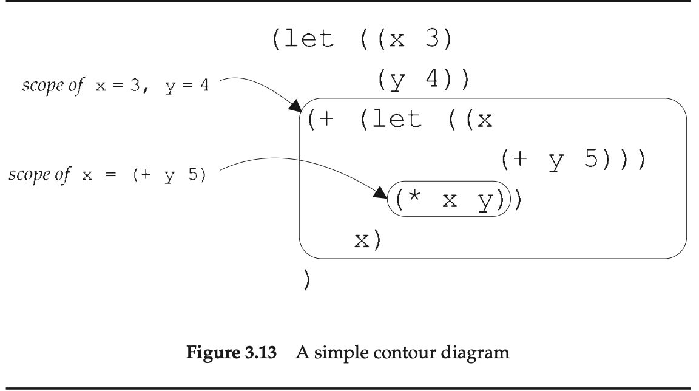
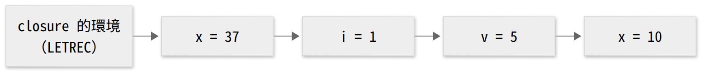
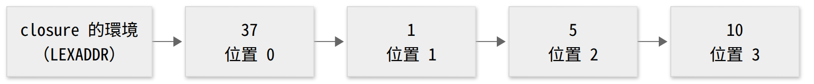

<!-- _class: lead -->

# 程式語言
## Programming Languages — Class 8

政大資碩 115-1　陳家宏

---

# 今天三堂課

| 時段 | 內容 |
|---|---|
| 第 1 堂 | §3.5 Scoping and Binding of Variables（pp.87–91） |
| 第 2 堂 | §3.6–3.7 去掉變數名字：translator 與 nameless interpreter（pp.91–100） |
| 第 3 堂 | 這個 translator 和編譯器、靜態檢查的關係；有了 unit test，還需要靜態檢查嗎？HW4 |

<!-- 講者備註：
第 1 堂：概念 9 個、停下來想 3 處（第 4、13、18 張）、約 48 分鐘
第 2 堂：概念 6 個、停下來想 2 處（第 31、39 張）、約 50 分鐘
第 3 堂：概念 5 個、停下來想 2 處（第 44、47 張）、約 40 分鐘
超時時：把第 44–45 張移到第 2 堂末尾。 -->

---

# reference 與 declaration（p.87）

p.87：變數在程式裡有兩種出現方式。**reference** 是"使用"這個變數；**declaration** 是宣告這個變數，讓它成為某個值的名字。

```scheme
(f x y)                        ; f, x, y: all references
(lambda (x) (+ x 3))           ; first x: declaration
(let ((x (+ y 7))) (+ x 3))    ; first x: declaration
```

p.87：兩種 declaration 的值從不同地方來：

| | 值從哪裡來 |
|---|---|
| `lambda` 的 `x` | 程序被呼叫時才給 |
| `let` 的 `x` | 右手邊 `(+ y 7)` 的值 |

---

# 上週的預告題

class 7 最後一張的程式：

```
letrec double(x) = if zero?(x) then 0 else -((double -(x,1)), -2)
in (double 6)
```

**停下來想**：

1. `double` 出現幾次？哪幾次是 declaration？
2. `x` 出現幾次？哪幾次是 declaration？

<!-- 答案：
1. double 出現 3 次：letrec double(x) 的 double 是 declaration；(double -(x,1)) 與 (double 6) 是 reference。
2. x 出現 3 次：double(x) 的 x 是 declaration；zero?(x) 與 -(x,1) 是 reference。 -->

---

# bound by、bound to（p.87）

p.87 用了兩個介系詞：

| 說法 | 連到哪裡 |
|---|---|
| a variable reference is **bound by** the declaration | reference → 它對應的 declaration |
| it is **bound to** its value | reference → 它的值 |

用上一張的程式：

| reference | bound by | bound to |
|---|---|---|
| `(double 6)` 的 `double` | `letrec double(x)` 的 `double` | 一個 procedure 值 |
| `zero?(x)` 的 `x` | `double(x)` 的 `x` | 每次呼叫時傳進來的引數 |


---

# Scope vs Qualified Keywords

* Scope => 在大多數程式語言中，宣告的作用域是**有限的**，因此同一個變數名稱可以在程式的不同部分 (parts) 用於不同的用途 (purposes)。 (課文)
* Qualified Keywords => 在資料導向的設計中，"屬性"的語意是**全域且明確的**，因此同一個名稱可以在系統的不同邊界 (boundaries) 保持相同的含意 (meanings)。 (補充教材)

---

# Qualified Keywords in Clojure

```
;; 依靠區域範圍或特定物件結構來給予語意
{:name "Alice" :id 101} 
;; 上方的 name 到底是指用戶名稱、商品名稱還是檔名？

;; 透過包含 Namespace 的 Keyword，給予資料「全域唯一且明確」的語意
{:user/id 101
 :user/name "Alice"
 :account/balance 500.0}
```

---

# scope、scoping rules、static property（p.88）

| 詞 | p.88 的意思 |
|---|---|
| scope | 一個 declaration 有效的那一段程式 |
| scoping rules | 決定每個 reference 對應哪個 declaration 的規則 |
| static property | 不執行程式就能算出來的性質 |

p.88：每個 reference 對應哪個 declaration，不執行程式就能決定，所以它是 static property。

p.88 給的方法：從 reference 出發**往外找**，找到的第一個同名 declaration 就是答案。

為什麼要在意 scope（p.88）：有 scope，同一個名字才能在程式的不同地方各有用途，例如第一、二章反覆用 `lst` 當參數。

---

# p.88 的例子

```scheme
(let ((x 3)              ; call this x1
      (y 4))
  (+ (let ((x            ; call this x2
             (+ y 5)))
       (* x y))          ; Here x refers to x2
     x))                 ; Here x refers to x1
```

---

# p.89 的推導

```scheme
  (+ (let ((x (+ y 5))) (* x y)) x)     ; with x1 = 3, y = 4
= (+ (let ((x (+ 4 5))) (* x 4)) 3)
= (+ (let ((x 9)) (* x 4)) 3)
= (+ 36 3)
= 39
```

在終端機打 `racket -i`（或 DrRacket 選 `#lang racket`），貼上整段：

```racket
> (let ((x 3) (y 4)) (+ (let ((x (+ y 5))) (* x y)) x))
39
```

---

# shadowing：在 scope 裡打洞（p.89）

p.89：這種規則叫 lexical scoping。內層重新宣告同一個名字，就在外層的 scope 裡打了一個洞，稱為 **shadow**。上一張的 x2 shadow 了 x1。

把內層的 `x` 改名成 `w`，`(* x y)` 的 `x` 就往外找到 x1：

```racket
> (let ((x 3) (y 4)) (+ (let ((w (+ y 5))) (* x y)) x))
15
```

`(* x y)` 從 `(* 9 4)` 變成 `(* 3 4)`。

---

# contour diagram（Figure 3.13, p.88）



* p.89：每個 scope 用一個框圍起來，並把 declaration 連到它的 scope。scope 一層套一層，每個 scope 都落在另一個 scope 裡面。
* variable scope = body of `let`

---

# Figure 3.14：第 5、7、8 行各指向誰？（p.90）

```scheme
(lambda (x y)                        ; x1, y1
  (let ((z (+ x y)))                 ; z1
    (lambda (x z)                    ; x2, z2
      (let ((x (let ((x              ; x3, x4
                       (+ x y z))    ; line 5
                      (y 11))        ; y2
                  (+ x y z)))        ; line 7
        (+ x y z)))))                ; line 8
```

**停下來想**：line 5、7、8 的 `x`、`y`、`z`，各對應哪一個 declaration？

提示：內層 `let` 同時宣告 x4 與 y2；x3 的右手邊是內層那個 `let`。

---

<!-- _class: small -->

# 對答案（p.89）

| | `x` | `y` | `z` |
|---|---|---|---|
| line 5 | x2 | y1 | z2 |
| line 7 | x4 | y2 | z2 |
| line 8 | x3 | y1 | z2 |

p.89 的說法：line 5 在 x2、z2 的 scope 裡；line 7 在 x4、y2 的 scope 裡；line 8 在 x3 的 scope 裡；外面再一層一層包住。

用數字驗證（`x1=1, y1=2, x2=100, z2=1000` 是我選的）：

```racket
> (define fig314
    (lambda (x y)
      (let ((z (+ x y)))
        (lambda (x z)
          (let ((x (let ((x (+ x y z)) (y 11)) (+ x y z))))
            (+ x y z))))))
> ((fig314 1 2) 100 1000)
3115
```

<!-- line 5 = 100 + 2 + 1000 = 1102 = x4
line 7 = 1102 + 11 + 1000 = 2113 = x3
line 8 = 2113 + 2 + 1000 = 3115
可以順便問：z1 被哪一行用到？沒有。三行的 z 都被 z2 shadow 了（我的觀察）。 -->

---

# 我們的語言在哪裡建立 binding？（p.90）

p.90：變數和它的值之間的關聯叫 **binding**。三種 declaration 各自建立 binding：

| declaration | binding 何時建立 | p.90 的等式 |
|---|---|---|
| `proc` 的參數 | 程序被呼叫時 | `(apply-procedure (procedure var body ρ) val)`<br>`= (value-of body (extend-env var val ρ))` |
| `let` 的變數 | 右手邊算出值之後 | `(value-of (let-exp var val body) ρ)`<br>`= (value-of body (extend-env var val ρ))` |
| `letrec` 的程序名 | 用右手邊建立 | `(value-of (letrec-exp ...) ρ)`<br>`= (value-of letrec-body (extend-env-rec ...))` |

這三處，加上建立初始環境的 `init-env`，就是 letrec-lang 裡呼叫 `extend-env`／`extend-env-rec` 的地方：`value-of` 只能靠 `apply-env` 查變數，所以 binding 只能由這兩個函式建立（我的解讀）。

<!-- p.90 的 let 等式把第二個欄位直接寫成 val；p.67 的寫法是 exp1，右邊是 (value-of exp1 ρ)。我的解讀：p.90 把「右手邊算出來的值」簡寫成 val。
interp.scm（letrec-lang）的三處：第 64 行 let、第 76 行 letrec、第 86 行 apply-procedure；init-env 在 environments.scm。 -->

---

# extent：binding 要留多久？（p.90）

p.90：binding 被保留的時間區間叫 **extent**。這個語言（和 Scheme 一樣）的 binding 都是 **semi-infinite extent**：一旦建立，原則上就得一直留著，因為它可能被藏在一個被回傳的 closure 裡。

用 class 7 的 letrec-lang 跑：

```racket
> (run "let f = let a = 5 in proc (x) -(x,a) in (f 7)")
(num-val 2)
```

`let a = 5` 的 body 求值完之後，`a` 的 binding 還存在 closure 裡；`(f 7)` 時查得到 `a = 5`。

p.90：binding 什麼時候不再被用到、可以被 garbage collector 回收，要到執行時才能確定，所以這是 **dynamic property**。

---

# 「dynamic」的兩個意思（pp.90–91）

p.91：dynamic 有時指 “during the evaluation of an expression”，有時指 “not calculable in advance”。

| 詞 | dynamic 在這裡的意思（p.91） | 這個詞說的是 | 屬於哪一種 property |
|---|---|---|---|
| dynamic property（p.90） | not calculable in advance：事先算不出來 | semi-infinite extent 下，binding 何時能回收 | dynamic |
| dynamic extent（p.91） | during the evaluation of an expression：在某個式子求值的期間 | 假設程序不能當 `let` 的值，binding 只在 `let` body 求值期間有效 | static：可以事先預測何時丟棄 |

p.91：dynamic binding（Exercise 3.28 起）的行為和 dynamic extent 類似。

---

# dynamic binding（Ex 3.28, p.82）

Exercise 3.28 [★★]（p.82）：dynamic binding 下，procedure body 在「把呼叫處的環境擴充之後」的環境裡求值。p.82 的例子：

```
let a = 3
in let p = proc (x) -(x,a)
       a = 5
   in -(a,(p 2))
```

p.82：procedure body 裡的 `a` 會綁到 5，不是 3。

原版用了 Ex 3.16 的多變數 `let`（用 HW3 的 3.16＋3.28 可跑）。改寫成單變數 `let` 就能在 letrec-lang 跑（課本沒有，是我改寫的）：

```
let a = 3 in let p = proc (x) -(x,a) in let a = 5 in -(a,(p 2))
```

**停下來想**：lexical binding 與 dynamic binding 下，整個程式各得多少？

<!-- 答案在下一張：lexical 得 6，dynamic 得 8。改寫版已實跑：letrec-lang 得 (num-val 6)；dynamic binding 版本得 (num-val 8)。
已實跑：letrec-lang 加上 3.16（lexical）得 (num-val 6)；再加上 3.28（dynamic）得 (num-val 8)。這兩份實作是我自己寫來驗證的，不公開；只展示輸出。 -->

---

# 對答案：`a` 對到哪一個 declaration？

| binding | `p` 的 body 裡的 `a` 對到 | `(p 2)` | 整個程式 |
|---|---|---|---|
| lexical | `let a = 3` | `-(2,3)` = −1 | `(num-val 6)` |
| dynamic | 呼叫處的 `a = 5` | `-(2,5)` = −3 | `(num-val 8)` |

---

# 第 1 堂回顧

1. reference 是使用變數，declaration 是引入名字；reference **bound by** declaration、**bound to** 值（p.87）
2. reference 對應哪個 declaration 是 static property，方法是從 reference 往外找（p.88）
3. 內層同名的 declaration 會 shadow 外層；contour diagram 把每個 scope 畫成一個框（p.89）
4. binding 留多久叫 extent；這個語言是 semi-infinite，何時能回收是 dynamic property（p.90）
5. dynamic binding 下，procedure body 的變數對到呼叫處的 declaration（Ex 3.28, p.82）

---

<!-- _class: lead -->

# 第 2 堂
## §3.6–3.7 去掉變數名字

---

# lexical depth（p.91）

p.91：往外找的路上會穿過幾個 contour，叫這個 reference 的 **lexical depth**（或 static depth）。習慣從 0 起算：最後穿過、找到 declaration 的那一個 contour 不算。

p.91 的例子：

```scheme
(lambda (x)
  ((lambda (a)
     (x a))      ; this x, and a
   x))           ; this x
```

p.91：第三行的 `x` 是 1；`a` 和最後一行的 `x` 都是 0。

---

# nameless-lambda（p.91）

把 declaration 的名字拿掉，reference 換成它的 lexical depth（p.91）：

```scheme
(nameless-lambda
  ((nameless-lambda
     (#1 #0))
   #0))
```

p.91：這些數字叫 **lexical address** 或 **de Bruijn index**，每個數字都指出它對應的是哪一個 declaration。

p.91：編譯器例行地計算每個 reference 的 lexical address；算完之後，除了除錯資訊，變數名字就可以丟掉。

---

# 在 REPL 裡跑 lexaddr-lang

今天用 `eopl3/chapter3/lexaddr-lang/`：

```bash
cd eopl3/chapter3/lexaddr-lang
racket -i -t top.scm
```

`top.scm` 只 provide `run`。要單獨看 translator 的輸出，先在 REPL 打：

```racket
> (require "translator.scm" "lang.scm")
```

之後就能呼叫 `translation-of-program` 和 `scan&parse`。

本堂的錯誤訊息照終端機 `racket -i` 印出的格式寫（開頭是 `; `，結尾是 `[,bt for context]`）；DrRacket 的顯示方式不同。

---

# lexical depth 預測得準嗎？（p.92）

p.92：在 `-(x,y)` 裡，`y` 的 depth 是 0、`x` 是 1。用等式算：

```
(value-of <<let x = exp1 in let y = exp2 in -(x,y)>> ρ)
= (value-of <<let y = exp2 in -(x,y)>> [x=val1]ρ)
= (value-of <<-(x,y)>> [y=val2][x=val1]ρ)
```

p.92：求 `-(x,y)` 時，`y` 在環境的第 0 層、`x` 在第 1 層，和 depth 預測的一樣。換成 a-list 表示法（Ex 2.5），就是 0 個或 1 個 `cdr`，和 val1、val2 是什麼無關。

```racket
> (translation-of-program (scan&parse "let x = 3 in let y = 4 in -(x,y)"))
(a-program
 (nameless-let-exp
  (const-exp 3)
  (nameless-let-exp
   (const-exp 4)
   (diff-exp (nameless-var-exp 1) (nameless-var-exp 0)))))
```

---

# procedure body 也一樣（pp.92–93）

p.92：`let a = 5 in proc (x) -(x,a)`，body 裡 `x` 的 depth 是 0、`a` 是 1。p.93 的等式：

```
(value-of <<let a = 5 in proc (x) -(x,a)>> ρ)
= (value-of <<proc (x) -(x,a)>> (extend-env a ⌈5⌉ ρ))
= (proc-val (procedure x <<-(x,a)>> [a=⌈5⌉]ρ))

(apply-procedure (procedure x <<-(x,a)>> [a=⌈5⌉]ρ) ⌈7⌉)
= (value-of <<-(x,a)>> [x=⌈7⌉][a=⌈5⌉]ρ)
```

p.93 在第二、三行之間換了寫法：`(extend-env a ⌈5⌉ ρ)` 就是 `[a=⌈5⌉]ρ`（縮寫見 p.61）。

```racket
> (translation-of-program (scan&parse "let a = 5 in proc (x) -(x,a)"))
(a-program
 (nameless-let-exp
  (const-exp 5)
  (nameless-proc-exp (diff-exp (nameless-var-exp 0) (nameless-var-exp 1)))))
```

---

<!-- _class: small -->

# LEXADDR 的規格，四個角度各改了什麼？

延續 class 6、7 的表。lexaddr-lang 建在 PROC 上（repo 的 `lang.scm` 沒有 `letrec`），所以和 PROC 比。

| 角度 | PROC（§3.3） | LEXADDR（§3.7） |
|---|---|---|
| syntax | 加 `proc-exp`、`call-exp`（p.75） | source 不變；多三個 nameless production，只給 translator 的輸出用（p.94） |
| values | Int + Bool + Proc（p.75） | ExpVal 不變；Proc 少了變數名字那一欄（p.98） |
| environments | `extend-env` 存名字和值（p.61） | 拆成兩種：翻譯時的 static environment 只存名字（p.95）；執行時的 nameless environment 只存值（pp.98–99） |
| behavior | 三條等式（p.76） | `apply-procedure` 拿掉變數名字（p.98）；`value-of` 多三個 nameless 分支（p.100） |
| 新的一段 | — | `run` 先翻譯、再執行（p.98） |

---

# 三個新的 production（p.94）

```
Expression ::= %lexref number                    nameless-var-exp (num)
Expression ::= %let Expression in Expression     nameless-let-exp (exp1 body)
Expression ::= %lexproc Expression               nameless-proc-exp (body)
```

p.94：translator 不接受含這三種 nameless 結構的程式；interpreter 不接受 `var-exp`、`let-exp`、`proc-exp`。

p.94：名字用 `%` 開頭，因為 `%` 在這個語言裡通常是註解字元。實測：

```racket
> (scan&parse "%let 3 in %nameless-var 0")
; parsing: at line 1: nonterminal <program> can't begin with end-marker #f [,bt
;   for context]
```

整行被當成註解。我的解讀：使用者打不出這三種結構，它們只能由 translator 產生。

<!-- repo 的 lang.scm 把第一條寫成 %nameless-var，課本 p.94 寫 %lexref；上面的實測用 repo 的寫法。 -->

---

# static environment（Figure 3.15, pp.94–95）

p.94：要算 lexical address，得知道目前被哪些 scope 包住。這是 context 資訊，像 §1.3 的 inherited attribute（class 2 的 context argument）。

```racket
;; Senv = Listof(Sym),  Lexaddr = N
(define extend-senv
  (lambda (var senv)
    (cons var senv)))

(define apply-senv              ; Senv × Var → Lexaddr
  (lambda (senv var)
    (cond
      ((null? senv) (report-unbound-var var))
      ((eqv? var (car senv)) 0)
      (else (+ 1 (apply-senv (cdr senv) var))))))
```

p.94：第一個元素是最內層的變數。senv 是 `(z y x)` 時，查 `x`、`y`、`z` 各得 2、1、0。`apply-senv` 回傳**位置**，`apply-env` 回傳**值**。

---

# Figure 3.16 的三條翻譯規則（pp.95–97）

翻譯就是把樹複製一份（像 Ex 1.33、2.26），只有三種節點要換（pp.95–96）：

```racket
(var-exp (var)
  (nameless-var-exp (apply-senv senv var)))
(let-exp (var exp1 body)
  (nameless-let-exp
    (translation-of exp1 senv)                       ; same scope
    (translation-of body (extend-senv var senv))))   ; new scope
(proc-exp (var body)
  (nameless-proc-exp
    (translation-of body (extend-senv var senv))))
```

其他節點（`const-exp`、`diff-exp`、`zero?-exp`、`if-exp`、`call-exp`）照樣複製，子節點用同一個 `senv` 翻譯（p.97）。

p.96：翻譯一個程式時，起點是 `init-senv`，也就是 `(i v x)`。

---

# 動手翻譯 p.93 的程式

```
let x = 37
in proc (y)
     let z = -(y,x)
     in -(x,y)
```

**停下來想**：用上一張的三條規則，在紙上寫出翻譯結果。

1. `-(y,x)` 翻譯時，senv 是什麼？兩個 reference 各得幾？
2. `-(x,y)` 翻譯時，senv 是什麼？兩個 reference 各得幾？

---

# 對答案：用 `translation-of-program`

```racket
> (translation-of-program
   (scan&parse "let x = 37 in proc (y) let z = -(y,x) in -(x,y)"))
(a-program
 (nameless-let-exp
  (const-exp 37)
  (nameless-proc-exp
   (nameless-let-exp
    (diff-exp (nameless-var-exp 0) (nameless-var-exp 1))
    (diff-exp (nameless-var-exp 2) (nameless-var-exp 1))))))
```

| 哪個式子 | senv | 結果 |
|---|---|---|
| `-(y,x)` | `(y x i v x)` | `y`→0，`x`→1 |
| `-(x,y)` | `(z y x i v x)` | `x`→2，`y`→1 |

p.93 印成 `#(struct:a-program ...)`，Racket 8 的 REPL 印成 constructor 形式；結構相同。

<!-- 兩個 senv 的尾端都有 init-senv 的 (i v x)。注意 senv 裡出現兩個 x：前面那個是 let x = 37 宣告的，apply-senv 先找到它。 -->

---

# nameless environment（Figure 3.17, pp.98–99）

p.98 的介面：

```
empty-nameless-env  : () → Nameless-env
extend-nameless-env : Expval × Nameless-env → Nameless-env
apply-nameless-env  : Nameless-env × Lexaddr → DenVal
```

Figure 3.17 的實作：一個值的 list。

```racket
(define extend-nameless-env
  (lambda (val nameless-env)
    (cons val nameless-env)))

(define apply-nameless-env
  (lambda (nameless-env n)
    (list-ref nameless-env n)))
```

p.98 寫 DenVal，Figure 3.17 寫 ExpVal；本章兩者相同（p.61）。

---

# `apply-procedure` 少了什麼？（p.76、p.98）

| | 等式 |
|---|---|
| PROC（p.76） | `(apply-procedure (procedure var body ρ) val)`<br>`= (value-of body [var=val]ρ)` |
| LEXADDR（p.98） | `(apply-procedure (procedure body ρ) val)`<br>`= (value-of body (extend-nameless-env val ρ))` |

p.98：新規格就是舊的拿掉變數名字（LEXADDR 這條的 ρ 是 nameless environment），所以 `proc` 少一欄：

```racket
(define-datatype proc proc?
  (procedure
    (body expression?)
    (saved-nameless-env nameless-environment?)))
```

p.98：用到環境的只有 procedure 和 `value-of` 兩處。

---

# Figure 3.18：`value-of` 的三個新分支（p.100）

```racket
(nameless-var-exp (n)
  (apply-nameless-env nameless-env n))

(nameless-let-exp (exp1 body)
  (let ((val (value-of exp1 nameless-env)))
    (value-of body
      (extend-nameless-env val nameless-env))))

(nameless-proc-exp (body)
  (proc-val (procedure body nameless-env)))
```

p.99：其他分支和以前一樣，只是 `env` 換成 `nameless-env`。

p.100：遇到 `var-exp`、`let-exp`、`proc-exp` 時，`value-of` 會報錯（`report-invalid-translated-expression`）。

---

# 三個「環境」各指什麼？

| 名字 | 出現在 | 存了什麼 | 什麼時候用 | 查詢回傳 |
|---|---|---|---|---|
| `env` | letrec-lang 的 `value-of` | 名字 + 值 | 執行時 | 值（`apply-env`） |
| `senv` | lexaddr-lang 的 `translation-of` | 只有名字 | 翻譯時 | 位置（`apply-senv`） |
| `nameless-env` | lexaddr-lang 的 `value-of` | 只有值 | 執行時 | 值（`apply-nameless-env`） |

把 `env` 拆成兩半：名字那一半在翻譯時用完，值那一半留到執行時（我的解讀）。

---

<!-- _class: small -->

<style scoped>pre { font-size: 15px; }</style>

# 同一個程式，closure 裡存了什麼？

p.93 的程式，兩個語言各跑一次：

```racket
;; letrec-lang
> (run "let x = 37 in proc (y) let z = -(y,x) in -(x,y)")
(proc-val
 (procedure
  'y
  (let-exp
   'z
   (diff-exp (var-exp 'y) (var-exp 'x))
   (diff-exp (var-exp 'x) (var-exp 'y)))
  (extend-env
   'x
   (num-val 37)
   (extend-env
    'i
    (num-val 1)
    (extend-env 'v (num-val 5) (extend-env 'x (num-val 10) (empty-env)))))))

;; lexaddr-lang
> (run "let x = 37 in proc (y) let z = -(y,x) in -(x,y)")
(proc-val
 (procedure
  (nameless-let-exp
   (diff-exp (nameless-var-exp 0) (nameless-var-exp 1))
   (diff-exp (nameless-var-exp 2) (nameless-var-exp 1)))
  (list (num-val 37) (num-val 1) (num-val 5) (num-val 10))))
```

---

# 兩個 closure 環境並排

（圖是我依上一張的 REPL 輸出畫的。）





下排拿掉了上排的名字，順序不變。

closure 被呼叫時，`apply-procedure` 把參數 `y` 的值接在最前面（p.98），`x` 的位置就從 0 變成 1。這和第 32 張 `-(y,x)` 裡 `x`→1 對得上。

<!-- 圖的原始碼：img/env-named.mmd、img/env-nameless.mmd（Mermaid），設定檔 img/config.json。兩張圖的節點數相同，位置對齊。 -->

---

# 翻譯與執行，兩邊怎麼對齊？

兩個起點，一個在 `translator.scm`，一個在 `environments.scm`：

```racket
(define init-senv                      ; translator.scm (p.96)
  (lambda ()
    (extend-senv 'i (extend-senv 'v (extend-senv 'x (empty-senv))))))

(define init-nameless-env              ; environments.scm (repo)
  (lambda ()
    (extend-nameless-env (num-val 1)            ; was i
      (extend-nameless-env (num-val 5)          ; was v
        (extend-nameless-env (num-val 10)       ; was x
          (empty-nameless-env))))))
```

**停下來想**：只改 `init-senv`，把 `'i` 和 `'x` 對調，變成 `(x v i)`。`init-nameless-env` 不動。

`(run "x")` 會得到什麼？會有錯誤訊息嗎？

---

# 對答案：沒有錯誤訊息

改完 `translator.scm`，重開 REPL：

```racket
> (run "x")
(num-val 1)
> (run "i")
(num-val 10)
```

`x` 被翻成位置 0，nameless env 的位置 0 是 `i` 原本的值。

translator 和 interpreter 各自照自己的規則都沒有出錯；出錯的是兩邊的順序沒有對齊。這種錯誤不會產生錯誤訊息，只會算出錯的值（我的解讀）。

<!-- 示範完記得改回 (i v x)。 -->

---

# 第 2 堂回顧

1. lexical depth 是往外穿過的 contour 數，從 0 起算；它就是 de Bruijn index（p.91）
2. translator 用 static environment（只有名字）算出每個 reference 的位置（Figures 3.15–3.16, pp.95–97）
3. nameless interpreter 用 nameless environment（只有值），照位置用 `list-ref` 取值（Figures 3.17–3.18, pp.99–100）
4. 原本的 `env` 被拆成兩半：名字在翻譯時用，值在執行時用（我的解讀）
5. 兩半要照同一個順序；`init-senv` 與 `init-nameless-env` 對不齊時，程式照跑、答案錯（實測）

---

<!-- _class: lead -->

# 第 3 堂
## 翻譯這一段，和編譯器、靜態檢查、LLM 的關係

---

# 今天怎麼進行

| 時間 | 內容 |
|---|---|
| 0–8 分 | 為什麼要先翻譯？ |
| 8–28 分 | 問題一：這和編譯器的 phase、靜態分析、linter 有什麼關係？ |
| 28–36 分 | 問題二：有了 unit test，還需要靜態檢查嗎？ |
| 36–50 分 | HW4 與提問 |

兩個問題都是我備課時讀這一節想到的。第 1、2 堂的程式和實驗，這一堂會再用到。

---

# 為什麼要先翻譯？

p.96：nameless interpreter 利用 lexical-address 分析的預測，執行時就不必明確地搜尋變數。

兩邊查變數的程式碼：

```racket
;; letrec-lang: apply-env, the extend-env branch (Figure 3.12, p.86)
(extend-env (saved-var saved-val saved-env)
  (if (eqv? saved-var search-var)
      saved-val
      (apply-env saved-env search-var)))

;; lexaddr-lang: apply-nameless-env (Figure 3.17, p.99)
(list-ref nameless-env n)
```

**停下來想**：`(run "x")` 查初始環境裡的 `x`。兩邊各要走到第幾個節點？各做幾次 `eqv?` 比較？

---

# 對答案：這個實作省下了什麼？

| | 走到第幾個節點 | `eqv?` 比較 |
|---|---|---|
| `apply-env` 查 `x`（初始環境 `i, v, x`） | 第 3 個 | 3 次 |
| `(list-ref nameless-env 2)` | 第 3 個 | 0 次 |

我的解讀：兩邊走過的節點數一樣，都隨 depth 線性增加。在這個實作裡，翻譯省下的是每一層的名字比較，以及環境裡存的名字。

p.101 的 Ex 3.43 [★★★] 舉了一個更進一步的例子：translator 可以靜態知道某次呼叫的對象是哪個程序，連查環境都省掉。

---

# 問題一：這和編譯器的 phase 有關嗎？

p.98 的 `run` 依序呼叫三個函式：

| 階段 | 函式 | 輸入 | 輸出 |
|---|---|---|---|
| 1 | `scan&parse` | 字串 | 含名字的 AST |
| 2 | `translation-of-program` | 含名字的 AST | nameless AST |
| 3 | `value-of-program` | nameless AST | ExpVal |

<!-- repo 的 top.scm 把第 3 階段的函式叫 value-of-translation，課本 p.98 寫 value-of-program；兩者 body 相同。 -->

p.94：寫 translator 要先講清楚 source language 與 target language。p.91：編譯器例行計算 lexical address。

我的解讀：第 2 階段是一個在執行前跑的 phase；它算的 lexical address 是 static property（p.88），所以它也是一個 static analysis。

「multi-phase compilation」是課外的詞，課本只說 translator。

---

# 同一個程式，兩個語言

```
if zero?(0) then 1 else foo
```

`foo` 在初始環境裡沒有定義，但 `zero?(0)` 成立，`else` 分支不會被執行。

**停下來想**：

1. 在 letrec-lang 跑 `(run "if zero?(0) then 1 else foo")`，得到什麼？
2. 在 lexaddr-lang 跑同一行，得到什麼？
3. 如果有錯誤，是哪一個函式報的？

---

# 對答案：錯誤在翻譯時就出現

```racket
;; letrec-lang
> (run "if zero?(0) then 1 else foo")
(num-val 1)

;; lexaddr-lang
> (run "if zero?(0) then 1 else foo")
; translation-of: unbound variable in code: foo [,bt for context]

> (scan&parse "if zero?(0) then 1 else foo")
(a-program (if-exp (zero?-exp (const-exp 0)) (const-exp 1) (var-exp 'foo)))
```

報錯的是 Figure 3.15 `apply-senv` 的第一個分支：`(null? senv)` 時呼叫 `report-unbound-var`（p.95）。`scan&parse` 成功產生 AST，所以這一行的形狀符合 grammar。

我的解讀：這個檢查是 translator 順帶做到的。課本給 translator 的理由是執行時不必搜尋變數（p.96），沒有把抓錯當成目的。

---

<!-- _class: small -->

# 這個 translator 檢查什麼、不檢查什麼？

（lexaddr-lang 實測；輸出是節錄，省略了開頭的 `; ` 與結尾的 `[,bt for context]`。）

| 錯誤 | 例子 | 誰抓到 | 時機 | 輸出 |
|---|---|---|---|---|
| 形狀不符 grammar | `-(1,` | `scan&parse` | 翻譯前 | `parsing: at line 1: nonterminal <expression> can't begin with end-marker #f` |
| 找不到 declaration | `if zero?(0) then 1 else foo` | `apply-senv` | 翻譯時 | `translation-of: unbound variable in code: foo` |
| 值的種類不對 | `-(zero?(0),1)` | `expval->num` | 執行時 | `expval-extractors: Looking for a num, found #(struct:bool-val #t)` |
| 對到錯的 declaration | 第 53 張 | 沒有 | — | 照常算出一個值 |

第三列 class 5 看過：grammar 管不到值的種類，要等 `expval->num` 被呼叫才知道。

---

# 在執行前算出位置，需要什麼前提？

（這張是我的歸納。）translator 要在執行前算出每個 reference 的位置，至少需要兩件事：

| | 前提 | 不成立時 |
|---|---|---|
| 1 | 每個 reference 對應哪個 declaration，只看程式文字就能決定 | dynamic binding：對應關係要看呼叫者（第 19 張，Ex 3.28, p.82） |
| 2 | translator 知道每個可能的 declaration，包括初始環境裡的名字 | `init-senv` 與 `init-nameless-env` 對不齊時，答案錯（第 40 張） |

前提 1 是 §3.5 的 lexical scoping；前提 2 在課本裡由 `init-senv`（p.96）負責。

反對論點（課外補充）：真實語言常有 `eval`、動態載入、在執行時新增全域名字之類的機制，前提 2 不一定成立。這種語言要不就把檢查延到執行時，要不就只檢查一部分。

---

# 同一個「往外找」，三種用途

（這張是我的解讀。）三個工具都從 reference 往外找 declaration（p.88 的方法），差別在找到之後要拿什麼：

| 工具 | 找到時要的是 | 找不到時 | 出處 |
|---|---|---|---|
| `apply-senv` | 穿過幾層（位置） | `report-unbound-var` | Figure 3.15, p.95 |
| class 5 的 jump-to-def | declaration 在檔案裡的位置 | — | conjure PR #704 |
| clj-kondo（課外補充） | 不回報 | 回報錯誤 | 實測 v2025.02.20 |

clj-kondo 是 Clojure 的 linter（課外補充：不執行程式、只讀原始碼找問題的工具）。對 `(defn f [] (if true 1 foo))`：

```
u.clj:1:23: error: Unresolved symbol: foo
linting took 6ms, errors: 1, warnings: 0
```

<!-- 毫秒數每次執行會不同。 -->

---

# 問題二：有了 unit test，還需要靜態檢查嗎？

我的問題是：coding agent 自己跑 unit test 很快，那這種靜態檢查是不是不做也還好？

我的答案：還需要。測試只檢查被執行到的分支；translator 走訪整棵樹。以第 47 張的 `if zero?(0) then 1 else foo` 為例：

| 檢查方式 | 有沒有發現 `foo` | 原因 |
|---|---|---|
| 在 letrec-lang 跑測試 | 沒有，得到 `(num-val 1)` | `else` 分支沒被執行 |
| lexaddr-lang 的 translator | 有，翻譯時報錯 | Figure 3.16 的每個分支都會遞迴翻譯子節點 |

---

# translator 管不到的：對到錯的 declaration

把 `let` 宣告的 `y` 改名成 `x`，body 裡的 `y` 也跟著改：

```racket
> (run "let y = 1 in let f = proc (x) -(x,y) in (f 10)")
(num-val 9)
> (run "let x = 1 in let f = proc (x) -(x,x) in (f 10)")
(num-val 0)
```

translator 都沒有報錯。`proc` body 的翻譯結果，一個是 `(diff-exp (nameless-var-exp 0) (nameless-var-exp 1))`，另一個是 `(diff-exp (nameless-var-exp 0) (nameless-var-exp 0))`。

我的解讀：改名後，body 裡原本指向 `let` 的那個 reference 被 `proc` 的參數 shadow 了。要看出這種錯，得畫 contour、從 reference 往外找。

---

# 兩個問題的結論

**問題一**：有關。`run` 分成翻譯與執行兩段（p.98）；翻譯算的是 static property（p.88）；抓到「找不到 declaration」是 `apply-senv` 順帶做到的（p.95）。課本給翻譯的理由是執行時不必搜尋（p.96）。

**問題二**：還需要。測試只檢查被執行到的分支；translator 走訪整棵樹（第 52 張）。這個 translator 管不到「對到錯的 declaration」（第 53 張），那要靠人讀。

---

# HW4：三個題號

| 題號 | 內容 | 難度 | 頁碼 |
|---|---|---|---|
| 3.37 | dynamic binding 下，用 `let` 寫遞迴；再寫 `even`、`odd` | ★ | p.87 |
| 3.38 | lexical address translator 與 interpreter 加上 `cond`（先完成 3.12 [★], p.73） | ★ | p.101 |
| 3.40 | lexical address translator 與 interpreter 加上 `letrec` | ★★ | p.101 |

**繳交期限：week 10 上課前，上傳 Moodle。**

week 9 是期中考。3.40 同時用到 class 7 與今天的內容，可以先做這一題，當作期中考的準備。

硬性要求同 HW3（contract、先寫規格、自己補測試）。

---

<!-- _class: small -->

# 每題的補充說明

**3.37**：建在 3.28 的參考解上（HW3 截止後公布），只用其中一種表示法。PROC 沒有 `add1` 和 `*`：`add1(n)` 改寫成 `-(n,-1)`；`*` 二選一，自己加一個 `*` 運算，或把 `fact` 換成 class 7 的 `double`（見下）。兩種 binding 的結果都要附上。練的是第 18–19 張：dynamic binding 下，reference 對到哪個 declaration 要看呼叫者。

**3.38**：lexaddr-lang 沒有 `cond`，grammar、translator、interpreter 都要改。練的是第 30 張：不引入新變數的結構，子節點用同一個 senv 翻譯。

**3.40**：lexaddr-lang 的 grammar 沒有 `letrec`，production 要自己加。另附一個測試：遞迴程序的 closure 若建在錯的環境，這個測試會失敗（對照 class 7 把 `env` 改成 `saved-env`）。練的是引入新變數時 senv 怎麼擴充，以及第 39–40 張的兩邊對齊。

3.37 換成 `double` 的寫法：

```
let double = proc (n) -(n,-1)
in let double = proc (x) if zero?(x) then 0 else -((double -(x,1)), -2)
   in (double 6)
```

---

# 本日結論

1. reference 對應哪個 declaration，在 lexical scoping 下是 static property，方法是從 reference 往外找（p.88）；dynamic binding 下要看呼叫者（Ex 3.28, p.82）
2. lexical address 是往外穿過的 contour 數（p.91）；translator 用只存名字的 senv 算出它，interpreter 用只存值的 nameless env 照位置取值（pp.94–100）
3. 兩邊的順序要對齊，對不齊時沒有錯誤訊息，只有錯的答案（實測）
4. 翻譯是執行前的一個 phase；它走訪整棵樹，所以連不會被執行的分支裡「找不到 declaration」的錯也抓得到，測試只檢查被執行到的分支（實測）
5. 翻譯抓不到「對到錯的 declaration」，因為作者想對到哪一個，不寫在程式裡（我的解讀）

---

<!-- _class: lead -->

# 問題時間

1. Email: laurence@replware.dev
2. Office Hour: 週四下午 1:00~2:00，請先跟我約
3. 助教：邵振皓 (負責改作業、監考)
4. 助教信箱：114971020@nccu.edu.tw
5. 作業一律上傳 Moodle
