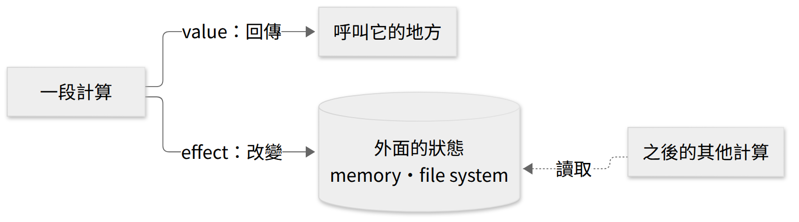
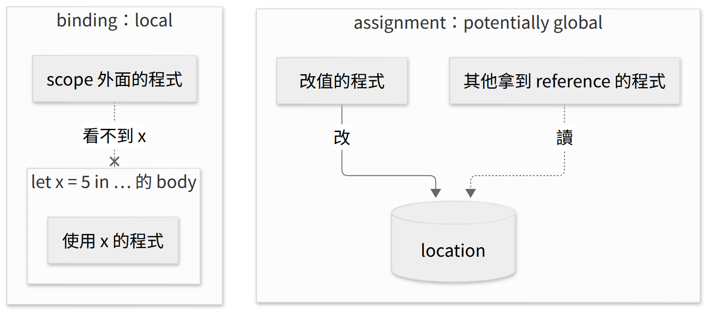
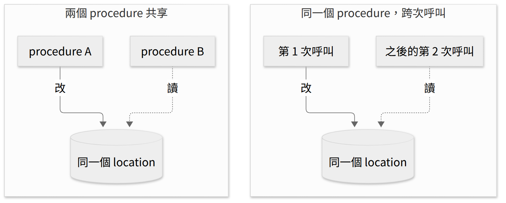
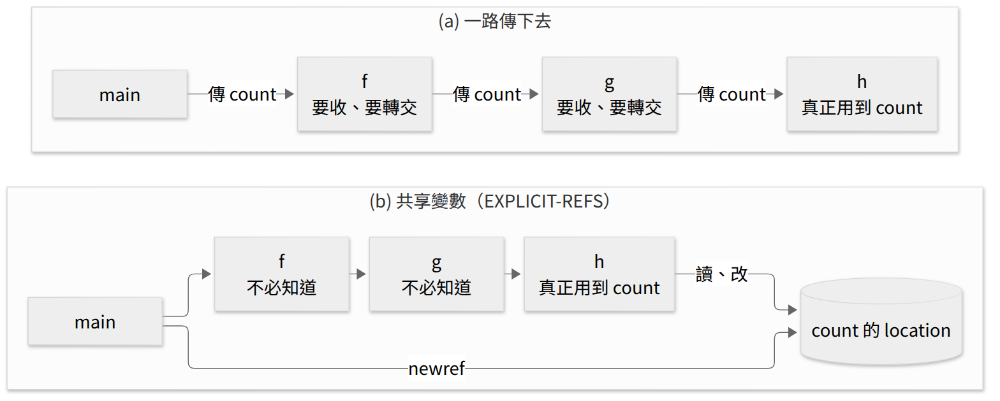
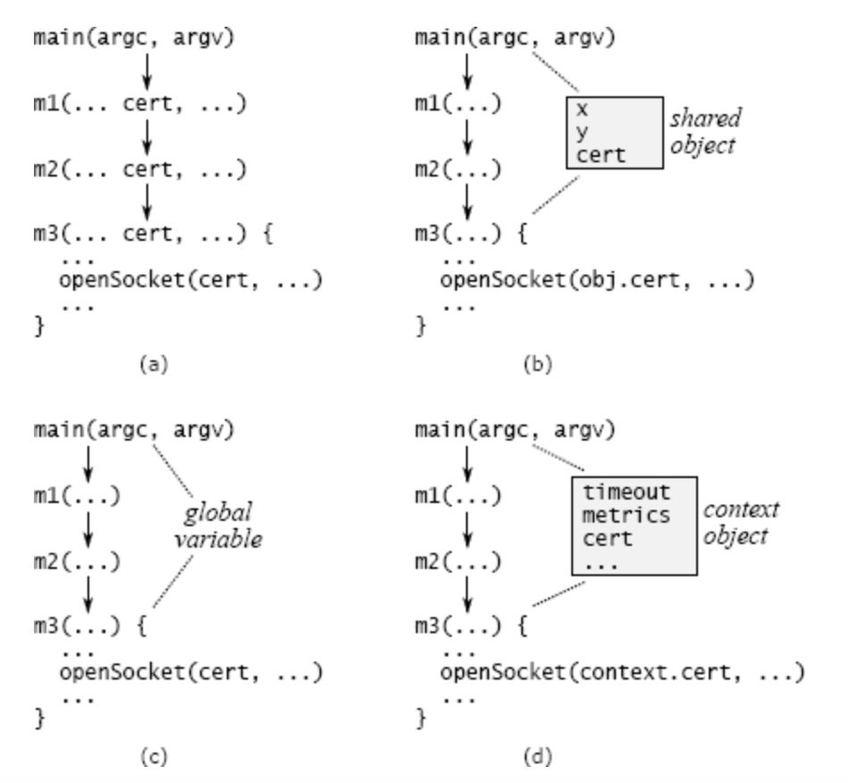
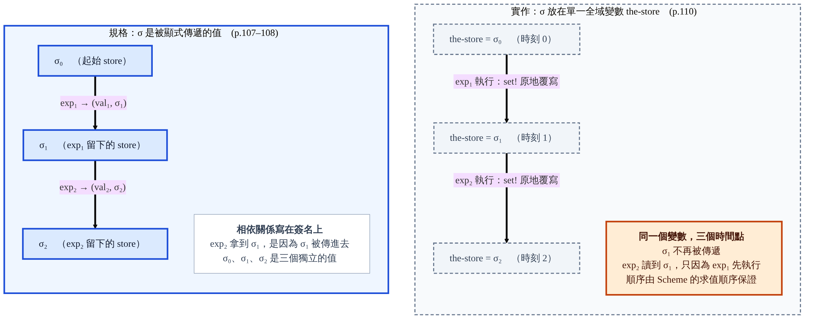
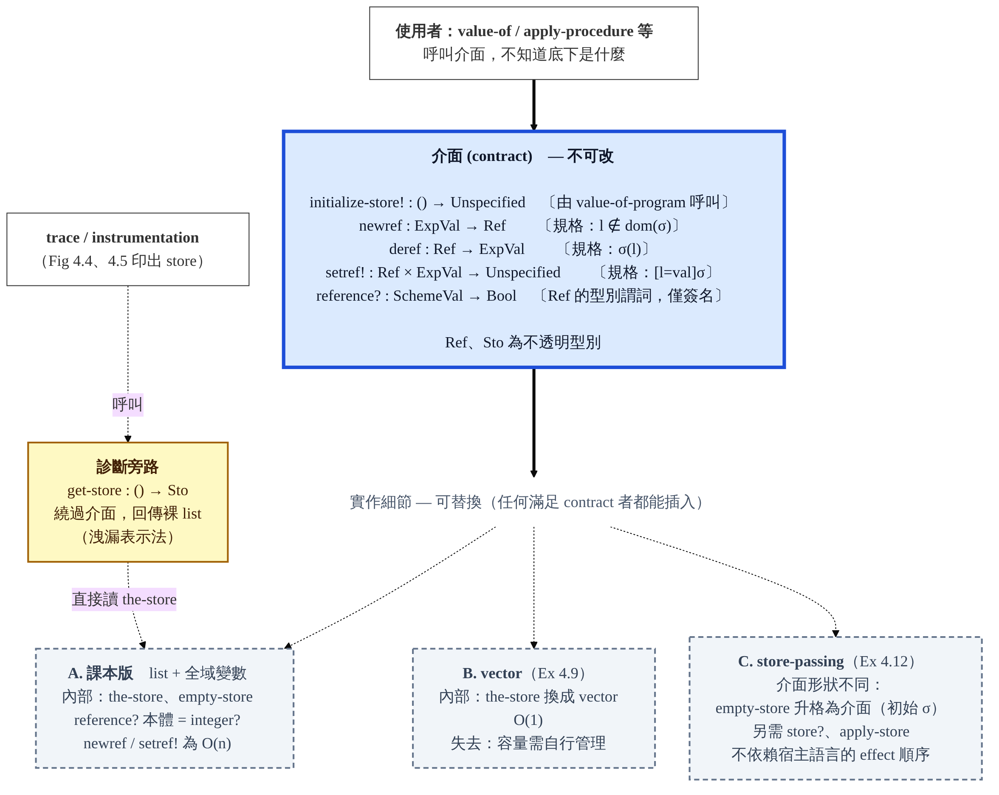

<!-- _class: lead -->

# 程式語言
## Programming Languages — Class 10

政大資碩 115-1　陳家宏

---

# 今天三堂課

| 時段 | 內容 |
|---|---|
| 第 1 堂 | Ch4 全章總表；§4.1 value、effect 與共享；handler + DB；store 模擬了什麼；EXPLICIT-REFS 的前兩個例子（pp.103–105） |
| 第 2 堂 | Exercise 4.1、Clojure 的 atom、§4.2.1 store-passing、§4.2.2 三個新運算的規則（pp.105–109） |
| 第 3 堂 | §4.2.3 的實作：實作策略、store 的介面、Figure 4.1–4.3、trace（pp.109–114） |

<!-- 講者備註：
第 1 堂：概念 10 個（含第 3 張的 Ch4 全章總表）、停下來想 1 處（第 19 張）、約 53 分鐘
第 2 堂：概念 10 個、停下來想 2 處（第 24、27 張）、約 49 分鐘
第 3 堂：概念 6 個、停下來想 0 處、約 40 分鐘 -->

---

<!-- _class: small -->

# Ch4 全章總表：每一節新增了哪些可觀察的東西？

| 語言 | Ref 出現在哪裡 | 新 identity 誕生於 | 新增的可觀察性 |
|---|---|---|---|
| PROC／LETREC | 無 | 無 | 無：共享與複製分辨不出來（只看值） |
| EXPLICIT-REFS（今天） | ExpVal（p.104） | 只在 `newref`（p.104） | 顯式 cell 的 identity；運算元的求值順序 |
| IMPLICIT-REFS | DenVal（p.113） | `let`、call、letrec 查找（p.119）、init env（repo 程式） | 每個變數的 identity；closure 捕捉的是 location |
| MUTABLE-PAIRS | DenVal，另外藏在 pair 裡（p.124） | 同上，另外每個 pair 配置兩格 | 藏在值裡的 identity，可跨變數共享 |
| CALL-BY-REFERENCE | DenVal | 同 IMPLICIT-REFS，但 call 的實參是變數時不配置（p.132） | 參數與實參共享 identity（aliasing） |
| CALL-BY-NAME／NEED | DenVal，location 可放 thunk（p.137） | 同 CALL-BY-REFERENCE；非變數的實參存成 thunk（p.137） | 終止性（p.136，不需 effect）；有 effect 時，求值的次數與時機；by-need 共享求值結果 |

<!-- 講者備註：
1. 嚴格說，讓共享「可觀察」的是 assignment（setref、set）；store 是把這件事記錄下來的模型。第 2 堂的 Ex 4.1（第 25–26 張）會讓學生看到：newref 的位置不同，兩次呼叫讀寫的是不是同一個 location 就不同。
1a. 學生可能問：Ch3 的 environment 也在記憶體裡，那時為什麼不需要 store？回答（我的解讀）：environment 和 store 都在 Racket 的記憶體裡；差別在被定義的語言能不能觀察到共享。Ch3 的環境建好後不會被修改，拷貝和原本那份永遠相同，只看值的話分辨不出來。
2. 第一列的「只看值」：在 Ch3 的語言裡，兩個運算元都出錯時，先出現哪一個錯誤取決於求值順序（實測，proc-lang：-(-(zero?(0), 1), (3 4))）。
3. EXPLICIT-REFS 列的「求值順序」指 diff-exp 兩個運算元誰先求值（第 2 堂第 34–35 張）。CALL-BY-NAME／NEED 列的「求值的次數與時機」是另一件事：operand 在呼叫前求值（eager，p.136 說 4.5.2 之前都是），還是用到時才求值。上課時不要把兩者說成同一件事。兩者的共同點在 p.138：call-by-name／need 讓求值順序難以判斷，而有 effect 時，求值順序會影響結果。
4. 終止性：p.136 的 (f (infinite-loop 0))，lazy evaluation 下回傳 11，call-by-value 下不終止；不需要 effect 就分辨得出來。
5. Exercise 4.39 [★]（p.138）：沒有 effect 時，call-by-name 與 call-by-need 的答案一定相同，和 Ex 4.1 同一個想法：沒有 effect，「共享」和「重算一次」就分辨不出來。
6. p.132 談 call-by-reference：The only thing that changes is the allocation of new locations.；p.137 談 call-by-need 的配置策略與 call-by-reference 相同。
7. init env 的配置：課本 4.3 沒有明講；repo 的 implicit-refs/environments.scm 裡 init-env 用 newref 配置 i、v、x。
8. thunk：還沒求值的 operand 加上它的環境（p.136）。名詞（Ref、location、newref）第 9–10 張才正式定義，這裡只當地圖看。 -->

---

# value vs effects



- p.103 的其他例子：read（輸入）、print（螢幕），兩者都由使用者看見或提供
- p.103：Ch4 只處理其中一種 effect，assignment to a location in memory
- 圖是我依 p.103 的文字畫的

<!-- 圖的原始碼：img/value-vs-effect.mmd（Mermaid），設定檔 img/config.json。
可補充的兩點：同樣的參數呼叫兩次，Ch3 結果一定相同，有 effect 時可能不同（counter g，第 19 張）；規格從 (value-of exp ρ) = val 變成多帶一個 store：(value-of exp ρ σ0) = (val, σ1)（p.107，第 32 張）。 -->

---

# binding vs assignment

p.103：binding is local, but variable assignment is potentially global.



我的解讀：local 和 global 的差別在於誰看得到。binding 由 scope 決定；assignment 由誰拿到 reference 決定。

<!-- 圖的原始碼：img/binding-vs-assignment.mmd（Mermaid），設定檔 img/config.json。
學生可能問：closure 可以把 x 帶到 scope 外面，binding 還算 local 嗎？
回答（我的解讀）：closure 帶出去的是 x 的值，Ch3 沒有辦法改這個值，所以沒有程式觀察得到「共享」，效果上仍然是 local。 -->

---

<!-- _class: small -->

# 兩種共享（p.103）

- Two procedures can share information if they both know about the same location in memory.
- A single procedure can share information with a future invocation of itself by leaving the information in a known location.



兩格形狀相同，差別在讀的是誰：另一個 procedure，或未來的自己。例子：左格 even / odd（第 13–15 張）；右格 counter `g`（第 19–20 張）。

<!-- 圖的原始碼：img/share-location.mmd（Mermaid），設定檔 img/config.json。兩格的節點位置對齊。 -->

---

<!-- _class: small -->

# 課外補充：每次 request 從零開始的 handler

以 PHP 的傳統執行模型為例：每個 request 啟動一支 script，跑完就結束。（課本沒有，是我假設的例子）

```php
<?php
// handler A: no database; the client must send the balance back
$bal = intval($_GET['bal']);
echo $bal + 100;
```

```php
<?php
// handler B: the balance lives in the database
$db->exec("UPDATE accounts SET balance = balance + 100 WHERE id = 1");
echo $db->query("SELECT balance FROM accounts WHERE id = 1")->fetchColumn();
```

- 兩支都是「存 100，回傳新餘額」
- A：request 結束時 `$bal` 消失；下一次存款，client 得把上一次的餘額帶回來
- B：餘額留在 `accounts` 裡 `id = 1` 那一筆 row；同一個 request 送兩次，第二次的回應比第一次多 100

<!-- 講者備註：比喻生效的條件是 shared-nothing。Node/Express 這類 server 可以把狀態放在 process 記憶體裡跨 request 保留；用那種經驗來想，env 與 store 的界線會模糊。所以投影片寫「每次 request 從零開始的 handler」，PHP 只是例子。 -->

---

# EOPL 與 handler + DB 對照表

| EOPL | handler + DB |
|---|---|
| environment（名字 → 值） | handler 裡的 local variable |
| store | 資料庫 |
| location | 一筆 row |
| reference | 那筆 row 的 primary key |
| `newref(v)` | `INSERT`，拿回新的 id |
| `deref(r)` | `SELECT ... WHERE id = r` |
| `setref(r, v)` | `UPDATE ... WHERE id = r` |
| Ch3 的 procedure | 不碰 DB 的 handler（第 7 張的 A） |
| 用到 store 的 procedure | 讀寫 DB 的 handler（第 7 張的 B） |

這張表是我的解讀。課本自己的比喻是 file 與 URL（p.103，第 9 張）。三個運算的課本定義在第 10 張。

---

# store、location、reference（pp.103–104）

| 名詞 | 課本的說法 |
|---|---|
| store | 從 location 到 storable values 的 finite map（p.103） |
| storable values | 通常和 expressed values 相同，但不一定；這是語言設計的一部分（p.103） |
| location | 記憶體裡可以存放值的地方（p.103） |
| reference | 代表一個 location 的資料結構（p.103） |
| 課本的比喻 | location 像 file，reference 像 URL（p.103） |
| L-value | reference 的別名，對應 assignment 左邊的變數（p.104） |
| R-value | expressed value 的別名，對應 assignment 右邊的運算式（p.104） |

---

<!-- _class: small -->

# EXPLICIT-REFS 的規格，四個角度各改了什麼？（p.104）

| 角度 | LETREC（§3.4） | EXPLICIT-REFS（§4.2） |
|---|---|---|
| syntax | 加 `letrec-exp`（p.82） | 加三個運算（p.104；production 在 p.108）：`newref` 配置新的 location 並回傳它的 reference；`deref` 讀那個 location 的內容；`setref` 改它的內容 |
| values | ExpVal = Int + Bool + Proc（p.75；§3.4 沒有重新定義，我的推論）；DenVal = ExpVal | ExpVal = Int + Bool + Proc + Ref(ExpVal)；DenVal = ExpVal（p.104） |
| environments | 加 `extend-env-rec`（p.83） | 沒有改：p.104 說 binding structures 維持不變 |
| behavior | `letrec-exp` 一條等式（p.83） | 規格多帶一個 store（4.2.1–4.2.2, pp.107–109） |

Ref(ExpVal)：指向「存放 expressed value 的 location」的 reference（p.104）。三個運算的 DB 說法見第 8 張。

---

<!-- _class: small -->

# 在 REPL 裡跑 explicit-refs

```
cd eopl3/chapter4/explicit-refs
racket -i -t top.scm
```

```
> (run "let x = newref(0) in begin setref(x,5); deref(x) end")
(num-val 5)
```

**課外補充：第 2 堂會用 babashka（Clojure 的 script 執行環境）。裝好後 `bb --version` 印出版本，`bb repl` 進入 REPL**

```
# macOS
brew install borkdude/brew/babashka
# Linux (or macOS without Homebrew)
bash < <(curl -s https://raw.githubusercontent.com/babashka/babashka/master/install)
```

Windows：照 babashka README 的 scoop 指令安裝（講者備註有完整指令）。

<!-- 講者備註：Windows（scoop）：scoop bucket add scoop-clojure https://github.com/littleli/scoop-clojure；scoop bucket add extras；scoop install babashka。
Linux 的 install script 預設裝到 /usr/local/bin，可能要 sudo。不想用 sudo：先 curl -sLO 下載 install，再跑 bash install --dir ~/.local/bin（實測可用）。指令出處：babashka README。 -->

---

<!-- _class: small -->

# store 模擬記憶體的哪些性質？（p.103）

p.103：We model memory as a finite map from locations to a set of values called the storable values.

| 記憶體的性質 | EXPLICIT-REFS 的 store 有嗎？ | 怎麼確認 |
|---|---|---|
| 每個 location 有自己的 identity（分得出「同一格」與「另一格」） | 有 | 第 6 張：兩種共享都是讀寫同一個 location；第 2 堂的 Ex 4.1（第 25 張）會再直接驗證 |
| location 的內容會隨時間改變 | 有 | `setref`（第 10 張） |
| 釋放 location | 沒有 | grammar 只有 `newref`、`deref`、`setref`（p.108）；`newref` 只往 list 尾端加（Figure 4.1, p.111） |
| 容量上限 | 規格沒有提到 | 4.2.1–4.2.2 的規則都沒有這個條件 |
| 拿 reference 做算術或比較 | 不行 | 下方實測 |

```
> (run "zero?(newref(0))")
; expval-extractors: Looking for a num, found #(struct:ref-val 0) [,bt for
;   context]
```

---

<!-- _class: small -->

# even / odd（pp.104–105）

```
let x = newref(0)
in letrec even(dummy)
            = if zero?(deref(x))
              then 1
              else begin
                    setref(x, -(deref(x),1));
                    (odd 888)
                   end
          odd(dummy)
            = if zero?(deref(x))
              then 0
              else begin
                    setref(x, -(deref(x),1));
                    (even 888)
                   end
   in begin setref(x,13); (odd 888) end
```

p.105：`dummy` 是為了留在單參數語言裡；有多參數 procedure（Exercise 3.21）的話，可以寫成零參數。

p.105：這個程式用到 multi-declaration `letrec`（Exercise 3.32）與 `begin`（Exercise 4.4）；repo 的 explicit-refs 兩者都已經有了。

---

<!-- _class: small -->

# `(odd 888)` 怎麼算出結果？

`even`、`odd` 不看參數（`888` 只是佔位，p.105），只看 `x` 綁到的 location（p.104）：內容是 0 就回傳；不是 0，就減 1，再呼叫另一個 procedure。

以 `setref(x,13)` 為例（我依第 13 張的程式推的）：

| 呼叫 | 進入時 location 的內容 | 做了什麼 |
|---|---|---|
| `(odd 888)` | 13 | 不是 0：改成 12，呼叫 `even` |
| `(even 888)` | 12 | 不是 0：改成 11，呼叫 `odd` |
| … | … | … |
| `(odd 888)` | 1 | 不是 0：改成 0，呼叫 `even` |
| `(even 888)` | 0 | 是 0：回傳 1 |

結果（實測）：`setref(x,13)` → `(num-val 1)`，13 是奇數（p.104）；`setref(x,12)` → `(num-val 0)`，減到 0 時輪到 `odd`，所以回傳 0。

---

# even 和 odd 怎麼交換資訊？（pp.104–105）

p.104：They communicate not by passing data explicitly, but by changing the contents of the variable they share.

p.105：This style of communication is convenient when two procedures might share many quantities; one needs to assign only to the few quantities that change from one call to the next.

這就是第 6 張的左格：`even` 和 `odd` 是兩個 procedure，都知道 `x` 綁到的那個 location。

---

<!-- _class: small -->

# 透過共享變數溝通，為什麼算 information hiding？（p.105）

p.105：Similarly, one procedure might call another procedure not directly but through a long chain of procedure calls. They could communicate data directly through a shared variable, without the intermediate procedures needing to know about it. Thus communication through a shared variable can be a kind of information hiding.



圖是我依 APOSD 圖 7.2 的結構畫的，例子是我自己的。

<!-- 圖的原始碼：img/pass-through.mmd（Mermaid），設定檔 img/config.json。
(b) 對應的 EXPLICIT-REFS 程式（實測 (num-val 2)）：只改 h，f、g 不動。
(run "let calls = newref(0) in let h = proc (x) begin setref(calls, -(deref(calls), -1)); -(x,1) end in let g = proc (x) (h x) in let f = proc (x) (g x) in let r1 = (f 10) in let r2 = (f 20) in deref(calls)") -->

---

# 課外補充：A Philosophy of Software Design 第 7 章

7.5 節〈Pass-through variables〉、圖 7.2 比較了四種做法。表格是我依書的內容整理的：

| APOSD 的做法 | 怎麼做 | 對應到 EOPL |
|---|---|---|
| (a) 參數一路傳 | 中間每一層都要收、要轉交 | PROC 的做法 |
| (b) 共享物件 | 在已經在傳的物件裡多放一個欄位 | 把 reference 放進已經在傳的值裡 |
| (c) 全域變數 | 不用傳，但整個系統只能有一份 | p.105 說的 shared variable |
| (d) context 物件 | 狀態集中在一個物件，每個系統實例各有一個 | 課本沒有直接對應；Exercise 4.21 [★★]（p.122）的 dynamic assignment 是相關的想法 |

APOSD 針對 pass-through variables 的挑戰提出的解法，用 EOPL 的話說，是利用 assignment（我的解讀）。

<!-- (c) 那一列不夠精確：EOPL 的 x 是 lexical scope 裡的變數，even、odd 在它的 scope 內才看得到它，並不是真正的全域變數。
Exercise 4.21（p.122）原文說這種遠距溝通 very often should only be temporary，要學生加入 setdynamic（fluid binding）。Clojure 的 ^:dynamic var 搭配 binding 是同一類機制。 -->

---

# APOSD 圖 7.2



圖片出處：John Ousterhout，*A Philosophy of Software Design*，7.5 節〈Pass-through variables〉，圖 7.2。


---

# counter `g`（p.105）

```
let g = let counter = newref(0)
        in proc (dummy)
            begin
             setref(counter, -(deref(counter), -1));
             deref(counter)
            end
in let a = (g 11)
   in let b = (g 11)
      in -(a,b)
```

**停下來想**：`a`、`b`、程式最後的值各是多少？

<!-- 答案在第 20 張。 -->

---

<!-- _class: small -->

# 對答案：counter `g`（p.105）

p.105：第一次呼叫回傳 1，第二次回傳 2，程式最後的值是 -1。

```
> (run "let g = let counter = newref(0)
                in proc (dummy) begin setref(counter, -(deref(counter), -1));
                                      deref(counter) end
        in let a = (g 11) in let b = (g 11) in -(a,b)")
(num-val -1)
```

p.105 把這叫做用 private variable 建立 hidden state。

這就是第 6 張的右格：第一次呼叫把資訊留在 `counter` 那格，第二次呼叫讀到它。那個 location 只有 `g` 的 closure 拿得到。

DB 說法：只有一個 handler 知道這筆 row 的 id；這次 request 寫入，下次 request 讀出。

---

<!-- _class: small -->

# 第 1 堂回顧

1. **value 與 effect**：value 交給呼叫的地方；effect 改變外面的狀態，之後的計算讀得到（第 4 張；p.103：global）
2. **binding 與 assignment**：binding 的可見範圍由 scope 決定；assignment 由誰拿到 reference 決定（第 5 張）
3. **兩種共享**：even / odd 是兩個 procedure 共享同一個 location；counter `g` 是同一個 procedure 留資訊給下一次呼叫（第 6 張；pp.104–105）
4. **handler + DB 讀法**：store = DB，location = row，reference = primary key（第 8 張）
5. **EXPLICIT-REFS**：Ref 加進 ExpVal；新的 location 只在 `newref` 產生；environment 不變（第 10 張；p.104）。第 3 張總表 EXPLICIT-REFS 列的另一項「求值順序」，第 2 堂回答
6. **store 模擬了記憶體的哪些性質**：location 有 identity、內容會變；沒有釋放；reference 不能做算術（第 12 張）

---

<!-- _class: lead -->

# 第 2 堂
## Exercise 4.1、Clojure 的 atom、§4.2.1–4.2.2

---

<!-- _class: small -->

# `g` 的環境與 store（p.106）

p.106 有一張 `g` 被綁定時的環境圖。下圖是我依 p.105 的程式畫的，請和課本的圖對照。

```
g ──► procedure
        body:      begin setref(counter, -(deref(counter), -1)); deref(counter) end
        saved-env: [counter = (ref-val 0)] ──► init-env

store（location → 內容）
  建好 g 之後：        0 ↦ 0
  第一次 (g 11) 之後：  0 ↦ 1
  第二次 (g 11) 之後：  0 ↦ 2
```

`ref-val`：p.110 在 expressed value 的資料型別裡新增的 variant，代表 reference。

p.106：可以把這看成 `g` 的不同次呼叫彼此共享資訊。

<!-- 講者備註：p.106 說這個技巧被 Scheme 的 gensym 用來產生不重複的 symbol。
Racket 的 REPL 裡：(gensym) → 'g5487，再一次 → 'g5488（實測，數字每次不同）。
Clojure（bb repl）：(gensym) → G__224，再一次 → G__226（實測）。 -->

---

# Exercise 4.1 [★]（p.106）

把 `newref` 搬進 `proc` 裡：

```
let g = proc (dummy)
         let counter = newref(0)
         in begin
             setref(counter, -(deref(counter), -1));
             deref(counter)
            end
in let a = (g 11)
   in let b = (g 11)
      in -(a,b)
```

**停下來想**：`a`、`b`、程式最後的值各是多少？和第 19 張比，哪裡變了？

<!-- 答案在第 25 張。 -->

---

# 對答案：兩個版本並排

| | `newref` 在 `proc` 外（p.105） | `newref` 在 `proc` 內（Ex 4.1） |
|---|---|---|
| `a` | 1 | 1 |
| `b` | 2 | 1 |
| `-(a,b)` | -1 | 0 |
| 程式跑完後，store 裡有幾個 location | 1 | 2 |

最後一列在 REPL 裡查：先 `(require "store.scm")`，跑完程式後呼叫 `(get-store-as-list)`。

<!-- 實測：
外：(list (list 0 (num-val 2)))
內：(list (list 0 (num-val 1)) (list 1 (num-val 1))) -->

---

<!-- _class: small -->

# 兩個版本的環境圖

我依兩個程式畫的圖：

```
newref 在 proc 外：建 g 時 newref 一次
  g ──► procedure, saved-env: [counter = (ref-val 0)]
  兩次呼叫都讀寫 location 0

newref 在 proc 內：每次呼叫 g 都 newref 一次
  g ──► procedure, saved-env: init-env
  第一次呼叫：body 的環境 [counter = (ref-val 0)]，讀寫 location 0
  第二次呼叫：body 的環境 [counter = (ref-val 1)]，讀寫 location 1
```

| | DB 說法 |
|---|---|
| 外 | 只 `INSERT` 一次，之後每個 request 都 `UPDATE` 同一筆 row |
| 內 | 每個 request 先 `INSERT` 一筆新 row，再 `UPDATE` 它 |

兩個版本的程式碼只差 `newref` 的位置；差別在兩次呼叫讀寫的是不是同一個 location。

回到第 3 張的總表：EXPLICIT-REFS 那一列的「顯式 cell 的 identity」，指的就是這個差別。

---

# reference 存進 location（pp.106–107）

```
let x = newref(newref(0))
in begin
    setref(deref(x), 11);
    deref(deref(x))
   end
```

**停下來想**：

- `x` 綁到的 location 裡放的是什麼？
- `setref(deref(x), 11)` 改的是哪一個 location？
- 程式最後的值是多少？

<!-- 答案在第 28 張。 -->

---

# 對答案：reference 為什麼可以存進 location？

p.107：`deref(x)` 的值是第一個 location 的 reference，所以 `setref` 改的是第一個 location，程式最後回傳 11。

```
> (run "let x = newref(newref(0))
        in begin setref(deref(x), 11); deref(deref(x)) end")
(num-val 11)
```

為什麼可以這樣存：

- p.106：EXPLICIT-REFS 可以存任何 expressed value，而 reference 是 expressed value
- 這依賴兩個設計選擇：Ref 放進 ExpVal（p.104）；storable value 等於 expressed value（p.103 說這是設計選擇）

DB 說法：一筆 row 的欄位裡，存著另一筆 row 的 primary key。

---

<!-- _class: small -->

# 課外補充：Clojure 的 `atom`、`@`、`reset!`

| EXPLICIT-REFS | Clojure |
|---|---|
| `newref(v)` | `(atom v)` |
| `deref(r)` | `@r`，也就是 `(deref r)` |
| `setref(r, v)` | `(reset! r v)` |

在 `bb repl` 裡跑（實測，babashka v1.13.229）：

```
user=> (def r (atom 0))
#'user/r
user=> (reset! r 5)
5
user=> @r
5
user=> '@r
(clojure.core/deref r)
```

最後一行：reader（把文字讀成資料的那一步）把 `@r` 讀成 `(clojure.core/deref r)`，名字和課本的 `deref` 相同。

回傳值：`reset!` 回傳新值 5；`setref` 回傳 23（第 40 張）。

---


# `atom` 這個名字指什麼？

同一個字，在這門課裡出現過兩次：

| | class 1 的 Lisp atom | Clojure 的 atom |
|---|---|---|
| 指的是 | 不是 list 的 s-expression | clojure.core 裡的一個函式，回傳 `clojure.lang.Atom` 型別的值 |
| 例子 | `42`、`x`、`"hi"`、`#t` | `(atom 0)` |
| 主要的功能 | 組成 s-expression 的最小單位 | 多執行緒共享的狀態（clojure.org：shared, synchronous, independent state）。實務上常用來放快取、計數器、應用程式狀態（例如 Reagent 的 `r/atom`）；更新多用 `swap!`：傳入一個純函式計算新值，整個更新是 atomic 的，不需要加鎖 |

`clojure.lang.Atom` 這個型別在 `bb repl` 實測過：`(type (atom 0))`。

---

<!-- _class: small -->

# counter `g` 與 Exercise 4.1 的 Clojure 版

```clojure
;; counter g (book p.105): the atom is created once, outside fn
(def g (let [counter (atom 0)]
         (fn [_dummy]
           (reset! counter (inc @counter))
           @counter)))
(let [a (g 11) b (g 11)] (- a b))      ;; => -1

;; Exercise 4.1 (p.106): a new atom on every call
(def g2 (fn [_dummy]
          (let [counter (atom 0)]
            (reset! counter (inc @counter))
            @counter)))
(let [a (g2 11) b (g2 11)] (- a b))    ;; => 0
```

兩個結果和 EXPLICIT-REFS 相同（bb 實測）。

我的解讀：Clojure 的 `let` 綁定不能改，要改就得明確建立一個 atom。這和 EXPLICIT-REFS 的設計相同：binding structures 不變（p.104），會變的只有 reference 指向的格子。Clojure 另外還有 ref、agent 等 reference type，這裡只用 atom。

---


<!-- _class: small -->

# store-passing 是什麼？（4.2.1, p.107）

4.2.1 的節名是 Store-Passing Specifications：把 store 當成參數傳進 `value-of`，求值完再把新的 store 傳回來。

| | Ch3 | Ch4（4.2.1） |
|---|---|---|
| `value-of` 收什麼 | `exp`、`ρ` | `exp`、`ρ`，加上求值前的 store `σ0` |
| `value-of` 回傳什麼 | 一個值 | 一個值，加上求值後的 store `σ1` |
| 寫法 | `(value-of exp ρ) = val` | `(value-of exp ρ σ0) = (val, σ1)` |

為什麼要多帶 store：p.107 說 In our language, any expression may have an effect。任何 expression 都可能改 store，所以每一條規則都要交代 store 怎麼變。

記號：`[l=v]σ` 表示一個 store：除了 location l 對應到 v 之外，其餘都和 σ 相同（p.107）。

用詞：課本在 4.2.1 說 specification，在 4.2.2 說 rule，指的都是 value-of 對某一種 expression 的描述；投影片一律叫「規則」。「規格」只用在整體，例如和實作對照的時候。

---


# const-exp 的規則說了什麼？（p.107）

```
(value-of (const-exp n) ρ σ) = (n, σ)
```

p.107：Thus we can specify an effect-free operation like const-exp by writing … showing that the store is unchanged by evaluation of this expression.

| 規則的部分 | 意思 |
|---|---|
| 左邊的 `σ` | 求值前的 store |
| 右邊的 `n` | 回傳的 value |
| 右邊的 `σ`（和左邊同一個） | 求值後 store 沒有變：const-exp 是 effect-free operation |

一般形式的右邊是 `σ1`，可能和 `σ0` 不同（第 32 張）；const-exp 的右邊寫回同一個 `σ`，就是在說它沒有 effect。對照第 4 張的圖：const-exp 只有 value 這個出口（我的解讀）。

---


# diff-exp 的規則（p.107）

```
(value-of exp1 ρ σ0) = (val1, σ1)
(value-of exp2 ρ σ1) = (val2, σ2)
------------------------------------------------------
(value-of (diff-exp exp1 exp2) ρ σ0) = (⌈⌊val1⌋ - ⌊val2⌋⌉, σ2)
```

| 步驟 | 開始時的 store | 結束時的 store |
|---|---|---|
| 求值 exp1 | σ0 | σ1：exp1 的 effect 留下的狀態 |
| 求值 exp2 | σ1：exp1 留下的那個 | σ2 |
| 相減 | — | 仍是 σ2：相減本身不再改 store |

exp2 從 σ1 開始，所以 exp1 造成的改變，exp2 看得到；這條規則因此規定了先求值 exp1、再求值 exp2（p.107）。

p.107：The specification for diff-exp shows how we specify sequential behavior.

---


# Ch3 與 Ch4 的 diff-exp 規則差在哪？

Ch3 的規則（p.62）：

```
(value-of (diff-exp exp1 exp2) ρ)
= (num-val (- (expval->num (value-of exp1 ρ))
              (expval->num (value-of exp2 ρ))))
```

| | Ch3（p.62） | Ch4（p.107） |
|---|---|---|
| 規則的形式 | 一條等式 | 兩條前提，加上結論 |
| store | 沒有 | σ0 → σ1 → σ2 |
| 求值順序 | 沒有規定 | exp1 先：exp2 從 exp1 留下的 σ1 開始 |
| 為什麼這樣寫 | 沒有 effect，先算哪一個都得到同一個值 | 有 effect，先後會影響結果 |

表格後兩列是我的解讀：課本沒有明講 Ch3 不規定順序，這是從 p.62 的等式讀出來的。

---

# if-exp 的規則（p.108）

```
(value-of exp1 ρ σ0) = (val1, σ1)
----------------------------------------------------------------
(value-of (if-exp exp1 exp2 exp3) ρ σ0)
  = (value-of exp2 ρ σ1)   if (expval->bool val1) = #t
  = (value-of exp3 ρ σ1)   if (expval->bool val1) = #f
```

p.108：先在 σ0 下求值 exp1，得到 val1，store 變成 σ1；接著依 val1 求值 exp2 或 exp3，兩者都從 exp1 留下的 σ1 開始。

---


<style scoped>
pre { font-size: 30px; }
</style>

# 三個新的 production（p.108）

```
Expression ::= newref (Expression)
               newref-exp (exp1)

Expression ::= deref (Expression)
               deref-exp (exp1)

Expression ::= setref (Expression , Expression)
               setref-exp (exp1 exp2)
```

接下來三張，依序看 newref、deref、setref 的規則（pp.108–109）。

---

# newref 的規則（pp.108–109）

```
(value-of exp ρ σ0) = (val, σ1)      l ∉ dom(σ1)
------------------------------------------------------
(value-of (newref-exp exp) ρ σ0) = ((ref-val l), [l=val]σ1)
```

p.109 對這條規則的說明，逐項對到規則裡：

| 規則的哪一部分 | 意思 |
|---|---|
| `(value-of exp ρ σ0) = (val, σ1)` | 先求值 `exp`，得到 `val`，store 從 σ0 變成 σ1 |
| `[l=val]σ1` | 擴充 store：配置 location `l`，放進 `val`；domain 多了 `l` |
| `(ref-val l)` | 回傳指向 `l` 的 reference |
| `l ∉ dom(σ1)` | 「新」的意思：`l` 在 σ1 裡還沒被配置過 |

<!-- 口頭補充 σ1 的 domain 與 range：store 是從 location 到 storable values 的 finite map（p.103）。dom(σ1) 是 σ1 裡已經配置過的 location；對應到的值是 storable values，在 EXPLICIT-REFS 就是 expressed values（p.106）。σ1 是求值完運算元之後的 store，運算元本身也可能配置 location，例如 newref(newref(0))。 -->

---


<!-- _class: small -->

# deref 的規則（p.109）

```
(value-of exp ρ σ0) = (l, σ1)
---------------------------------------------
(value-of (deref-exp exp) ρ σ0) = (σ1(l), σ1)
```

p.109 對這條規則的說明，逐項對到規則裡：

| 規則的哪一部分 | 意思 |
|---|---|
| `(value-of exp ρ σ0) = (l, σ1)` | 先求值 `exp`，store 從 σ0 變成 σ1；`exp` 的值必須是一個 reference，指向 location `l` |
| `σ1(l)` | 回傳 `l` 在 σ1 裡的內容 |
| 右邊的 `σ1` | 回傳內容之後，store 不再改變 |

`exp` 的值不是 reference 時會報錯（實測）：

```
> (run "deref(5)")
; expval-extractors: Looking for a reference, found #(struct:num-val 5) [,bt
;   for context]
```

---


<!-- _class: small -->

# setref 的規則（p.109）

```
(value-of exp1 ρ σ0) = (l, σ1)
(value-of exp2 ρ σ1) = (val, σ2)
---------------------------------------------
(value-of (setref-exp exp1 exp2) ρ σ0) = (⌈23⌉, [l=val]σ2)
```

p.109 對這條規則的說明，逐項對到規則裡：

| 規則的哪一部分 | 意思 |
|---|---|
| `(value-of exp1 ρ σ0) = (l, σ1)` | 先求值 `exp1`；`exp1` 的值必須是一個 reference，指向 location `l` |
| `(value-of exp2 ρ σ1) = (val, σ2)` | 再從 σ1 求值 `exp2`，得到 `val`；`exp1`、`exp2` 由左到右求值 |
| `[l=val]σ2` | 更新 store：把 `val` 放進 `l` |
| `⌈23⌉` | 回傳值可以是任何東西，選 23 是為了強調這個選擇是任意的；我們不在乎回傳值，所以說 setref 是 executed for effect |

```
> (run "setref(newref(0), 5)")
(num-val 23)
```

---


<!-- _class: small -->

# 第 2 堂回顧

1. **Exercise 4.1**：`newref` 的位置，決定兩次呼叫讀寫的是不是同一個 location（-1 與 0）。這就是第 3 張總表 EXPLICIT-REFS 列的「顯式 cell 的 identity」（第 25–26 張）
2. **reference 存進 location**：reference 也是 expressed value，所以可以存進 location（pp.106–107，第 28 張）
3. **store-passing 與求值順序**：`(value-of exp ρ σ0) = (val, σ1)`；const-exp 的右邊寫回同一個 σ，表示 effect-free；diff-exp 的 exp2 從 σ1 開始，所以規定了先 exp1、後 exp2，Ch3 沒有 effect，規則不必規定順序（p.107，第 32–35 張）
4. **三個新運算的規則**：newref 配置一個 `l ∉ dom(σ1)` 的新 location；deref 回傳 `σ1(l)`，不改 store；setref 把 `val` 放進 `l`，回傳 23，executed for effect（pp.108–109，第 38–40 張）

---

<!-- _class: lead -->

# 第 3 堂
## §4.2.3：實作、求值順序

---


<!-- _class: small -->

# 4.2.3 的實作策略是什麼？（pp.109–110）



---
# store 的介面與可替換的實作



---

<!-- _class: small -->

# Figure 4.1（p.111，省略 contract 註解）

```scheme
(define empty-store
  (lambda () '()))

;; usage: A Scheme variable containing the current state
;; of the store. Initially set to a dummy value.
(define the-store 'uninitialized)

(define get-store
  (lambda () the-store))

(define initialize-store!
  (lambda ()
    (set! the-store (empty-store))))

(define reference?
  (lambda (v) (integer? v)))

(define newref
  (lambda (val)
    (let ((next-ref (length the-store)))
      (set! the-store (append the-store (list val)))
      next-ref)))

(define deref
  (lambda (ref)
    (list-ref the-store ref)))
```

---

<!-- _class: small -->

# Figure 4.2（p.112）

```scheme
;; usage: sets the-store to a state like the original, but with
;; position ref containing val.
(define setref!
  (lambda (ref val)
    (set! the-store
      (letrec
        ((setref-inner
           ;; usage: returns a list like store1, except that
           ;; position ref1 contains val.
           (lambda (store1 ref1)
             (cond
               ((null? store1)
                (report-invalid-reference ref the-store))
               ((zero? ref1)
                (cons val (cdr store1)))
               (else
                (cons
                  (car store1)
                  (setref-inner (cdr store1) (- ref1 1))))))))
        (setref-inner the-store ref)))))
```

`setref-inner` 產生一個新的 list，`set!` 再拿它換掉 `the-store`。

---
# store 之外還要改什麼？

1. 在 `value-of-program` 呼叫 `(initialize-store!)`
2. 在 `expval` 加一個 variant `ref-val`（p.110）
3. 在 `value-of` 增加三個 clauses ，分別對應 3 個 explicit-reference operators
  - newref 
  - deref
  - setref

---

# value-of-program 每次執行前先清空 store（p.110）

```scheme
(define value-of-program
  (lambda (pgm)
    (initialize-store!)
    (cases program pgm
      (a-program (exp1)
        (value-of exp1 (init-env))))))
```

---
# expval 這個 datatype（repo 的 data-structures.scm）

```
(define-datatype expval expval?
    (num-val
      (value number?))
    (bool-val
      (boolean boolean?))
    (proc-val 
      (proc proc?))
    (ref-val
      (ref reference?))
    )
```

* 注意：`reference?` 在 store 的實作裡定義了。

---

<!-- _class: small -->

# Figure 4.3（p.113）

```scheme
(newref-exp (exp1)
  (let ((v1 (value-of exp1 env)))
    (ref-val (newref v1))))

(deref-exp (exp1)
  (let ((v1 (value-of exp1 env)))
    (let ((ref1 (expval->ref v1)))
      (deref ref1))))

(setref-exp (exp1 exp2)
  (let ((ref (expval->ref (value-of exp1 env))))
    (let ((val2 (value-of exp2 env)))
      (begin
        (setref! ref val2)
        (num-val 23)))))
```

`setref-exp` 用兩層 `let`：先求值 `exp1`，再求值 `exp2`，和第 40 張規則的順序一致。`expval->ref` 就是第 39–40 張「`exp` 的值必須是 reference」的實作：不是的話會報錯。

---

<!-- _class: small -->

# Figure 4.4 的 trace（p.114）

p.110：這份 trace 顯示，減法的 `exp1`、`exp2` 由左到右求值。

```
> (require "interp.scm" "store.scm")
> (instrument-let #t)
> (instrument-newref #t)
> (run "let x = newref(22)
        in let f = proc (z) let zz = newref(-(z,deref(x))) in deref(zz)
           in -((f 66), (f 55))")
newref: allocating location 0 with initial contents #(struct:num-val 22)
entering body of proc z with env =
((z #(struct:num-val 66))
 ...
newref: allocating location 1 with initial contents #(struct:num-val 44)
entering body of proc z with env =
((z #(struct:num-val 55))
 ...
newref: allocating location 2 with initial contents #(struct:num-val 33)
(num-val 11)
```

---
# Trace 是怎麼實現的？（repo 的 store.scm）

```
(define instrument-newref (make-parameter #f))

(define newref
    (lambda (val)
      (let ((next-ref (length the-store)))
        (set! the-store
              (append the-store (list val)))
        (when (instrument-newref)
            (eopl:printf 
             "newref: allocating location ~s with initial contents ~s~%"
             next-ref val))                     
        next-ref)))                     
```

`make-parameter` 建立 Racket 的 parameter：`(instrument-newref)` 讀出目前的設定，`(instrument-newref #t)` 把它打開。

---

<!-- _class: small -->

# 下週預告：§4.3 IMPLICIT-REFS（p.113）

| | EXPLICIT-REFS（p.104） | IMPLICIT-REFS（p.113） |
|---|---|---|
| ExpVal | Int + Bool + Proc + Ref(ExpVal) | Int + Bool + Proc |
| DenVal | ExpVal | Ref(ExpVal) |

p.113：在這個設計裡，每個變數都代表一個 reference；reference 不再是 expressed value，只以變數綁定的形式存在。

p.113：每個綁定運算都會建立 location：每次 procedure call、`let`、`letrec`。

下週的問題：第 10 張的四角度表，哪幾格會改？對照第 3 張總表的 IMPLICIT-REFS 那一列。

---


<!-- _class: small -->

# 本日結論

1. **value、effect 與共享**：value 交給呼叫的地方；effect 改變外面的狀態，之後的計算讀得到；binding 由 scope 決定，assignment 由誰拿到 reference 決定（第 4–6 張）
2. **EXPLICIT-REFS**：Ref 加進 ExpVal，新增 `newref`、`deref`、`setref`，environment 不變（第 10 張）；`newref` 放的位置，決定兩次呼叫讀寫的是不是同一個 location（Ex 4.1，第 25–26 張）
3. **store-passing 規則**：`(value-of exp ρ σ0) = (val, σ1)`；diff-exp 的 exp2 從 σ1 開始，規定了先 exp1、後 exp2（第 32–35 張）
4. **實作策略**：不傳 σ，改用一個 global variable `the-store`（p.110）；diff-exp 的先後改由 Racket 的求值順序決定，這是對 Scheme effect 時機的依賴（p.112 Ex 4.12，第 43 張）
5. **trace**：`newref` 內建印出配置訊息，用 `instrument-newref` 開關；trace 顯示減法由左到右求值（pp.110、114，第 51–52 張）

---

<!-- _class: lead -->

# 問題時間

1. Email: laurence@replware.dev
2. Office Hour: 週四下午 1:00~2:00，請先跟我約
3. 助教：邵振皓 (負責改作業、監考)
4. 助教信箱：114971020@nccu.edu.tw
5. 作業一律上傳 Moodle
