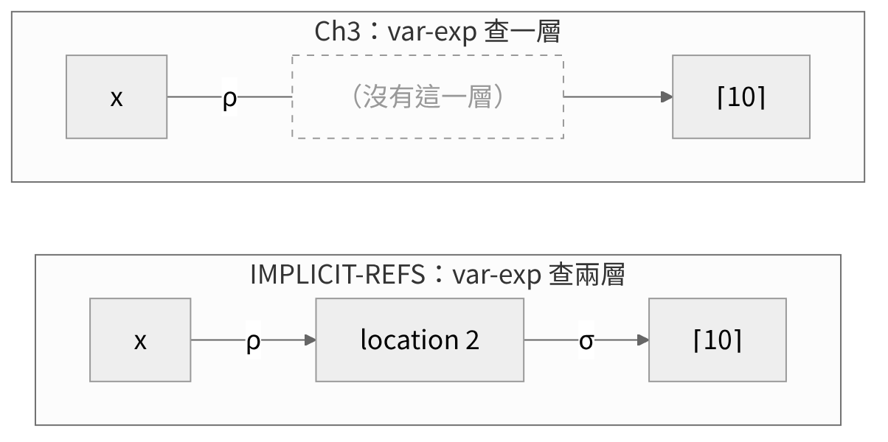
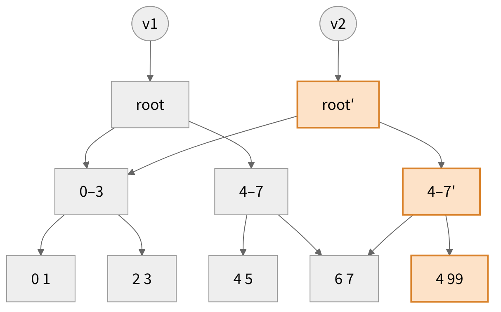

<!-- _class: lead -->

# 程式語言
## Programming Languages — Class 11

政大資碩 115-1　陳家宏

---

# 今天三堂課

| 時段 | 內容 |
|---|---|
| 第 1 堂 | 從 EXPLICIT-REFS 到 IMPLICIT-REFS：domain equations、兩層查找、`set`、Figure 4.7；var-exp 與 assign-exp 的規則（pp.113、116–118） |
| 第 2 堂 | procedure call 與 let 的規則、Exercise 4.14、§4.3.2 實作、Figure 4.8（pp.118–120） |
| 第 3 堂 | 補充教材：mutable 與 immutable collection；課堂練習 Exercise 4.15、4.16（30 分鐘）；下週預告（pp.121、124） |

<!-- 講者備註：
第 1 堂：概念 10 個（含第 8 張的 class-05 回顧、第 13 張的規格形式、第 14 張的推論、第 15–16 張的兩條規則）、停下來想 1 處（第 6 張）、約 48 分鐘
第 2 堂：概念 8 個（含第 22 張的規格到實作）、停下來想 3 處（第 20、26、28 張；第 20 張是隨堂演練，約 8 分鐘）、約 45 分鐘
第 3 堂：概念 3 個（mutable 與 immutable collection、structural sharing、下週預告）、課堂練習 30 分鐘（第 35–37 張）、約 52 分鐘
Figure 4.8 原本排在第 3 堂，為了平衡時間移到第 2 堂結尾，接在第 27 張的 trace 之後。
程式都在 eopl3/chapter4/implicit-refs 下用 racket -i -t top.scm 跑過。 -->

---

<!-- _class: small -->

# 四角度表：IMPLICIT-REFS 改了哪幾格？

class-10 第 10 張的 EXPLICIT-REFS 欄，加上 IMPLICIT-REFS 欄：

| 角度 | EXPLICIT-REFS（§4.2） | IMPLICIT-REFS（§4.3） | 在第幾張講 |
|---|---|---|---|
| syntax | 加 `newref`、`deref`、`setref`（p.104；production 在 p.108） | 加 `set`（p.116）；repo 的文法沒有 `newref`、`deref`、`setref` | 7、10 |
| values | ExpVal = Int + Bool + Proc + Ref(ExpVal)；DenVal = ExpVal（p.104） | ExpVal = Int + Bool + Proc；DenVal = Ref(ExpVal)（p.113） | 5–7 |
| environments | 沒有改：binding structures 維持不變（p.104） | `extend-env` 存進去的 DenVal 變成 Ref；`apply-env` 的 `extend-env-rec` 分支改成配置 location（p.119） | 25–26 |
| behavior | 規格多帶一個 store（pp.107–109） | var-exp 多查一層 store（p.117）；新增 assign-exp；call 與 let 配置新 location（p.118） | 13–16、19 |

---

# p.113：為什麼要把 reference 藏起來？

p.113 的前兩段：

- The explicit reference design gives a clear account of allocation, dereferencing, and mutation because all these operations are explicit in the programmer's code.
- Most programming languages take common patterns of allocation, dereferencing, and mutation, and package them up as part of the language. Then the programmer need not worry about when to perform these operations, because they are built into the language.

在 EXPLICIT-REFS 裡，程式設計者要自己決定三件事：什麼時候配置、什麼時候取值、什麼時候修改。IMPLICIT-REFS 把這三件事交給語言決定。

<!-- 講者備註：「多數語言」是課本的論斷，課堂上不展開其他語言。 -->

---

# 兩組 domain equations（p.104、p.113）

```
EXPLICIT-REFS (p.104)              IMPLICIT-REFS (p.113)
ExpVal = Int + Bool + Proc         ExpVal = Int + Bool + Proc
         + Ref(ExpVal)
DenVal = ExpVal                    DenVal = Ref(ExpVal)
```

p.113：In this design, every variable denotes a reference. … References are no longer expressed values. They exist only as the bindings of variables.

p.61 在 Ch3 留下的一句話：Chapter 4 presents languages in which expressed and denoted values are different. IMPLICIT-REFS 是第一個兌現它的語言。

<!-- 講者備註：EXPLICIT-REFS 的 ExpVal 和 DenVal 仍然相等（DenVal = ExpVal），所以 p.61 那句話到 4.3 才第一次成立。 -->

---

# ExpVal 與 DenVal 各回答什麼問題？

p.61 的定義：expressed values 是 expression 可能的值；denoted values 是綁到變數的值。

我把這兩句話改寫成兩個問句（這是我的解讀）：

| | 問句 |
|---|---|
| ExpVal | 有沒有某個 expression，算出來的值是它？ |
| DenVal | 它能不能綁到一個變數上？ |

**停下來想**：拿 Ref 分別問這兩個問句，在 EXPLICIT-REFS、IMPLICIT-REFS 各回答一次。

<!-- 答案在第 7 張。 -->

---

<!-- _class: small -->

# 對答案：Ref 在兩個語言裡的位置

| 問句 | EXPLICIT-REFS | IMPLICIT-REFS |
|---|---|---|
| 有 expression 算出 Ref 嗎？ | 有：`newref(0)` 的值是 `(ref-val 0)` | 沒有：reference 不再是 expressed value（p.113） |
| Ref 能綁到變數上嗎？ | 能：`let x = newref(0) in ...` | 能，而且每個變數都綁到 Ref（p.113） |
| 結論 | Ref ∈ ExpVal，DenVal = ExpVal 所以也 ∈ DenVal | Ref ∈ DenVal，Ref ∉ ExpVal |

repo 的 implicit-refs 文法裡沒有 `newref`（課本沒明講，這是 repo 的 lang.scm）：

```
> (run "newref(0)")
; parsing: at line 1: symbols left over: literal-string51 "(" etc... [,bt for
;   context]
```

---

<!-- _class: small -->

# 回顧 class-05：var-exp 的等式兩邊是什麼型別？

Ch3 的 var-exp 規則（p.62）：

```
(value-of (var-exp var) ρ) = (apply-env ρ var)
```

| 式子 | 回傳 | 依據 |
|---|---|---|
| `(value-of exp ρ)` | ExpVal | p.62 寫出 `value-of : Exp × Env → ExpVal` |
| `(apply-env ρ var)` | DenVal | 第三章沒寫簽名，由 p.61 推出 |

等號左邊是 ExpVal，右邊是 DenVal。成立的依據在 p.61：Ch3 的 ExpVal 與 DenVal 相同。

<!-- 講者備註：推導（class-05 的整理）：p.61 說 denoted values 是綁定到變數上的值；environment 是函數，定義域是有限的變數集合，函數值都是 denoted values。所以 apply-env : Env × Var → DenVal。對照 Ch2 p.38：apply-env : Env × Var → SchemeVal。 -->

---

# var-exp 怎麼找到值？（p.116）

p.116：先在 environment 裡查到變數綁定的 location，再到 store 裡查那個 location 的內容。課本把這叫做 “two-level” system。



圖是我依 p.116 的文字畫的。`x`、location 2、⌈10⌉ 取自 repo 的 init env：`x` 的初始值是 10，放在 location 2（第 2 堂第 22 張會實測）。

<!-- 圖的原始碼：img/var-lookup.mmd（Mermaid），設定檔 img/config.json。上下兩列的節點位置對齊；Ch3 那一列中間的虛線框標「沒有這一層」。 -->

---

# `set` 的語法（p.116）

```
Expression ::= set Identifier = Expression
               assign-exp (var exp1)
```

- p.116：Identifier 不是 expression 的一部分，所以不會被 dereference
- p.116：在這個設計裡，變數是 mutable 的
- 回收 p.104：reference 又叫 L-value。`set` 左邊用到的是 `x` 綁定的 location，用不到 location 裡的值

---

<!-- _class: small -->

# Figure 4.7 的 even / odd（p.117 對照 pp.104–105）

```
EXPLICIT-REFS (pp.104-105)                IMPLICIT-REFS (Figure 4.7, p.117)
let x = newref(0)                         let x = 0
in letrec even(dummy)                     in letrec even(dummy)
            = if zero?(deref(x))                      = if zero?(x)
              then 1                                    then 1
              else begin                                else begin
                    setref(x, -(deref(x),1));                 set x = -(x,1);
                    (odd 888)                                 (odd 888)
                   end                                       end
          odd(dummy)                                odd(dummy)
            = if zero?(deref(x))                      = if zero?(x)
              then 0                                    then 0
              else begin                                else begin
                    setref(x, -(deref(x),1));                 set x = -(x,1);
                    (even 888)                                (even 888)
                   end                                       end
   in begin setref(x,13); (odd 888) end      in begin set x = 13; (odd -888) end
```

```
> (run "let x = 0 in letrec even(dummy) = ... in begin set x = 13; (odd -888) end")
(num-val 1)
```

<!-- 講者備註：p.117 最後一行寫 (odd -888)，pp.104–105 寫 (odd 888)。參數沒被用到，結果相同。學生問到再講。
REPL 那行為了版面把程式中段換成 ...；實際跑的是完整程式。 -->

---

# 少了什麼：reference 鏈（p.117）

class-10 第 27 張的程式，在 EXPLICIT-REFS 裡回傳 11：

```
let x = newref(newref(0))
in begin
    setref(deref(x), 11);
    deref(deref(x))
   end
```

p.117：Because references are no longer expressed values, we can't make chains of references, as we did in the last example in section 4.2.

| | EXPLICIT-REFS | IMPLICIT-REFS |
|---|---|---|
| 變數能不能用 `set` 改 | 不能，可以改的是 reference 指向的 location | 能 |
| reference 能不能存進 location、當參數傳、當回傳值 | 能 | 不能：程式拿不到 reference |

<!-- 講者備註：兩欄是取捨。 -->

---

<!-- _class: small -->

# 4.3 的規格長什麼樣？

| | Ch3 | EXPLICIT-REFS | IMPLICIT-REFS |
|---|---|---|---|
| 規則的形式 | `(value-of exp ρ) = val`（p.62） | `(value-of exp ρ σ0) = (val, σ1)`（p.107） | 同 EXPLICIT-REFS |
| ρ：變數 → ? | DenVal = ExpVal（p.61） | DenVal = ExpVal（p.104） | location（p.113、p.117） |
| σ：location → ? | 沒有 store | storable value = ExpVal（p.106） | ExpVal：locations contain expressed values（p.113） |

「形式和 4.2.1 相同」是我的解讀：p.118 說要重寫 call 和 let 的規則來呈現被修改的 store，課本沒有明講其他規則沿用 4.2.1 的形式。

把 ρ、σ 兩層接起來，就是 var-exp 的規則（p.117）：

```
(value-of (var-exp var) ρ σ) = (σ(ρ(var)), σ)
```

下一張看其他規則要改哪幾條。

---

<!-- _class: small -->

# 規格要改哪幾條？從三個運算的消失推出來

p.113：References are no longer expressed values. `newref` 產生 Ref，`deref`、`setref` 接收 Ref，所以它們不能再是 expression，這三個 syntax 消失（第 7 張）。但配置、取值、修改還是要發生，所以藏進其他 syntax 的 behavior（推論是我的整理）：

| 消失的運算 | 藏進哪裡 | 為什麼是那裡 | 要改的規則 |
|---|---|---|---|
| `newref` | 建立 binding 的地方：call、let、letrec | p.113：Locations are created with each binding operation: at each procedure call, let, or letrec. | call（p.118）、let（Ex 4.14）、letrec（課本沒寫，Ex 4.18 [★★]，p.121） |
| `deref` | var-exp | 要回傳 ExpVal，environment 給的是 Ref（第 8 張） | var-exp（p.117） |
| `setref` | `set`（assign-exp） | 改變數綁到的那一格 | assign-exp（p.118） |
| — | const、diff、zero?、if、proc | 不建立 binding，也不讀變數 | 不用改 |

對照課本：p.117–118 寫出的是 var-exp、assign-exp、call、let 四條；letrec 的規則留給 Exercise 4.18。init env 也會配置 location（p.118），但它不是 expression，沒有規則。

<!-- 講者備註：「藏進哪裡」是 p.113 的設計選擇：如果只讓 letmutable 引入的變數綁 location（Exercise 4.20，p.121），newref 就只藏進 letmutable。 -->

---

<!-- _class: small -->

# var-exp 的規則：Ch3（p.62）與 4.3（p.117）

第 13 張的例子，逐項拆開：

```
Ch3  (p.62)    (value-of (var-exp var) ρ)   = (apply-env ρ var)
4.3  (p.117)   (value-of (var-exp var) ρ σ) = (σ(ρ(var)), σ)
```

| 4.3 規則的部分 | 意思 |
|---|---|
| `ρ(var)` | 就是 `(apply-env ρ var)`：在 environment 裡查到的 location |
| `σ(ρ(var))` | 那個 location 在 σ 裡的內容 |
| 右邊的 `σ` | 和左邊同一個：var-exp 不改 store |

p.117：The environment now always binds variables to locations, so when a variable appears as an expression, we need to dereference it.

接回第 8 張：`(apply-env ρ var)` 回傳的 DenVal 現在是 Ref，不等於 ExpVal，所以右邊要多一個 `σ(...)`。

<!-- 講者備註：ρ(var) 的寫法：p.61 說 environment 是一個 function，所以可以寫成 ρ(var)。σ(l) 的寫法在 class-10 的 deref 規則（p.109）用過。 -->

---

<!-- _class: small -->

# assign-exp 的規則（p.118）

```
(value-of exp1 ρ σ0) = (val1, σ1)
--------------------------------------------------------------
(value-of (assign-exp var exp1) ρ σ0) = (⌈27⌉, [ρ(var)=val1]σ1)
```

| p.118 原文（依序） | 對到規則的哪一部分 |
|---|---|
| we look up the left-hand side in the environment, getting a location | `ρ(var)` |
| we evaluate the right-hand side in the environment | `(value-of exp1 ρ σ0) = (val1, σ1)`：用同一個 ρ |
| and we modify the desired location | `[ρ(var)=val1]σ1`：在 exp1 留下的 σ1 上修改 |
| We choose to have it return the expressed value 27. | `⌈27⌉`：原文說回傳值和 setref 一樣是任意的；setref 選的是 23（p.109） |

左邊的 `var` 只在 environment 裡查，沒有經過 value-of，所以前提只有 exp1 一條。依據是 p.116：Identifier 不是 expression，不被 dereference（第 10 張）。下面的 `x` 來自 init env：

```
> (run "set x = 5")
(num-val 27)
```

---

<!-- _class: small -->

# 第 1 堂回顧

1. **動機**：EXPLICIT-REFS 讓程式設計者自己決定配置、取值、修改；IMPLICIT-REFS 把這三件事交給語言（p.113，第 4 張）
2. **domain equations**：Ref 從 ExpVal 移到 DenVal；p.61 說的「Ch4 的 ExpVal 與 DenVal 不同」在這裡第一次成立；Ch3 的 var-exp 等式靠兩者相同才成立（第 5–8 張）
3. **兩層查找與 `set`**：environment 給 location，store 給內容；`set` 左邊的 Identifier 不被 dereference，用到的是 location（p.116，第 9–10 張）
4. **取捨**：變數可以改，但拿不到 reference，做不出 reference 鏈（p.117，第 12 張）
5. **規格的形式與要改哪幾條**：形式和 4.2 相同，ρ 給 location、σ 給 ExpVal；`newref`、`deref`、`setref` 消失，藏進 call、let、letrec、var-exp、assign-exp，其他規則不用改（第 13–14 張）
6. **兩條規則**：var-exp 是 `(σ(ρ(var)), σ)`；assign-exp 依原文的順序是查左邊的 location、算右邊、修改那一格、回傳 27（pp.117–118，第 15–16 張）

---

<!-- _class: lead -->

# 第 2 堂
## procedure call 與 let 的規則、§4.3.2 實作、Figure 4.8

---

<!-- _class: small -->

# procedure call 的規則：Ch3（p.76）與 4.3（p.118）

```
Ch3 (p.76)
(apply-procedure (procedure var body ρ) val)
  = (value-of body [var=val]ρ)

4.3 (p.118)
(apply-procedure (procedure var body ρ) val σ)
  = (value-of body [var=l]ρ [l=val]σ)
  where l is a location not in the domain of σ
```

| | Ch3 | 4.3 |
|---|---|---|
| environment 裡 `var` 綁到 | `val` | 新的 location `l` |
| `val` 放在哪 | environment | store：`[l=val]σ` |

記號：`[var=l]ρ` 是擴充 environment（p.61）；`[l=val]σ` 是擴充 store（p.107）。

p.117 稱這個設計為 call-by-value。p.130 的定義：formal parameter 綁到一個 reference，指向放著 actual parameter 的 expressed value 的 location，即 `[var=l]ρ [l=val]σ`。Ch3 的 `[var=val]ρ` 叫 natural parameter passing（p.130，指回 p.75）。

---

# Exercise 4.14 [★]（p.118）：寫出 let 的規則

p.118 的文字描述：

The right-hand side exp1 is evaluated, and the value of the let expression is the value of the body, evaluated in an environment where the variable var is bound to a new location containing the value of exp1.

**停下來想**（隨堂演練，5 分鐘）：仿照第 16、19 張，寫出

```
(value-of (let-exp var exp1 body) ρ σ0) = ?
```

提示：exp1 求值時可能改 store。新的 location 要不在哪一個 store 的 domain 裡？

<!-- 答案在第 21 張。 -->

---

# 參考答案：let 的規則

這是我寫的參考答案，課本沒有給：

```
(value-of exp1 ρ σ0) = (val1, σ1)      l ∉ dom(σ1)
------------------------------------------------------------
(value-of (let-exp var exp1 body) ρ σ0)
  = (value-of body [var=l]ρ [l=val1]σ1)
```

| 寫成 | 理由 |
|---|---|
| body 從 σ1 開始 | exp1 的 effect 要留給 body（同 class-10 的 diff-exp 規則，p.107） |
| 條件寫 `l ∉ dom(σ1)` | exp1 求值時可能也配置了 location，例如 `let y = let z = 1 in z in ...` |

第 24 張的程式可以拿來對照這條規則。

<!-- 講者備註：常見的錯：寫成 [l=val1]σ0，等於丟掉 exp1 對 store 的修改；或寫成 l ∉ dom(σ0)，l 可能和 exp1 配置的 location 撞在一起。 -->

---

<!-- _class: small -->

# 從規格到實作：哪些程式要改？

p.118：Now we are ready to modify the interpreter. 照第 14 張的對應：

| 運算 | 程式裡藏在哪裡 | 頁碼 | 程式碼 |
|---|---|---|---|
| `deref` | var-exp clause：`(deref (apply-env env var))` | p.118 | 第 23 張 |
| `setref` | 新增的 assign-exp clause：`(setref! (apply-env env var) ...)` | p.118 | 第 23 張 |
| `newref` | 四個建立 binding 的位置（p.118：exactly four places）：init env（`init-env`）、let（let-exp clause）、procedure call（`apply-procedure`）、letrec（`apply-env` 的 `extend-env-rec` 分支） | pp.118–119 | 下方 REPL；第 24、26 張 |

store 模組不用改（我的解讀）：規則對 σ 只有配置、讀、改，4.2.3 的三個函式就夠用。

init env：程式沒有 binding，store 也有三格（`i`、`v`、`x`）：

```
> (require "store.scm")
> (run "5")
(num-val 5)
> (get-store-as-list)
(list (list 0 (num-val 1)) (list 1 (num-val 5)) (list 2 (num-val 10)))
```

---

# var-exp 與 assign-exp 的程式（p.118）

```scheme
(var-exp (var) (deref (apply-env env var)))

(assign-exp (var exp1)
  (begin
    (setref!
      (apply-env env var)
      (value-of exp1 env))
    (num-val 27)))
```

| 程式 | 對到第幾張的規則 |
|---|---|
| `(deref (apply-env env var))` | 第 15 張的 `σ(ρ(var))` |
| `(setref! (apply-env env var) ...)` | 第 16 張的 `[ρ(var)=val1]σ1`；`var` 只經過 `apply-env`，沒有 `deref` |

---

<!-- _class: small -->

# let-exp 與 apply-procedure 的程式（p.119）

```scheme
;; PROC / LET (Figure 3.9, p.72)          ;; IMPLICIT-REFS (p.119)
(let-exp (var exp1 body)                  (let-exp (var exp1 body)
  (let ((val1 (value-of exp1 env)))         (let ((val1 (value-of exp1 env)))
    (value-of body                            (value-of body
      (extend-env var val1 env))))              (extend-env var (newref val1) env))))
```

```scheme
;; PROC (p.79)                            ;; IMPLICIT-REFS (p.119)
(define apply-procedure                   (define apply-procedure
  (lambda (proc1 val)                       (lambda (proc1 val)
    (cases proc proc1                         (cases proc proc1
      (procedure (var body saved-env)           (procedure (var body saved-env)
        (value-of body                            (value-of body
          (extend-env var val saved-env))))))       (extend-env var (newref val) saved-env))))))
```

兩組都只差一處：`val1`、`val` 換成 `(newref val1)`、`(newref val)`。

對照第 21 張：`(value-of exp1 env)` 先跑完才呼叫 `newref`，所以新 location 配置在 exp1 的 effect 之後，對應規則的 `l ∉ dom(σ1)`。

---

# 一個值在 environment 裡走過哪幾步？

這張是我的解讀，依第 23–24 張的程式整理：

```
value-of 算出 ExpVal
  → newref            把 ExpVal 放進新的 location，拿回 Ref
  → extend-env        Var × DenVal × Env → Env，存進去的是 Ref
  → apply-env         查到的是 Ref（DenVal）
  → deref             讀出 location 的內容，變回 ExpVal
```

| | PROC | IMPLICIT-REFS |
|---|---|---|
| DenVal | = ExpVal（p.61） | Ref(ExpVal)（p.113） |
| 進 environment 前 | 直接放 `val` | `(newref val)` |
| 出 environment 後（`apply-env` 回傳 DenVal，見第 8 張） | 直接當 ExpVal 用 | `(deref ...)` |

PROC 看不出這兩步，因為 DenVal = ExpVal，放進去和拿出來是同一個東西。

---

<!-- _class: small -->

# letrec：`extend-env-rec` 分支裡的 `newref`（p.119）

```scheme
(extend-env-rec (p-names b-vars p-bodies saved-env)
  (let ((n (location search-var p-names)))
    (if n
      (newref
        (proc-val
          (procedure
            (list-ref b-vars n)
            (list-ref p-bodies n)
            env)))
      (apply-env saved-env search-var))))
```

p.119：這裡用 multideclaration `letrec`（Exercise 3.32）。程式裡的 `location` 是 p.119 的輔助函式：回傳 `search-var` 在 `p-names` 裡的位置，不在就回傳 `#f`，和 store 的 location 同名不同義。

回收 class-07「每一層查到的 `double` 一樣嗎？」：查到 p-name 時才組 closure；現在組完還要 `newref`。

**停下來想**：`letrec f(x) = x in -((f 1),(f 2))` 跑完，store 裡有幾格？各是誰配置的？

<!-- 答案在第 27 張。 -->

---

<!-- _class: small -->

# 對答案：用 trace 數一數

```
> (instrument-newref #t)
> (run "letrec f(x) = x in -((f 1),(f 2))")
newref: allocating location 0 with initial contents #(struct:num-val 1)
newref: allocating location 1 with initial contents #(struct:num-val 5)
newref: allocating location 2 with initial contents #(struct:num-val 10)
newref: allocating location 3 with initial contents #(struct:proc-val ...)
newref: allocating location 4 with initial contents #(struct:num-val 1)
newref: allocating location 5 with initial contents #(struct:proc-val ...)
newref: allocating location 6 with initial contents #(struct:num-val 2)
(num-val -1)
```

| location | 誰配置的 |
|---|---|
| 0–2 | init env |
| 3、5 | 查 `f` 兩次，`extend-env-rec` 分支各配置一格 |
| 4、6 | 呼叫 `f` 兩次，`apply-procedure` 各配置一格 |

`#(struct:proc-val ...)`：實際輸出很長，我把 closure 的內容換成 `...`。

---

# Figure 4.8 的程式（p.120）

```
let f = proc (x) proc (y)
          begin
           set x = -(x,-1);
           -(x,y)
          end
in ((f 44) 33)
```

**停下來想**：

- 程式的值是多少？
- 跑完之前，`newref` 一共被呼叫幾次？每一次是第 22 張四種地方的哪一種？

<!-- 答案在第 29 張。 -->

---

<!-- _class: small -->

# Figure 4.8 的 trace（repo 實際輸出）

```
> (require "interp.scm" "store.scm")
> (instrument-let #t)
> (instrument-newref #t)
> (run "let f = proc (x) proc (y) begin set x = -(x,-1); -(x,y) end in ((f 44) 33)")
newref: allocating location 0 with initial contents #(struct:num-val 1)
newref: allocating location 1 with initial contents #(struct:num-val 5)
newref: allocating location 2 with initial contents #(struct:num-val 10)
newref: allocating location 3 with initial contents #(struct:proc-val ...)
newref: allocating location 4 with initial contents #(struct:num-val 44)
entering body of proc x with env =
((x 4) (i 0) (v 1) (x 2))
store = ...
newref: allocating location 5 with initial contents #(struct:num-val 33)
entering body of proc y with env =
((y 5) (x 4) (i 0) (v 1) (x 2))
store = ...
(num-val 12)
```

六次：0–2 是 init env；3 是 `let f`；4 是呼叫 `(f 44)`；5 是呼叫 `(... 33)`。值是 12：`set x` 把 location 4 改成 45，45 − 33 = 12。

<!-- 講者備註：store = 之後的內容省略，完整輸出和課本 Figure 4.8（p.120）的 store 相同。
repo 的格式和課本不同：課本有 entering let f 這一行；repo 的 newref 那一行會印出初始內容。投影片照 repo 實際輸出。 -->

---

<!-- _class: small -->

# 第 2 堂回顧

1. **procedure call 與 let**：配置新的 location，條件是不在 σ 的 domain 裡；和第 1 堂的 var-exp、assign-exp 合起來，課本寫出四條規則，letrec 的留給 Exercise 4.18（pp.117–118，第 13–16、19–21 張）
2. **三個運算在程式裡的位置**：`deref` 在 var-exp；`setref!` 在 assign-exp；`newref` 在四個建立 binding 的位置：init env、let、procedure call、letrec。store 模組不用改（pp.118–119，第 22–25 張）
3. **letrec**：每次查到 letrec 綁定的名字，都重新組 closure 並配置一格（p.119，第 26–27 張）
4. **Figure 4.8**：trace 裡 environment 綁的是 location 的編號；`set x` 改的是 location 4（p.120，第 28–29 張）

---

<!-- _class: lead -->

# 第 3 堂
## mutable 與 immutable collection；課堂練習；下週預告

---

<!-- _class: small -->

# 補充教材：mutable collection vs immutable collection（1/3）

同一個 `[]` 加一個元素之後，原本的名字 `a` 看到什麼？

```js
// JavaScript (node v22): an array is a mutable collection
const a = [1, 2, 3];
const b = a;          // b and a name the same array
b.push(4);            // changes that array in place
console.log(a);       // [ 1, 2, 3, 4 ]
```

```clojure
;; Clojure (bb v1.13.229): a vector is an immutable collection
(def a [1 2 3])
(def b (conj a 4))    ; conj returns a new vector; a is untouched
a                     ;=> [1 2 3]
b                     ;=> [1 2 3 4]
```

| | JavaScript array | Clojure vector |
|---|---|---|
| 「改」的意思 | 改這個 collection 本身 | 產生一個新的 collection |
| 改完之後，`a` | `[1, 2, 3, 4]`：拿到同一個 array 的名字都看得到 | `[1 2 3]`：舊版本不變 |

---

<!-- _class: small -->

# 補充教材：mutable collection vs immutable collection（2/3）

巢狀的 `[]`：在 JavaScript 裡，要怎麼改出一份新的，才不會動到原本那份？

```js
// JavaScript (node v22)
// shallow copy: copies the outer array only
const n = [[1, 2], [3]];  const s = [...n];
s[0].push(9);  console.log(n);      // [ [ 1, 2, 9 ], [ 3 ] ]  n changed
// deep clone: copies every level
const m = [[1, 2], [3]];  const d = structuredClone(m);
d[0].push(9);  console.log(m);      // [ [ 1, 2 ], [ 3 ] ]     m unchanged
console.log(d[1] === m[1]);         // false: [3] was copied too
```

```clojure
;; Clojure (bb v1.13.229): no clone needed
(def n [[1 2] [3]])
(def d (update n 0 conj 9))
n                                   ;=> [[1 2] [3]]  n unchanged
(identical? (n 1) (d 1))            ;=> true: [3] is shared, not copied
```

Clojure 的 `update` 和 JavaScript 先 `structuredClone` 再改，效果相同：原本那份不變。差別在成本：deep clone 每一層都複製；Clojure 沒改到的 `[3]` 直接共用（下一張）。

---

<!-- _class: small -->

# 補充教材：mutable collection vs immutable collection（3/3）

Clojure 的 vector 內部是一棵樹。`(def v2 (assoc v1 5 99))`，其中 `v1` 是 `[0 1 2 3 4 5 6 7]`：



| | 做了什麼 |
|---|---|
| 橘色節點 | 從 root 到第 5 格的路徑，每個節點複製一份再改；灰色節點 `v1`、`v2` 共用 |
| 舊版本 `v1` | 節點建好之後不再被修改，所以 `v1` 不變：效果近似 deep clone，複製的只有一條路徑 |

圖是簡化：實際每個節點有 32 格（PersistentVector.java 的 `new Object[32]`；`doAssoc` 沿路 `clone`），這裡畫成 2 格。

<!-- 講者備註：圖的原始碼 img/pvec.mmd（Mermaid），設定檔 img/config.json。
實際的 PersistentVector 還有 tail 最佳化：最後不滿 32 個元素放在 tail 陣列，8 個元素的 vector 其實全在 tail 裡。圖為了說明 path copying，畫成每個節點 2 格的樹。
這頁是 Clojure 的實作，課本沒有。對照 EOPL：IMPLICIT-REFS 的值（Int、Bool、Proc）沒有改內容的運算；下週 MUTABLE-PAIRS 的 pair 可以 setleft，是 mutable collection（p.124）。 -->

---

# 課堂練習（30 分鐘）

可以分組討論。

| 練習 | 題目 | 頁碼 |
|---|---|---|
| 練習 1 | Exercise 4.15 [★]：Figure 4.8 的 environment 為什麼綁整數？ | p.121 |
| 練習 2 | Exercise 4.16 [★]：用 `set` 寫遞迴的 `times4` | p.121 |

可以用的材料：

- 第 28–29 張：Figure 4.8 的程式與 trace
- 第 22、24、26 張：`newref` 在程式裡的四個位置
- REPL：`eopl3/chapter4/implicit-refs` 下跑 `racket -i -t top.scm`

30 分鐘後對答案。

---

# 練習 1：Exercise 4.15 [★]（p.121）

In figure 4.8, why are variables in the environment bound to plain integers rather than expressed values, as in figure 4.5?

| | 課本的 trace 裡，environment 的一行 |
|---|---|
| Figure 4.5（EXPLICIT-REFS，p.115） | `(x #(struct:ref-val 0))` |
| Figure 4.8（IMPLICIT-REFS，p.120） | `(x 4)` |

**提示**：兩邊的 `x` 綁到的東西，各屬於 ExpVal 還是 DenVal？`4` 這個整數代表什麼？

<!-- 講者備註：參考答案（我寫的，課本沒有給）。
Figure 4.5：environment 綁的是 DenVal = ExpVal（p.104）。x 綁到一個 expressed value，剛好是 reference，所以包成 ref-val，印成 #(struct:ref-val 0)。
Figure 4.8：environment 綁的是 DenVal = Ref(ExpVal)（p.113）。x 綁到一個 reference，印成 4。
為什麼 reference 印成整數：reference? 就是 integer?，newref 回傳 store 的長度（Figure 4.1，p.111）。
Figure 4.5 裡的 ref-val 是 ExpVal 的 variant；IMPLICIT-REFS 的 Ref 不是 ExpVal，所以不用包。 -->

---

# 練習 2：Exercise 4.16 [★]（p.121）：用 `set` 寫遞迴

```
letrec times4(x) = if zero?(x)              let times4 = 0
                   then 0                   in begin
                   else -((times4 -(x,1)),        set times4 = proc (x)
                          -4)                                   if zero?(x)
in (times4 3)                                                   then 0
                                                                else -((times4 -(x,1)), -4);
                                                  (times4 3)
                                                 end
```

p.121：Now that variables are mutable, we can build recursive procedures by assignment.

**提示**（手動 trace）：右邊的 `proc (x)` 建 closure 的時候，`times4` 綁到哪裡、裡面放的是什麼？body 裡查 `times4` 時，又查到什麼？

<!-- 講者備註：參考答案（我寫的，課本沒有給）。實測兩邊都是 (num-val 12)。
ρ0 是 let times4 = 0 外面的環境。let times4 = 0 配置 location l（實際跑時是 location 3），內容是 ⌈0⌉；ρ1 = [times4 = l]ρ0。
建 proc (x) 的 closure 時，存下的環境是 ρ1；此時 l 裡放的還是 ⌈0⌉。
set times4 = ... 把這個 closure 放進 l。之後 body 查 times4：ρ1 → l → closure 本身，所以遞迴查得到自己。
回收 class-07「遞迴需要什麼？」的條件 3：closure 自己存的環境裡要查得到自己。這裡靠 store 繞回來，沒有用 extend-env-rec（我的解讀）。
對答案時可以畫 img/times4.png 這張圖（原始碼 img/times4.mmd）。 -->

---

<!-- _class: small -->

# 本日結論

1. **domain equations**：Ref 從 ExpVal 移到 DenVal，每個變數都綁到一個 location；var-exp 查兩層（pp.113、116–117，第 5–9 張）
2. **取捨**：變數可以用 `set` 改，但拿不到 reference，做不出 reference 鏈（p.117，第 12 張）
3. **規格**：`newref`、`deref`、`setref` 消失，藏進 call、let、letrec、var-exp、assign-exp；其他規則不用改（pp.113、117–118，第 13–16、19–21 張）
4. **實作**：`deref` 在 var-exp，`setref!` 在 assign-exp，`newref` 在四個建立 binding 的位置；store 模組不用改（pp.118–119，第 22–25 張）
5. **用 trace 驗證**：letrec 每次查找都配置一格；Figure 4.8 的 environment 綁的是 location 的編號（pp.119–120，第 26–29 張）
6. **mutable 與 immutable collection**：JavaScript 的 array 改了，拿到它的名字都看得到；Clojure 的 vector 產生新版本，效果近似 deep clone，內部用 tree 共用沒改的部分（第 32–34 張）

---

<!-- _class: small -->

# 下週預告：§4.4 MUTABLE-PAIRS（p.124）

p.124：In exercise 3.9 we added lists to our language, but these were immutable: there was nothing like Scheme's set-car! or set-cdr! for them.

```
ExpVal  = Int + Bool + Proc + MutPair
DenVal  = Ref(ExpVal)
MutPair = Ref(ExpVal) × Ref(ExpVal)
```

p.124：A pair consists of two locations, each of which is independently assignable.

```
;; eopl3/chapter4/mutable-pairs
> (run "let p = newpair(1,2) in let q = p in begin setleft q = 99; left(p) end")
(num-val 99)
```

改 `q` 的左格，`p` 讀得到：pair 是 mutable collection，和第 32 張的 JavaScript array 同一類。課本 Figure 4.11 寫成 `setleft(glo, 99)`；repo 的文法是 `setleft q = 99`。

下週的問題：第 3 張的四角度表，MUTABLE-PAIRS 那一欄要怎麼填？

---

<!-- _class: lead -->

# 問題時間

1. Email: laurence@replware.dev
2. Office Hour: 週四下午 1:00~2:00，請先跟我約
3. 助教：邵振皓 (負責改作業、監考)
4. 助教信箱：114971020@nccu.edu.tw
5. 作業一律上傳 Moodle
