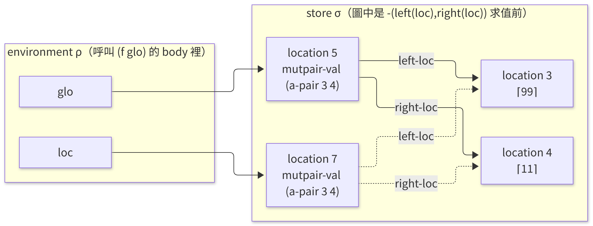
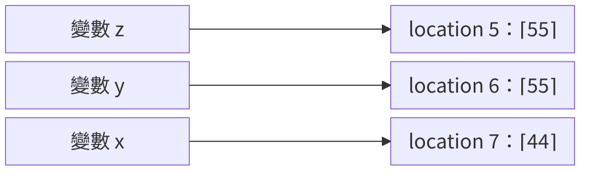
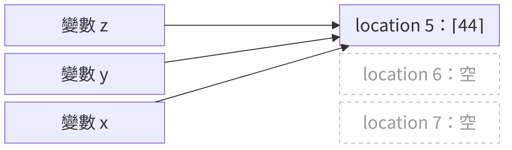
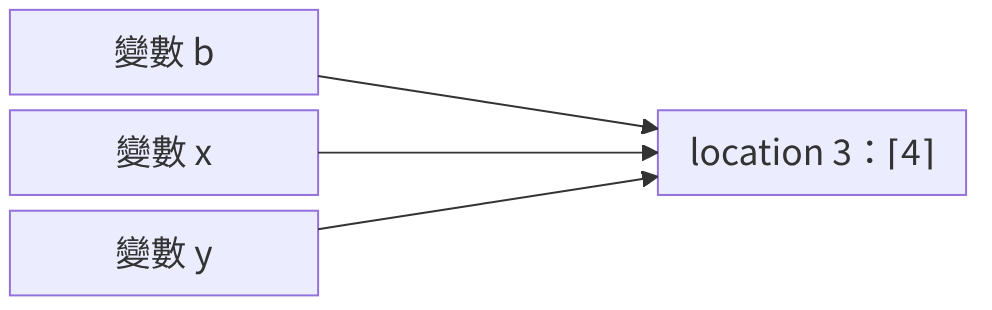

<!-- _class: lead -->

# 程式語言
## Programming Languages — Class 12

政大資碩 115-1　陳家宏

---

# 今天三堂課

- **第 1 堂**：§4.4 MUTABLE-PAIRS：pair 的 domain equation、兩種實作、Figure 4.11 的 trace；接到 §4.5 的 p.130（pp.124–130）
- **第 2 堂**：§4.5.1 CALL-BY-REFERENCE：定義、f／g／z 與 swap、`apply-procedure` 與 `value-of-operand`、`let`、aliasing（pp.131–136）
- **第 3 堂**：§4.5.2 call-by-name 與 call-by-need（pp.136–138）；實務上的 call-by-name 補充；HW5

<!-- 講者備註：
第 1 堂：概念 9 個（domain equation 與五個運算、Figure 4.9、Figure 4.10、兩層 location、§4.4.2 表示法、表示法切換、pointer 與長度、四角度表、p.130 的一句話；其中 natural 與 call-by-value 的對照是 class-11 的回顧）、停下來想 2 處（第 8、13 張）、約 43 分鐘
第 2 堂：概念 7 個（call-by-reference 的定義、共用 location、swap、apply-procedure／call-exp／value-of-operand 的分工、domain equation 不變、let 仍為 call-by-value、aliasing）、停下來想 1 處（第 21 張）、約 41 分鐘；第 30–32 張是 aliasing 範例的逐步解說，約 8 分鐘
三堂約 43、41、45 分鐘，最大差 4 分鐘。p.130 的兩張銜接投影片（第 16–17 張）放在第 1 堂尾端；不移動的話，三堂約 38、47、45 分鐘，最大差 9 分鐘，也在 10 分鐘內；第 1 堂超時就可以把這兩張挪回第 2 堂開頭
第 3 堂：概念 11 個（lazy evaluation 8、實務上的 call-by-name 3），另有 thunk 由來 1 張課外補充（第 38 張）、約 45 分鐘；第 45–47 張由你用 Clojure 與 Python 示範，各約 3 分鐘；超時先刪第 43 張
每張的分鐘數是我的假設，沒有實測。
程式都在 mwand/eopl3 的 chapter4 下用 racket -i -t top.scm 跑過（Racket v8.10）；Clojure 用 babashka v1.13.229；Python 用 3.12.3。 -->

---

# p.124：為什麼要在 IMPLICIT-REFS 上加 mutable pair？

- 課本的起點：在 Exercise 3.9 裡，課本加進語言的 list **不可變 (immutable)**，list 並沒有 Scheme 的 `set-car!`、`set-cdr!` 那類操作（p.124）
- 也因此，課文在 4.4 引入了 mutable pair，相當於 Scheme 裡 `set-car!`、`set-cdr!` 所作用的那種**可變 (mutable)** pair。

---

<!-- _class: small -->

# MUTABLE-PAIRS 有哪五個運算？domain equation 長什麼樣？

Mutable-Pair 的五種操作

```
newpair  : ExpVal × ExpVal → MutPair         
left     : MutPair → ExpVal                 
right    : MutPair → ExpVal                 
setleft  : MutPair × ExpVal → Unspecified
setright : MutPair × ExpVal → Unspecified
```
p.124：A pair consists of two locations, each of which is independently assignable.

Domain Equations 長成：

```
ExpVal= Int + Bool + Proc + MutPair
DenVal= Ref(ExpVal)
MutPair= Ref(ExpVal) × Ref(ExpVal)
```

repo 的語法：`newpair(e1, e2)`、`left(e)`、`right(e)`、`setleft e1 = e2`、`setright e1 = e2`。課本 p.127 的 `pair(11,22)` 在 repo 不能用。

---

<!-- _class: small -->

# 四角度表：MUTABLE-PAIRS 欄

| 角度 | IMPLICIT-REFS（class-11 第 3 張） | MUTABLE-PAIRS | 依據 |
|---|---|---|---|
| syntax | 加 `set`（p.116） | 再加五個運算：`newpair`、`left`、`right`、`setleft`、`setright` | p.124 |
| values | ExpVal = Int + Bool + Proc；DenVal = Ref(ExpVal)（p.113） | ExpVal 多一項 MutPair；DenVal 不變；MutPair = Ref(ExpVal) × Ref(ExpVal) | p.124 |
| environments | `extend-env` 存的是 Ref；`extend-env-rec` 分支配置 location（p.119） | 沒有改（DenVal 不變，這是我的解讀） | pp.119、124 |
| behavior | var-exp 查兩層；assign-exp；call、let 配置新 location（pp.117–118） | `value-of` 多五個 clause；`newpair` 配置兩個 location；`setleft`、`setright` 改 pair 內的 location，回傳 82、83（程式見第 6、7 張） | pp.124–126 |

p.124：`value-of` 多五行。其他 clause 沒有提到要改（我的解讀：不用改）。

<!-- 講者備註：這是 class-11 最後一張留下的問題（四角度表的 MUTABLE-PAIRS 欄要怎麼填），這裡直接給答案。behavior 欄的 82、83 與五個 clause 在第 7 張看程式；newpair 配置兩個 location 在第 6 張的 make-pair。 -->

---

<!-- _class: small -->

# Figure 4.9：用兩個 reference 實作 pair，要寫哪些程式？（p.125）

```scheme
(define-datatype mutpair mutpair?
  (a-pair  ;; variant name, also the constructor name
    (left-loc reference?) 
    (right-loc reference?)))

(define make-pair                       ; ExpVal × ExpVal → MutPair
  (lambda (val1 val2) (a-pair (newref val1) (newref val2))))

(define left                            ; MutPair → ExpVal
  (lambda (p) (cases mutpair p (a-pair (left-loc right-loc) (deref left-loc)))))

(define setleft                         ; MutPair × ExpVal → Unspecified
  (lambda (p val) (cases mutpair p (a-pair (left-loc right-loc) (setref! left-loc val)))))
```

| 函式 | 用到的 store 操作 |
|---|---|
| `make-pair` | 兩次 `newref` |
| `left`、`right` | `deref left-loc`、`deref right-loc` |
| `setleft`、`setright` | `setref! left-loc`、`setref! right-loc` |

<!-- 講者備註：p.125 的圖名是 Naive implementation of mutable pairs。`right`、`setright` 與 `left`、`setleft` 對稱，這裡省略。repo 對應的檔案是 pairval1.scm；repo 預設啟用另一版（第 12 張）。 -->

---

<!-- _class: small -->

# Figure 4.10：value-of 多哪五個 clause？（p.126）

```scheme
(newpair-exp (exp1 exp2)
  (let ((val1 (value-of exp1 env)) (val2 (value-of exp2 env)))
    (mutpair-val (make-pair val1 val2))))
(left-exp (exp1)
  (let ((val1 (value-of exp1 env)))
    (let ((p1 (expval->mutpair val1))) (left p1))))
(setleft-exp (exp1 exp2)
  (let ((val1 (value-of exp1 env)) (val2 (value-of exp2 env)))
    (let ((p (expval->mutpair val1)))
      (begin (setleft p val2) (num-val 82)))))
```

`right-exp`、`setright-exp` 與 `left-exp`、`setleft-exp` 對稱，`setright` 回傳 83。p.124：回傳 82、83 是任意的選擇。對照：`setref` 回傳 23（p.109），`set` 回傳 27（p.118）。

```
> (run "let p = newpair(1,2) in setleft p = 5")
(num-val 82)
> (run "let p = newpair(1,2) in setright p = 5")
(num-val 83)
```

---

# 停下來想：Figure 4.11 的程式值是多少？（p.127）

```
let glo = newpair(11,22)
in let f = proc (loc)
            begin
             setright loc = left(loc);
             setleft glo = 99;
             -(left(loc),right(loc))
            end
in (f glo)
```

1. 程式的值是多少？
2. `glo` 與 `loc` 綁到同一個 location 嗎？
3. 兩個修改各改了哪個 location？

**停下來想**（4 分鐘）。答案從下一張開始。

<!-- 講者備註：p.127 用 `let d1 = setright(loc, left(loc)) in let d2 = setleft(glo, 99) in ...` 串起兩個動作；這裡用 begin 串起（repo 的 tests.scm 裡的 example-for-mutable-pairs-section），兩個動作的順序相同。 -->

---

<!-- _class: small -->

# Figure 4.11–4.12 的 trace：location 5 與 location 7 各存什麼？（pp.127–128）

```
> (require "interp.scm" "store.scm")
> (instrument-newref #t)
> (run "let glo = newpair(11,22) in let f = proc (loc) ... in (f glo)")
...                                    (locations 0-2: init env)
newref: allocating location 3 with initial contents #(struct:num-val 11)
newref: allocating location 4 with initial contents #(struct:num-val 22)
newref: allocating location 5 with initial contents #(struct:mutpair-val #(struct:a-pair 3 4))
newref: allocating location 6 with initial contents #(struct:proc-val ...)
newref: allocating location 7 with initial contents #(struct:mutpair-val #(struct:a-pair 3 4))
(num-val 88)
```

| location | 誰配置的 |
|---|---|
| 0–2 | init env |
| 3、4 | `newpair(11,22)` 的兩格（左 11、右 22） |
| 5、6、7 | `let glo`（存 pair 值）、`let f`（存 closure）、呼叫 `(f glo)` 時 `loc` 的 location（也存 pair 值） |

結果 88（p.128）：`setright` 把 location 4 改成 11，`setleft` 把 location 3 改成 99，99 − 11 = 88。

<!-- 講者備註：這份輸出是把 pairvals.scm 切到 pairval1（Figure 4.9 的表示法）跑的，所以 location 5 存 (a-pair 3 4)，和課本 Figure 4.11–4.12 相同。repo 預設的版本在第 12–14 張。`#(struct:proc-val ...)` 那一行實際輸出很長，我把內容換成 ...。 -->

---

# 變數的 location 與 pair 內部的 location，各有幾層？



- `glo` 綁 location 5，`loc` 綁 location 7：兩個不同的 location
- 兩個 location 存的 pair 值，指向同一組 location 3、4
- 為什麼要在意：改 location 5 的內容只有 `glo` 看得到；改 location 3 或 4 的內容，`glo` 與 `loc` 都看得到

<!-- 講者備註：圖是我依 Figure 4.11–4.12 畫的，畫的是兩個修改都做完、`-` 還沒算的時候。圖的原始碼：img/pair-two-layers.mmd（Mermaid），設定檔 img/config.json。 -->

---

<!-- _class: small -->

# §4.4.2：兩個 location 一起配置，能怎麼利用？（p.126）

* （課文沒有明說）表示法一的每個 pair 值要存兩個 reference；表示法二只存一個。代價是假設右格緊接在左格後面，所以表示法和 store 的配置方式綁在一起。
* p.126（改寫）：pair 的兩個 location 各自可以 assign；**配置時兩個一起配置**：左格是某個 location，右格就是下一個 location。所以可以只用「指向左格的 reference」表示一個 pair。課本接著說：Nothing else need change。

| | 表示法一（Figure 4.9，p.125） | 表示法二（Figure 4.13，p.129） |
|---|---|---|
| 一個 pair 是 | `(a-pair left-loc right-loc)` | 一個 reference（左格的位置） |
| 右格在哪 | 存在 `a-pair` 裡 | 左格的位置 + 1 |
| 配置 | 兩次 `newref` | 兩次 `newref`（連續配置） |

這是我的解讀：這是 Ch2 的表示法選擇再次出現（class-03、class-04）。五個運算的介面不變，只換 pairval 那個檔案。

---

<!-- _class: small -->

# Figure 4.13：用一個 reference 表示 pair，要怎麼寫？（p.129）

```scheme
(define mutpair? (lambda (v) (reference? v)))

(define make-pair
  (lambda (val1 val2)
    (let ((ref1 (newref val1)))
      (let ((ref2 (newref val2))) ref1))))

(define left     (lambda (p) (deref p)))
(define right    (lambda (p) (deref (+ 1 p))))
(define setleft  (lambda (p val) (setref! p val)))
(define setright (lambda (p val) (setref! (+ 1 p) val)))
```

repo 的 `mutable-pairs/pairvals.scm` 有兩組 `require`／`provide`，一組指向 `pairval1.scm`（Figure 4.9），一組指向 `pairval2.scm`（Figure 4.13）。**repo 預設啟用的是 `pairval2.scm`。**

---

# 停下來想：換表示法後，同一支程式哪裡不同？

在 `mutable-pairs` 資料夾：

```
$ racket -i -t top.scm
> (require "interp.scm" "store.scm")
> (run "...第 8 張的程式...")
> (get-store-as-list)
```

1. 先用預設的 `pairval2.scm` 跑，記下程式的值與 store
2. 把 `pairvals.scm` 切到 `pairval1.scm`，重跑
3. 預測：程式的值相同嗎？store 的哪幾格內容會不同？

**停下來想**（4 分鐘，含操作）。答案在下一張。

---

<!-- _class: small -->

# 對答案：換表示法後，輸出與 store 有哪些不同？

| | pairval2（Figure 4.13，repo 預設） | pairval1（Figure 4.9） |
|---|---|---|
| 程式的值 | `(num-val 88)` | `(num-val 88)` |
| location 3、4 | 99、11 | 99、11 |
| location 5（`glo`） | `(mutpair-val 3)` | `(mutpair-val (a-pair 3 4))` |
| location 7（`loc`） | `(mutpair-val 3)` | `(mutpair-val (a-pair 3 4))` |

`(get-store-as-list)` 的輸出摘錄：

```
pairval2:  (list 5 (mutpair-val 3))                        pairval1:  (list 5 (mutpair-val (a-pair 3 4)))
           (list 7 (mutpair-val 3))                                   (list 7 (mutpair-val (a-pair 3 4)))
```

有差別的只有 pair 值本身的表示法。`value-of` 與其他檔案沒有改（p.126：Nothing else need change）。

---

<!-- _class: small -->

# 用「指向第一格的 pointer」表示一塊記憶體，缺什麼資訊？（p.128）

* p.128（改寫）：任何聚合物件都可以用「指向第一格的 pointer」表示；但 pointer 本身無法指出一塊記憶體的範圍，要另外補長度資訊（見 Exercise 4.30）。缺少長度資訊，是 out-of-bounds 寫入這類經典安全錯誤的來源。

- Figure 4.13 的 `right` 算 `(+ 1 p)`：它假設 `p` 是某個 pair 的左格
- Exercise 4.29、4.30（pp.128–130）把這個想法推到 array：`arrayref`、`arrayset`、`arraylength`，並要求檢查範圍

---

<!-- _class: small -->

# 接到 §4.5：formal parameter 綁到什麼？（p.130）

* The expressed values are the **possible values of expressions**.（p.61）
* The denoted values are the **values bound to variables**.（p.61）
* p.130（改寫）：procedure body 執行時，formal parameter 綁到一個 denoted value，這個值來自 procedure call 的 actual parameter。已經看過兩種傳參方式：

| 方式 | formal parameter 的 denoted value | 出處 |
|---|---|---|
| natural | 就是 actual parameter 的 expressed value | Ch3，p.75；p.130 |
| call-by-value | 一個 reference，指向放著 actual parameter 的 expressed value 的 location。 | §4.3；p.130 |
| call-by-reference | ？ | 第 28 張補上 |

接 class-11 第 19 張：natural 對應 `[var=val]ρ`，call-by-value 對應 `[var=l]ρ [l=val]σ`。

---

# p.130 的 `(p a)`：call-by-value 下得多少？

```
let p = proc (x) set x = 4
in let a = 3
   in begin (p a); a end
```

```
> (run "let p = proc (x) set x = 4 in let a = 3 in begin (p a); a end")
(num-val 3)
```

p.130（改寫）：`x` 的 reference 一開始存著和 `a` 相同的值，但兩個 reference 不同，所以對 `x` 賦值改不到 `a`。呼叫端看不到被呼叫端對參數做的 `set`。另一方面，若 `x` 儲存的值是 mutable pair，`setleft`、`setright` 對 pair 內容的修改，呼叫端看得到（對照第 10 張）。

以上在 `implicit-refs` 資料夾跑。

---

<!-- _class: small -->

# 第 1 堂回顧

1. **domain equation**：ExpVal 多 MutPair；MutPair = Ref(ExpVal) × Ref(ExpVal)；DenVal 不變（p.124，第 4、5 張）
2. **四角度表**：MUTABLE-PAIRS 改了 syntax、values、behavior 三格（第 5 張）
3. **兩種實作**：Figure 4.9 存兩個 reference；Figure 4.13 存左格的 reference，右格是 +1；`value-of` 的五個 clause 不用改（pp.125–129，第 6–14 張）
4. **兩層 location**：`glo` 與 `loc` 綁到不同的 location，但 pair 值指向同一組 location，所以改 pair 的欄位兩邊都看得到（pp.127–128，第 9、10 張）
5. **pointer 與長度**：用左格的位置表示聚合物件，不帶長度資訊（p.128，第 15 張）
6. **p.130 的銜接**：call-by-value 下，對參數做 `set` 呼叫端看不到；參數裡 pair 的內容被修改，呼叫端看得到（p.130，第 17 張）

---

<!-- _class: lead -->

# 第 2 堂
## §4.5.1 CALL-BY-REFERENCE

---

# call-by-reference 怎麼定義？（p.131）

p.131（改寫）：

| operand | formal parameter 綁到 |
|---|---|
| 變數，例：`a` | `a` 的 location |
| 其他 expression，例：`-(a,1)`、`3` | 新 location，放 operand 的值（和 call-by-value 相同） |

回到 `(p a)`，在 `call-by-reference` 資料夾跑：

```
> (run "let p = proc (x) set x = 4 in let a = 3 in begin (p a); a end")
(num-val 4)
```

p.131：`x` 的賦值等於對 `a` 賦值，所以程式的值是 4。

p.130：caller 與 callee 之間的 isolation 通常是好的；有些時候需要把 location 傳給 procedure，讓它去賦值。

---

# 停下來想：f／g／z 的值，與 x、y、z 各綁哪個 location？（p.131）

```
let f = proc (x) set x = 44
in let g = proc (y) (f y)
   in let z = 55
      in begin (g z); z end
```

在 call-by-reference 下：

1. 程式的值是多少？
2. 進入 g 的 body、再進入 f 的 body 時，`y`、`x` 各綁到哪個 location？`z` 呢？

init env 配置 location 0–2（class-11 第 22 張），`f`、`g`、`z` 各配置一格。

**停下來想**（5 分鐘）：先自己畫 environment 與 store，再看下一張。

---

<!-- _class: small -->

# Figure 4.14–4.15：x、y、z 綁到哪裡？（pp.131、134–135）

```
> (require "interp.scm" "store.scm")
> (instrument-newref #t)
> (instrument-let #t)
> (run "let f = proc (x) set x = 44 in let g = proc (y) (f y) in let z = 55 in begin (g z); z end")
...
entering body of proc y with env = ((y 5) (f 3) (i 0) (v 1) (x 2))
entering body of proc x with env = ((x 5) (i 0) (v 1) (x 2))
...
(num-val 44)
```

下一張用圖並排比較：這支程式在 `implicit-refs`（call-by-value）下得 `(num-val 55)`。

<!-- 講者備註：trace 中每個 entering 之後還有 store 內容，這裡省略（用 ... 表示）。 -->

---

# 同一支程式，兩種傳參下的 location




上：call-by-value，值 `(num-val 55)`。下：call-by-reference，三個變數共用 location 5；「空」表示沒有配置。圖是我畫的。

<!-- 講者備註：圖的原始碼 img/fgz-cbv.mmd、img/fgz-cbr.mmd，設定檔 img/config.json。兩張圖的變數與 location 順序對齊，下圖的 location 6、7 用虛線框標「空」（沒有配置）。圖用 Mermaid 的 block-beta 畫，因為一般 flowchart 的節點順序無法固定。 -->

---

<!-- _class: small -->

# call-by-reference 用來做什麼？（pp.131–132）

p.131（改寫）：典型用法是回傳多個值：procedure 用一般方式回傳一個值，其他的值用賦值寫進以 call-by-reference 傳入的參數。另一個例子是 swap：

```
let swap = proc (x) proc (y)
             let temp = x
             in begin set x = y; set y = temp end
in let a = 33
   in let b = 44
      in begin ((swap a) b); -(a,b) end
```

| 直譯器 | 結果 | 依據 |
|---|---|---|
| `call-by-reference` | `(num-val 11)` | p.132 |
| `implicit-refs`（call-by-value） | `(num-val -11)` | p.132 |

p.132（改寫）：在 call-by-value 下，swap 裡的賦值對 `a`、`b` 沒有影響。

---

<!-- _class: small -->

# `apply-procedure` 為什麼要改？（p.132）

唯一需要修改的地方（p.132 原文：The only thing that changes）：**the allocation of new locations**

哪些 operand 的求值要配置新 location，見第 28 張的表。

p.132：`apply-procedure` 必須改，因為 "no longer true that a new location is allocated for every procedure call"。

```scheme
;; IMPLICIT-REFS (p.119)                     ;; CALL-BY-REFERENCE (p.132)
;; Proc × ExpVal → ExpVal                    ;; Proc × Ref → ExpVal
(define apply-procedure                      (define apply-procedure
  (lambda (proc1 val)                          (lambda (proc1 val)
    (cases proc proc1                            (cases proc proc1
      (procedure (var body saved-env)              (procedure (var body saved-env)
        (value-of body                               (value-of body
          (extend-env var (newref val)                 (extend-env var val
                          saved-env))))))                              saved-env))))))
```

差別只有一行：`(newref val)` 換成 `val`，第二個參數的型別由 ExpVal 變成 Ref。配置不再發生在 `apply-procedure`，它收到的已經是 location。

---

<!-- _class: small -->

# `call-exp` 要改哪裡？（p.132）

p.132：配置的責任 "must be moved upstream, to the call-exp line in value-of"，因為那裡 "will have the information to make that decision"。

```diff
 (call-exp (rator rand)
   (let ((proc (expval->proc (value-of rator env)))
-        (arg (value-of rand env)))
+        (arg (value-of-operand rand env)))
     (apply-procedure proc arg)))
```

- `-`：PROC、IMPLICIT-REFS 的 `call-exp`（p.80）；`+`：CALL-BY-REFERENCE 的 `call-exp`（p.132），多了一個 `value-of-operand`
- 我的解讀：「做決定需要的資訊」是 operand 的語法形式。`call-exp` 手上的 `rand` 還是 expression，看得出它是不是變數；到了 `apply-procedure`，只剩一個值或一個 Ref，看不出它從哪來
- 求值順序沒變：`rator` 先、operand 後（Racket 的 `let` 由左到右）

---

<!-- _class: small -->

# `value-of-operand` 怎麼決定配不配置？（p.132）

p.132：`value-of-operand` "checks to see if the operand is a variable"。

```scheme
;; value-of-operand : Exp × Env → Ref
(define value-of-operand
  (lambda (exp env)
    (cases expression exp
      (var-exp (var) (apply-env env var))
      (else (newref (value-of exp env))))))
```

- operand 是變數：回傳它綁的 reference，不配置。`apply-env` 回傳的是 DenVal，在 IMPLICIT-REFS 裡就是 Ref（class-11 第 8 張）
- operand 是其他 expression：求值，再 `newref`

repo 對應的檔案：`call-by-reference/interp.scm`。

---

<!-- _class: small -->

# domain equation 改了嗎？哪裡改了？（p.132）

```
ExpVal = Int + Bool + Proc
DenVal = Ref(ExpVal)
```

p.132（改寫）：兩條等式和 call-by-value 相同。改變的是配置新 location 的時機：

| 傳參方式 | 何時配置新 location |
|---|---|
| call-by-value | 每次求值一個 operand |
| call-by-reference | 每次求值一個不是變數的 operand |

接 class-10 的總表：CALL-BY-REFERENCE 那一列的「新 identity 誕生於」就是這一格。

回到第 16 張的表，第三列補上：

| 方式 | formal parameter 的 denoted value | 出處 |
|---|---|---|
| call-by-reference | operand 是變數：那個變數的 location；其他：新 location，放 operand 的值 | p.131 |

---

<!-- _class: small -->

# call-by-reference 的語言裡，`let` 綁的變數是哪一種？（p.133）

p.133（改寫）：課本可以把 `let` 也改成類似的做法，但刻意不改，讓語言裡還留著一些 call-by-value 的功能。在 `call-by-reference` 資料夾跑三段程式：

```
> (run "let a = 3 in let b = a in begin set b = 4; a end")                      ; P1
(num-val 3)
> (run "let p = proc (x) set x = 4 in let a = 3 in begin (p a); a end")         ; P2
(num-val 4)
> (run "let p = proc (x) set x = 4 in let a = 3 in begin (p -(a,0)); a end")    ; P3
(num-val 3)
```

| 程式 | 結果 | 原因 |
|---|---|---|
| P1 | 3 | `let b = a` 為 `a` 的值配置新 location（`let` 是 call-by-value，p.133） |
| P2 | 4 | `(p a)` 的 operand 是變數，`x` 綁到 `a` 的 location |
| P3：P2 的 `(p a)` 換成 `(p -(a,0))` | 3 | operand 不是變數，`x` 綁到新 location，放 `-(a,0)` 的值 |

---

<!-- _class: small -->

# `((p b) b)` 這個程式在做什麼？（p.133）

```
let b = 3
in let p = proc (x) proc (y)
             begin set x = 4; y end
   in ((p b) b)
```

- `p` 收一個參數 `x`，回傳另一個 procedure `proc (y) ...`。這個語言的 procedure 一次只收一個參數，傳兩個值就要這樣寫
- 回傳的 procedure 記得 `x`：它是一個 closure，environment 裡有 `x`（Ch3，p.79）
- `begin set x = 4; y end`：先把 `x` 設成 4，再回傳 `y` 的值
- `((p b) b)` 是兩次呼叫。下面的寫法與它等價（我的改寫，課本沒有；我在 call-by-reference 與 implicit-refs 兩個直譯器都跑過，結果與原程式相同）：

```
let q = (p b)     % call 1: pass b as x; q is a procedure waiting for y
in (q b)          % call 2: pass b as y; now the body runs
```

問題：在 call-by-reference 下，`x` 與 `y` 收到的是同一個 location 嗎？下一張走一遍。

---

<!-- _class: small -->

# call-by-reference：逐步走 `((p b) b)`（p.133）

| 步驟 | 發生什麼 | 新的綁定 | store |
|---|---|---|---|
| 0 | `let b = 3`、`let p = ...` | `b` → location 3，`p` → location 4 | location 3 = 3 |
| 1 | `(p b)`：operand `b` 是變數，傳它的 location | `x` → location 3 | 沒有新 location |
| 2 | `(q b)`：operand `b` 又是變數，又傳 location 3 | `y` → location 3 | 沒有新 location |
| 3 | `set x = 4` | 無 | location 3 = **4** |
| 4 | 回傳 `y` | 無 | 讀 location 3，得 **4** |

在 `call-by-reference` 資料夾用 `(instrument-let #t)` 看 environment：

```
entering body of proc x with env = ((x 3) (b 3) (i 0) (v 1) (x 2))
entering body of proc y with env = ((y 3) (x 3) (b 3) (i 0) (v 1) (x 2))
(num-val 4)
```

最後的 `(x 2)` 是 init env 本來就有的 `x`（class-11），與程式裡的 `x` 無關。`q` 是我替 `(p b)` 回傳的 procedure 取的名字，原程式沒有。

---

<!-- _class: small -->

# `x` 與 `y` 是同一個 location 嗎？（aliasing，p.133）



在 call-by-reference 下，`b`、`x`、`y` 共用 location 3，所以 `set x = 4` 之後，讀 `y` 得 4。圖是我畫的，畫的是 `set x = 4` 之後、讀 `y` 之前。

p.133（改寫）：這叫 variable aliasing，`x` 與 `y` 是同一個 location 的兩個名字。一般不預期對一個變數賦值會改變另一個變數，所以 aliasing 讓程式很難理解。

心算的做法（我的整理）：先找出每個變數綁到哪個 location；`set` 只改它指的 location；讀變數時，看那個 location 現在存什麼。

<!-- 講者備註：圖的原始碼 img/alias-cbr.mmd，設定檔 img/config.json；與第 23 張的 fgz 圖同一種畫法（block-beta）。 -->

---


<!-- _class: small -->

# 第 2 堂回顧

1. **三種傳參**：natural、call-by-value、call-by-reference 的差別，在 formal parameter 綁到什麼（pp.130–131，第 16、28 張）
2. **call-by-reference**：operand 是變數時傳它的 location（f／g／z 裡 `x`、`y`、`z` 共用 location 5）；operand 不是變數時，與 call-by-value 相同（p.131，第 20–23 張）
3. **swap 與回傳多個值**：swap 在 call-by-reference 下得 11，在 call-by-value 下得 −11（pp.131–132，第 24 張）
4. **實作**：`apply-procedure` 改接 Ref；配置的決定移到 `call-exp` 用的 `value-of-operand`（p.132，第 25–27 張）
5. **domain equation 不變**：改的是配置新 location 的時機（p.132，第 28 張）
6. **`let` 仍是 call-by-value**：`let` 綁的變數配置新 location（p.133，第 29 張）
7. **variable aliasing**：`x`、`y` 是同一個 location 的兩個名字，讓程式很難理解（p.133，第 30–32 張）

---

<!-- _class: lead -->

# 第 3 堂
## §4.5.2 call-by-name 與 call-by-need、實務補充、HW5

---

# 前面的機制 eager 到哪裡？lazy evaluation 的起點是什麼？（p.136）

p.136（改寫）：目前談過的傳參方式都是 eager：呼叫前一定先找到每個 operand 的值。lazy evaluation 讓 operand 到 procedure body 需要時才求值；body 用不到的參數，就不必求值。課本說這可能避免不終止。

| 傳參方式 | operand 何時求值 |
|---|---|
| natural、call-by-value | 呼叫前 |
| call-by-reference | operand 不是變數時，呼叫前 |
| call-by-name、call-by-need（今天） | body 用到 formal parameter 時 |

為什麼要在意（課本，p.136）：有些程式在 eager 的傳參下不會終止，在 lazy 下會終止。下一張看課本的例子。

---

<!-- _class: small -->

# `(f (infinite-loop 0))` 的值是多少？（p.136）

```
letrec infinite-loop (x) = (infinite-loop -(x,-1))
in let f = proc (z) 11
   in (f (infinite-loop 0))
```

p.136 寫 `infinite-loop(-(x,-1))`，repo 的 grammar 要寫 `(infinite-loop -(x,-1))`。

1. **先看 `f`**：body 是 `11`，用不到 `z`。課本："never refers to its argument and always returns 11"。所以只要 `f` 被呼叫，結果就是 11，不管 operand 是什麼
2. **再看 `infinite-loop`**：每次用 `x+1` 再呼叫自己，永遠回不來（"never terminates"）。所以 `(infinite-loop 0)` 一旦被求值，就不終止
3. **合起來看**：operand 要不要在呼叫 `f` 之前求值？先求值（eager，目前的機制）：卡在 `(infinite-loop 0)`。用到才求值（lazy）：`f` 用不到 `z`，直接得 11

在三個資料夾實跑：
```
call-by-need         (num-val 11)
implicit-refs        不終止，要 Ctrl-C
call-by-reference    不終止，要 Ctrl-C
```

<!-- 講者備註：p.136 的程式碼寫 (infinite-loop 0)，正文寫 (infinite-loop 1) 沒被求值，兩者指同一件事。 -->

---

<!-- _class: small -->

# frozen、thawed 與 thunk（p.136）

p.136（改寫）：lazy evaluation 下，bound variable 對應到一個還沒求值的 operand；body 需要它的值時，才求值。

- 課本的用語：operand 沒求值就傳進去，稱為 **frozen**（"passed unevaluated"）；procedure 求值它時，稱為 **thawed**（thaw 是動詞「解凍」，thawed 是它的過去分詞；"evaluates it"）
- 為什麼叫 frozen（我的解讀）：像把 operand 冰起來，冰著的時候什麼都不會發生；body 需要時才解凍（thaw），這時才開始求值。上一張的 `(infinite-loop 0)` 一直冰著，所以沒有卡住

解凍求值時，operand 裡的變數要在呼叫處的 environment 裡找（見 p.137 的 `value-of-operand exp env`），所以 expression 與 environment 要一起存。課本因此定義 thunk：

```scheme
(define-datatype thunk thunk?
  (a-thunk (exp1 expression?) (env environment?)))
```

`(infinite-loop 0)` 被包成 `(a-thunk (infinite-loop 0) env)`；`f` 沒有用到 `z`，這個 thunk 從來沒有被解凍。

<!-- 講者備註：課本 p.136：A thunk consists of an expression and an environment。我的解讀：thunk 像沒有 parameter 的 closure；Ch3 的 closure 存 parameter、body、environment（p.79 的 procedure）。 -->

---

<!-- _class: small -->

# thunk 這個名字從哪來？（課外補充）

課本 p.136 只定義 thunk，沒有說名字的由來。以下來自 Jargon File 與 FOLDOC 的 thunk 詞條（兩者內容相同）：

- **發明**：P. Z. Ingerman 在 1961 年為 ALGOL 60 的 procedure call 發明 thunk。呼叫時，如果 formal parameter 的位置傳進來的是一個運算式，編譯器就產生一小段程式，算出這個運算式，並把結果的位址放在固定的地方
- **名字的由來（Jargon File 的說法）**：設計者在深夜討論後發現，ALGOL 60 引數的型別可以在編譯時先想好，求值機制因此變簡單。這件事 "already been thought of"，所以取名 thunk，笑稱是 "the past tense of 'think' at two in the morning"
- **諧音**：thunk 是 think 的玩笑式過去式；think 的標準過去式是 thought
- **後來的意思**：一個運算式連同它的 environment 被凍結（frozen），等需要時才求值；解凍的過程叫 forcing（FOLDOC）。這就是 p.136 的 thunk

命名的故事出自 Jargon File（俚語詞典）。我沒有找到 Ingerman 的原論文（CACM，1961）對命名的說明。

<!-- 講者備註：來源：https://foldoc.org/thunk；https://jargon.net/jargonfile/t/thunk.html。FOLDOC 對 thunk 的第二個定義用「frozen together with its environment」，與 p.136 的 frozen 用語相同；但這不能證明 EOPL 為什麼選 frozen 這個詞，第 37 張的「為什麼叫 frozen」仍是我的解讀。Jargon File 另有一條說法：thunk 是資料碰到 stack 的聲音，詞典自己稱為傳說（myth）。 -->

---


<!-- _class: small -->

# DenVal = Ref(ExpVal + Thunk)：store 裡放什麼？（p.137）

```
ExpVal = Int + Bool + Proc
DenVal = Ref(ExpVal + Thunk)
```

p.137（改寫）：要同時容納 lazy evaluation、effect 與 eager evaluation（`let`），所以 denoted value 是 reference，指向的 location 裡放 expressed value 或 thunk。

| | 能放進 location | 是 ExpVal |
|---|---|---|
| Int、Bool、Proc | 是 | 是 |
| Thunk | 是 | 否 |

回扣 p.103（改寫）：storable values 通常（但不一定）和 expressed values 相同，這是語言設計的選擇。我的解讀：前面幾個語言的 storable values 與 ExpVal 相同；Thunk 讓兩者第一次出現差異。

---

<!-- _class: small -->

# `value-of-operand` 與 `value-of-thunk`（p.137）

```scheme
;; call-by-reference (p.132)                  ;; call-by-name / call-by-need (p.137)
(define value-of-operand                      (define value-of-operand
  (lambda (exp env)                             (lambda (exp env)
    (cases expression exp                         (cases expression exp
      (var-exp (var) (apply-env env var))           (var-exp (var) (apply-env env var))
      (else                                         (else
        (newref (value-of exp env))))))               (newref (a-thunk exp env))))))
```

- 變數：和 call-by-reference 相同，傳它的 reference
- 其他 operand：不求值，存成 thunk，放進新 location（p.137）

新增的 `value-of-thunk`：在 thunk 存的 environment 裡，對它存的 expression 求值（p.137）：

```scheme
;; value-of-thunk : Thunk → ExpVal
(define value-of-thunk
  (lambda (th)
    (cases thunk th
      (a-thunk (exp1 saved-env) (value-of exp1 saved-env)))))
```

repo 對應的檔案：`call-by-need/interp.scm`。

---

<!-- _class: small -->

# `var-exp`：call-by-name 與 call-by-need 差在哪一段？（pp.137–138）

```scheme
;; call by name (p.137)                       ;; call by need (p.138)
(var-exp (var)                                (var-exp (var)
  (let ((ref1 (apply-env env var)))             (let ((ref1 (apply-env env var)))
    (let ((w (deref ref1)))                       (let ((w (deref ref1)))
      (if (expval? w)                               (if (expval? w)
          w                                             w
          (value-of-thunk w)))))                        (let ((val1 (value-of-thunk w)))
                                                          (begin
                                                            (setref! ref1 val1)
                                                            val1))))))
```

差在 `setref!`：call-by-need 把求值結果寫回同一個 location，之後不再求值。課本把這稱為 memoization 的一例（p.138）：記住算過的結果，下次直接用。

---

<!-- _class: small -->

# 四角度表：CALL-BY-NAME／NEED 欄（pp.136–138）

| 角度 | 改了什麼（相對 CALL-BY-REFERENCE） |
|---|---|
| syntax | 沒有改 |
| values | ExpVal 不變；DenVal 由 Ref(ExpVal) 變成 Ref(ExpVal + Thunk) |
| environments | 沒有改，仍是變數對 Ref |
| behavior | ・`var-exp`（有改）：遇到 thunk 就呼叫新增的 `value-of-thunk`（在 thunk 的 environment 裡求值）；call-by-need 再 `setref!` 把值寫回<br>・`call-exp`（沒改）：它呼叫的 `value-of-operand` 有改，operand 不是變數時 `newref (a-thunk exp env)`，不求值<br>・`apply-procedure`、`let` 沒改 |

對照第 5 張（MUTABLE-PAIRS 的四角度表）。

<!-- 講者備註：頁碼：values 在 pp.136–137；value-of-operand、value-of-thunk 在 p.137；var-exp 在 pp.137–138；let 仍是 eager 在 p.137。syntax 與 environments 沒有改：課本沒有提要改；repo 的 lang.scm、environments.scm 與 call-by-reference 的版本只差註解和空白（我的比對，屬於我的解讀）。 -->

---


<!-- _class: small -->

# 同一個程式跑完，location 4 放的是 thunk 還是值？

```
let f = proc (x) -(x,x)
in (f -(5,3))
```

init env 佔 location 0–2，`f` 在 location 3，operand `-(5,3)` 不是變數，存成 thunk 放在 location 4。

| 版本 | 程式的值 | 跑完後 location 4 的內容 |
|---|---|---|
| call-by-need（repo 的 `call-by-need`） | `(num-val 0)` | `(num-val 2)` |
| call-by-name（第 41 張左邊的 `var-exp`） | `(num-val 0)` | `(a-thunk (diff-exp (const-exp 5) (const-exp 3)) ...)` |

```
> (require "store.scm")
> (run "let f = proc (x) -(x,x) in (f -(5,3))")
(num-val 0)
> (get-store-as-list)
```

`x` 第一次被用到時，call-by-need 把 thunk 換成 2，call-by-name 留著 thunk，每次用到都重算。沒有 effect 時答案相同，差別只在 store 裡（這張是我的設計）。

<!-- 講者備註：`...` 是輸出中 environment 的部分，實際很長。 -->

---

<!-- _class: small -->

# lazy evaluation 為什麼多出現在沒有 effect 的語言？（p.138）

p.138（改寫）：

- 沒有 effect 時，lazy evaluation 讓推理很簡單：把 call 換成 procedure body，body 裡的 formal parameter 換成對應的 operand。課本說這是 lambda calculus 的 β-reduction（課本只用這個詞，沒有定義）
- call-by-name 與 call-by-need 讓求值順序難以判斷；有 effect 時，求值順序是理解程式的關鍵
- 所以 lazy evaluation 常見於沒有 effect 的 functional language，其他語言少見

呼應 4.2.1 的 diff-exp（p.107）：store 從 exp1 傳給 exp2。順序換了，σ 的傳法也換了：

```
(value-of exp1 ρ σ0) = (val1, σ1)
(value-of exp2 ρ σ1) = (val2, σ2)
(value-of (diff-exp exp1 exp2) ρ σ0) = (val1 - val2, σ2)
```

---
<!-- _class: small -->

# 實務上的 call-by-name（1）：怎麼延遲一段 expression？

課外補充。想做的事：取得資源後、釋放資源前，執行一段 expression（開檔、使用、關檔）。

**call-by-value**：operand 在呼叫前先求值（第 35 張）。

```clojure
(defn run-eager [result]
  (println "acquire")
  (println "release")
  result)

(run-eager (do (println "using") 42))
;; using / acquire / release     <- "using" runs before "acquire"
```

**包成 `(fn [] ...)`**（thunk，第 37 張），到需要時才呼叫：

```clojure
(defn run-with-resource [thunk]
  (println "acquire")
  (try (thunk) (finally (println "release"))))

(run-with-resource (fn [] (println "using") 42))
;; acquire / using / release     -> 42
```

這就是 call-by-name：operand 不先求值，body 需要時才求值（p.137）。

<!-- 講者備註：Clojure 用 babashka v1.13.229 實測。`(fn [] ...)` 是沒有 parameter 的 closure，與第 37 張的 thunk 同形（我的解讀）。 -->

---

<!-- _class: small -->

# 實務上的 call-by-name（2）：有 macro 之後，`(fn [] ...)` 可以省略

macro 收到的是還沒求值的程式碼，可以自己決定放在哪裡（我的解讀：這是編譯期的 call-by-name）。

```clojure
(defmacro with-resource [& body]
  `(run-with-resource (fn [] ~@body)))

(with-resource (println "using") 42)    ; no (fn [] ...) at the call site
;; acquire / using / release     -> 42

(macroexpand '(with-resource (println "using") 42))
;; (user/run-with-resource (clojure.core/fn [] (println "using") 42))
```

Clojure 內建的 `with-*` 也是這個形狀：

| macro | 在 body 前後做什麼 | 例子 |
|---|---|---|
| `with-open` | body 結束後關閉資源 | `(with-open [r (java.io.StringReader. "abc")] (slurp r))` → `"abc"` |
| `binding` | body 內暫時改 dynamic var，結束後還原 | `(binding [*level* 1] *level*)` → 1，之後 `*level*` 回到 0 |
| `with-out-str` | body 內的輸出收集成字串 | `(with-out-str (println "hi"))` → `"hi\n"` |

<!-- 講者備註：`*level*` 先用 (def ^:dynamic *level* 0) 定義。也可以不經過函式，直接把 body 放進 try：(defmacro with-resource* [& body] `(do (println "acquire") (try ~@body (finally (println "release")))))，macroexpand 得 (do (clojure.core/println "acquire") (try (println "using") 42 (finally (clojure.core/println "release"))))。以上都在 babashka v1.13.229 實測。 -->

---

<!-- _class: small -->

# 實務上的 call-by-name（3）：它在解決什麼問題？

- **Resource／Context management**：body 一定要在 setup 之後、cleanup 之前執行，丟例外時 cleanup 也要執行。所以 body 不能在呼叫前先求值，要延遲，這就是 call-by-name 派上用場的地方
- 常見場景：關檔、關連線、lock、transaction、暫時改變 context（`binding`）、收集輸出

Python 的 `with` 也是類似的用法：

```python
from contextlib import contextmanager

@contextmanager
def resource():
    print("acquire")
    try:
        yield
    finally:
        print("release")

with resource():
    print("using")
# acquire / using / release
```

我的解讀：Python 的 `with` 由語法提供，body 是縮排的區塊；Clojure 的 `with-*` 由 macro 提供。兩者解決同一個問題。

<!-- 講者備註：Python 3.12.3 實測；例外情形下同樣先 release 再被 except 接到。Clojure 實測：(with-resource (throw (ex-info "boom" {}))) 先印 acquire，再印 release，最後才被 catch 接到。Python 的 `with open(...) as f` 也是同樣的 context manager 機制。 -->

---


<!-- _class: small -->

# HW5：四題課本習題

| 題號 | 難度 | 頁碼 | 內容 |
|---|---|---|---|
| 4.8 | ★ | p.112 | 指出 store 的實作中，哪些操作花線性時間（對照常數時間） |
| 4.28 | ★★ | p.128 | 寫出五個 mutable pair 運算的規格 |
| 4.37 | ★★ | pp.135–136 | 實作 call-by-value-result，並寫出一個與 call-by-reference 答案不同的程式 |
| 4.39 | ★ | p.138 | 構造一個 call-by-name 與 call-by-need 答案不同的程式 |

**繳交期限：week 14 上課前，上傳 Moodle。**

硬性要求同 HW3（contract、先寫規格、自己補測試）。

- 4.8：對照 Figure 4.1、4.2（pp.111–112）
- 4.28：規格的記號用 σ（p.107）
- 4.37：call-by-value-result 的定義在習題原文裡；以 repo 的 `call-by-reference` 為底；附上測試程式與兩種直譯器的結果
- 4.39：附上程式與兩種版本的結果，說明差異從哪裡來

---

<!-- _class: small -->

# 本日結論

1. **MUTABLE-PAIRS**：MutPair = Ref(ExpVal) × Ref(ExpVal)；變數的 location 與 pair 內部的 location 是兩層（pp.124–128，第 4、10 張）
2. **pair 的兩種表示法**：存兩個 reference，或存左格的 reference；`value-of` 不用改（pp.125–129，第 14 張）
3. **call-by-reference**：operand 是變數時傳它的 location；非變數時，行為與 call-by-value 一樣；domain equation 不變，改的是配置時機（pp.131–132，第 20、28 張）
4. **lazy evaluation 的起點**：operand 到用才求值，可以避免不終止（p.136，第 35、36 張）
5. **thunk**：沒求值的 operand 稱為 frozen，連同 environment 存成 thunk；operand 不是變數時才存成 thunk，變數仍傳它的 reference；call-by-name 每次重算，call-by-need 求值後寫回同一個 location（pp.136–138，第 37–42 張）
6. **沒有 effect 時答案相同**：差別在 store；有 effect 時，求值順序影響結果（p.138，第 43、44 張）
7. **補充**：實務上的 call-by-name：把 expression 包成 `(fn [] ...)` 延遲執行，macro 可以省略 `fn`；常用在 resource／context management，例如 Clojure 的 `with-open`、Python 的 `with`（第 45–47 張）

---

<!-- _class: lead -->

# 問題時間

1. Email: laurence@replware.dev
2. Office Hour: 週四下午 1:00~2:00，請先跟我約
3. 助教：邵振皓 (負責改作業、監考)
4. 助教信箱：114971020@nccu.edu.tw
5. 作業一律上傳 Moodle
