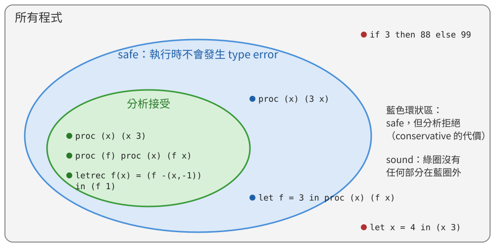
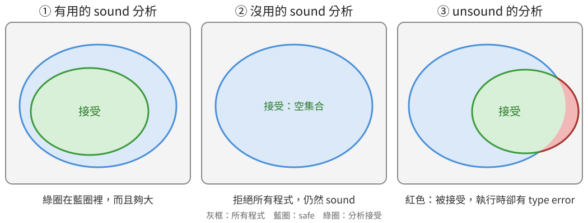

<!-- _class: lead -->

# 程式語言
## Programming Languages — Class 13

政大資碩 115-1　陳家宏

---

# 今天三堂課

| 時段 | 內容 |
|---|---|
| 第 1 堂 | Ch7 開場：safe evaluation、type error、sound（pp.233–235） |
| 第 2 堂 | §7.1 Values and Their Types：type structure、Type 的文法、Definition 7.1.1、Exercise 7.1（pp.235–238） |
| 第 3 堂 | §7.2 Assigning a Type to an Expression：`type-of` 的規格與規則、derivation、proc 規則的缺口（pp.238–240）；下週預告 |

<!-- 講者備註：
第 1 堂：概念 10 個（safe evaluation、五個條件、type error、條件與 extractor 的對應、不算 type error 的失敗、sound、接受夠多的程式、safe 一般而言不可判定（我的解讀）、會被拒絕的可執行程式、proc 的值不求值 body（class-06 回顧））、停下來想 1 處（第 9 張）、約 40 分鐘
第 2 堂：概念 7 個（type structure、Type 的文法、值與型別的例子、沒有型別的值、型別裡的 t、Definition 7.1.1、一個值的多個型別）、停下來想 2 處（第 19、26 張；Exercise 7.1 約 12 分鐘）、約 39 分鐘
第 3 堂：概念 10 個（type-of 的規格、值的型別與運算式的型別、well-typed、四條簡單規則、let 與 if、call、四角度對照、derivation、proc 規則、兩種設計；其中 clj-kondo 是課外補充）、停下來想 2 處（第 36、41 張）、約 43 分鐘；超時先刪第 45 張，再刪第 31 張
每張的分鐘數是我的假設，沒有實測。
EOPL 的程式都在 mwand/eopl3 的 chapter3/letrec-lang 下用 racket -i -t top.scm 跑過（Racket v8.10）；第 47 張在 chapter7/checked 下跑過；clj-kondo 用 babashka v1.12.196 以 pod 載入 clj-kondo v2024.08.01 跑過。
本週沒有作業。HW5 在 week 14 上課前繳交；依課綱，HW6 在 week 15 發布。 -->

---

<!-- _class: small -->

# class-08 那張表的第三列，誰抓到錯？

class-08「這個 translator 檢查什麼、不檢查什麼？」那張表（lexaddr-lang 實測）：

| 錯誤 | 例子 | 誰抓到 | 時機 |
|---|---|---|---|
| 形狀不符 grammar | `-(1,` | `scan&parse` | 翻譯前 |
| 找不到 declaration | `if zero?(0) then 1 else foo` | `apply-senv` | 翻譯時 |
| **值的種類不對** | `-(zero?(0),1)` | `expval->num` | **執行時** |
| 對到錯的 declaration | `let x = 1 in let f = proc (x) -(x,x) in (f 10)` | 沒有 | — |

在 letrec-lang 再跑一次第三列：

```
> (run "-(zero?(0),1)")
; expval-extractors: Looking for a num, found #(struct:bool-val #t)
```

今天的問題：第三列能不能在執行前抓到？

---

# 第 7 章想在執行前預測什麼？（p.233）

p.233（改寫）：

- 前面用直譯器模擬程式的執行；這一章用同樣的技術，**不執行程式**就分析或預測它的行為
- 這件事做過一次：§3.7 的 lexical-address translator 在分析時預測變數執行時會在 environment 的哪個位置
- 那個 translator 長得像直譯器，差別在它傳的參數換成 static environment

目標（p.233）：預測程式的求值是否 **safe**，也就是求值時不會發生某幾類錯誤。

為什麼要在意：class-08 的結論，測試只檢查被執行到的分支；分析會走訪每一個子運算式。

---

# safe evaluation 有哪五個條件？（p.233）

課本考慮的語言與 LETREC 類似（p.233）。一次求值是 safe，若且唯若：

| # | 對每一次求值 | 要求 |
|---|---|---|
| 1 | 變數 `var` | 有被綁定 |
| 2 | `(diff-exp exp1 exp2)` | `exp1`、`exp2` 的值都是 num-val |
| 3 | `(zero?-exp exp1)` | `exp1` 的值是 num-val |
| 4 | `(if-exp exp1 exp2 exp3)` | `exp1` 的值是 bool-val |
| 5 | `(call-exp rator rand)` | `rator` 的值是 proc-val |

p.234：這些條件要求每個運算只作用在正確型別的運算元上；違反這些條件，稱為 **type error**。

---

<!-- _class: small -->

# 五個條件各對應 LETREC 直譯器的哪一段？

| # | 條件 | 違反時誰報錯 | repo 位置（chapter3/letrec-lang） | 課本 |
|---|---|---|---|---|
| 1 | 變數有綁定 | `apply-env` | `environments.scm` 第 36 行 | Figure 3.12（p.86） |
| 2 | diff 的運算元是 num-val | `expval->num` | `interp.scm` 第 40–41 行 | Figure 3.8（p.71） |
| 3 | zero? 的運算元是 num-val | `expval->num` | `interp.scm` 第 48 行 | p.72 |
| 4 | if 的條件是 bool-val | `expval->bool` | `interp.scm` 第 56 行 | p.72 |
| 5 | rator 是 proc-val | `expval->proc` | `interp.scm` 第 70 行 | p.76 |

三個 extractor 定義在 `data-structures.scm`；LET 版本見 Figure 3.7（p.70）。

我的解讀：五個條件剛好是直譯器會報錯的五個位置。第 7 章想在執行前保證，這些位置的錯誤不會發生。

---

# 哪些失敗不算 type error？（pp.234–235）

p.234（改寫）：safe 的求值仍可能因為其他原因失敗，例如除以零、取空 list 的 `car`。這些不算進 safety，因為要預測它們比預測五個條件難得多。

不終止也不算：檢查程式會不會終止很難，一般而言不可判定（p.234）。

```
> (run "letrec f(x) = (f -(x,-1)) in (f 1)")
; user break
```

這個程式跑不停，要手動中斷。p.235：它的求值不終止，但依定義是 safe；課本的分析會接受它。

---

# 分析「接受」一個程式，代表什麼？（p.234）

目標：寫一個程序，看程式文字，然後**接受**或**拒絕**它（p.234）。

p.234（改寫）：

- 分析要 **conservative**：接受了，就能確定求值是 safe 的；沒把握就要拒絕
- 滿足這一點的分析，稱為 **sound**
- 拒絕所有程式的分析也是 sound 的，所以還要求它接受的程式夠多；本章的分析接受的程式多到夠用

---

<!-- _class: small -->

# 停下來想：p.234 的 11 個程式，accept 還是 reject？

| # | 程式 |
|---|---|
| 1 | `if 3 then 88 else 99` |
| 2 | `proc (x) (3 x)` |
| 3 | `proc (x) (x 3)` |
| 4 | `proc (f) proc (x) (f x)` |
| 5 | `let x = 4 in (x 3)` |
| 6 | `(proc (x) (x 3) 4)` |
| 7 | `let x = zero?(0) in -(3, x)` |
| 8 | `(proc (x) -(3,x) zero?(0))` |
| 9 | `let f = 3 in proc (x) (f x)` |
| 10 | `(proc (f) proc (x) (f x) 3)` |
| 11 | `letrec f(x) = (f -(x,-1)) in (f 1)` |

**停下來想**（4 分鐘）：每個程式寫下 accept 或 reject；reject 的話，寫出違反第 5 張的哪一條。

---

<!-- _class: small -->

# 對答案（pp.234–235）

| # | 程式 | 課本的判斷 |
|---|---|---|
| 1 | `if 3 then 88 else 99` | reject：條件不是 boolean |
| 2 | `proc (x) (3 x)` | reject：rator 不是 proc-val |
| 3 | `proc (x) (x 3)` | accept |
| 4 | `proc (f) proc (x) (f x)` | accept |
| 5 | `let x = 4 in (x 3)` | reject：rator 不是 proc-val |
| 6 | `(proc (x) (x 3) 4)` | reject：同第 5 個 |
| 7 | `let x = zero?(0) in -(3, x)` | reject：diff-exp 的引數不是整數 |
| 8 | `(proc (x) -(3,x) zero?(0))` | reject：同第 7 個 |
| 9 | `let f = 3 in proc (x) (f x)` | reject：rator 不是 proc-val |
| 10 | `(proc (f) proc (x) (f x) 3)` | reject：同第 9 個 |
| 11 | `letrec f(x) = (f -(x,-1)) in (f 1)` | accept：不終止，但 safe |

---

<!-- _class: small -->

# 被 reject 的程式丟進 letrec-lang，會怎樣？

```
> (run "proc (x) (3 x)")
(proc-val
 (procedure
  'x
  (call-exp (const-exp 3) (var-exp 'x))
  (extend-env 'i (num-val 1) (extend-env 'v (num-val 5) (extend-env 'x (num-val 10) (empty-env))))))
> (run "let f = 3 in proc (x) (f x)")
(proc-val
 (procedure
  'x
  (call-exp (var-exp 'f) (var-exp 'x))
  (extend-env 'f (num-val 3) (extend-env 'i (num-val 1) ...))))
> (run "(proc (x) (3 x) 7)")
; expval-extractors: Looking for a proc, found #(struct:num-val 3)
```

第 2、9 個程式求值完成，得到一個 proc-val，沒有報錯。把第 2 個程式的值拿去呼叫，才報錯。為什麼跑得完，下一張回答；課本為什麼仍然 reject，第 3 堂第 32 張回答。

<!-- 講者備註：第二個輸出的 environment 我節錄成 ...；其餘照實際輸出排版。前兩個程式是 p.234 的第 2、9 個；第三個 `(proc (x) (3 x) 7)` 不在課本裡，是我加的，用來示範呼叫時才報錯。 -->

---

<!-- _class: small -->

# 被 reject 的程式，為什麼跑得完？（p.76）

求值 `proc` 運算式時，body 原封不動放進 closure，不會被求值（p.76）：

```
(value-of (proc-exp var body) ρ)
  = (proc-val (procedure var body ρ))
```

body 要到呼叫時才求值（p.76）：

```
(apply-procedure (procedure var body ρ) val)
  = (value-of body [var=val]ρ)
```

| 程式 | 求值時做了什麼 | body 被求值了嗎？ |
|---|---|---|
| `proc (x) (3 x)` | 打包成 `(procedure 'x (call-exp (const-exp 3) (var-exp 'x)) ρ)` | 沒有 |
| `let f = 3 in proc (x) (f x)` | 先把 `f` 綁到 `(num-val 3)`，再打包；ρ 裡記著 `f = 3` | 沒有 |
| `(proc (x) (3 x) 7)` | 呼叫時，`apply-procedure` 求值 `(3 x)`，`expval->proc` 發現 rator 是 `(num-val 3)` | 有，報錯 |

第 5 張的條件是對「每一次求值」說的。前兩個程式執行時，`(3 x)`、`(f x)` 一次都沒被求值，所以它們的求值是 safe。

<!-- 講者備註：前兩列是 p.234 的程式，第三列是我加的（同第 11 張）。p.76 的兩條等式是 class-06 教過的 PROC 規格，這裡是回顧。對照 Clojure：(fn [x] (3 x)) 本身不會出錯，((fn [x] (3 x)) 7) 才丟 ClassCastException；第 45 張的 clj-kondo 例子是同一個現象。 -->

---

# sound 與 conservative，畫成集合長什麼樣？



- **sound**（p.234）：綠圈沒有任何部分在藍圈外；接受就保證 safe
- **conservative 的代價**：藍色環狀區裡的程式，執行時不會發生 type error，分析仍然拒絕
- 圖上的程式都來自 p.234 的 11 個程式；位置依課本的判斷（第 10 張）與 letrec-lang 的執行結果（第 11 張），也就是剛剛的答案

<!-- 講者備註：圖是我依 p.234 的定義畫的，原始檔 img/venn-sound.svg。藍色環狀區的兩個程式，第 11 張已經在 letrec-lang 跑過。 -->

---

# 三種分析，哪一種 sound、哪一種有用？



| | 綠圈的位置 | 對應 |
|---|---|---|
| ① | 在藍圈裡，而且夠大 | 本章的分析接受的程式多到夠用（p.234） |
| ② | 空集合 | 拒絕所有程式也是 sound（p.234） |
| ③ | 有一部分在藍圈外 | 違反 sound 的定義 |

我的解讀：在 LETREC 這類有遞迴的語言裡，綠圈是分析程式算出來的，給一個程式，它一定回答接受或拒絕。藍圈一般而言沒有程式能精確判斷，因為它要預測每一種執行；p.234 只說到終止性一般而言不可判定。所以 sound、而且檢查一定會結束的分析，藍色環狀區可以縮小，消不掉。

<!-- 講者備註：圖的原始檔 img/venn-three.svg。藍圈不可判定的推廣是我的解讀，課本沒有這樣寫；這是學術上的標準結論（sound 且 decidable 的型別系統必然拒絕某些 safe 的程式，可由 halting problem 歸約），這門課不證明。兩個前提：(1) 語言要有遞迴；LET 沒有遞迴，每個程式都終止，直接執行就能判斷 safe。(2) 分析要一定會結束；放棄 sound 就是圖中的 ③。 -->

---

<!-- _class: small -->

# 第 1 堂回顧

1. **safe 與 type error**：一次求值是 safe，若且唯若五個條件都沒被違反；違反任一條就是 type error。所以在這一章，safe 就是沒有 type error（pp.233–234，第 5 張）
2. **五個條件，兩種分析**：條件 1 屬於 binding，class-08 的 translator 翻譯時就由 `apply-senv` 抓到；條件 2–5 屬於運算元的種類，到 ch3 為止都要等執行時由 extractor 抓到，這是第 7 章要提前處理的部分。這是我的解讀（第 3、6 張）
3. **不算 type error 的失敗**：除以零、`car` 空 list、不終止（pp.234–235，第 7 張）
4. **sound**：接受就保證 safe。拒絕所有程式也是 sound，所以還要求接受夠多的程式（p.234，第 8、13、14 張）
5. **conservative 的代價**：分析會拒絕一些執行時不會發生 type error 的程式，例如 `proc (x) (3 x)`；它跑得完，因為 body 要到呼叫時才求值（p.76，第 11–13 張）
6. **綠圈與藍圈**：在 LETREC 這類有遞迴的語言裡，分析接受的集合算得出來，safe 的集合一般而言算不出來，所以 conservative 的代價可以縮小，消不掉。這是我的解讀（第 14 張）

---

<!-- _class: lead -->

# 第 2 堂
## §7.1 Values and Their Types

---

# 分析只追蹤 num-val、bool-val、proc-val，為什麼不夠？（p.235）

五個條件只談到 num-val、bool-val、proc-val。所以看起來，分析只要追蹤每個運算式的值是這三種中的哪一種，就足以判斷五個條件會不會被違反（p.235）。

p.235 的反例（改寫）：如果只知道 `f` 綁到一個 proc-val，那對 `(f 1)` 的值什麼結論都推不出來。

我的解讀：用下面的程式來看。

```
let f = ... in if (f 1) then 11 else 22
```

要判斷條件 4，得知道 `(f 1)` 的值是不是 bool-val，也就是要知道 `f` 給它什麼、它回傳什麼。

p.235：所以需要追蹤 procedure 更細的資訊；這種更細的資訊，稱為語言的 **type structure**。

---

# Type 的文法長什麼樣？（p.235）

```
Type ::= int              int-type ()
Type ::= bool             bool-type ()
Type ::= (Type -> Type)   proc-type (arg-type result-type)
```

每條 production 右邊的名字，和 ch3 用 SLLGEN 寫的 Expression 文法同一種寫法。

p.235：LETREC 的 procedure 只有一個參數；多參數（Exercise 3.33）需要多一些工作，不需要新概念。

---

# 停下來想：這六個值各是什麼型別？（p.236）

| # | 運算式（取它的值） |
|---|---|
| 1 | `-(33,22)` |
| 2 | `zero?(11)` |
| 3 | `proc (x) -(x,11)` |
| 4 | `proc (x) if x then 11 else 22` |
| 5 | `proc (x) proc (y) if y then x else 11` |
| 6 | `proc (f) if (f 3) then 11 else 22` |

**停下來想**（4 分鐘）：用第 18 張的文法寫出型別。

---

# 對答案（p.236）

| # | 運算式 | 型別 | p.236 的理由（改寫） |
|---|---|---|---|
| 1 | `-(33,22)` | `int` | |
| 2 | `zero?(11)` | `bool` | |
| 3 | `proc (x) -(x,11)` | `(int -> int)` | 給整數，回傳整數 |
| 4 | `proc (x) if x then 11 else 22` | `(bool -> int)` | 給 boolean，回傳整數 |
| 5 | `proc (x) proc (y) if y then x else 11` | `(int -> (bool -> int))` | 給整數，回傳一個從 boolean 到整數的 procedure |
| 6 | `proc (f) if (f 3) then 11 else 22` | `((int -> bool) -> int)` | 給一個從整數到 boolean 的 procedure，回傳整數 |

p.236 的理由都是同一個句型：給它什麼型別的引數，它回傳什麼型別的值。

---

# `proc (x) if x then 11 else zero?(11)` 有型別嗎？（p.236）

```
> (run "let f = proc (x) if x then 11 else zero?(11) in (f zero?(0))")
(num-val 11)
> (run "let f = proc (x) if x then 11 else zero?(11) in (f zero?(1))")
(bool-val #f)
```

兩次呼叫都沒有 type error。

p.236（改寫）：給它 boolean，它可能回傳整數，也可能回傳 boolean；型別語言裡沒有型別能描述這種行為，所以這個值**沒有型別**。

---

# 型別裡的 `t` 代表什麼？（p.236）

| 運算式（取它的值） | 型別 | p.236 的理由（改寫） |
|---|---|---|
| `proc (f) (f 3)` | `((int -> t) -> t)`，t 為任何型別 | 給一個 `(int -> t)` 的 procedure，回傳 t 的值 |
| `proc (f) proc (x) (f (f x))` | `((t -> t) -> (t -> t))`，t 為任何型別 | 給一個 `(t -> t)` 的 procedure，回傳另一個 procedure；給這個 procedure 一個 t 的引數，它回傳 t 的值 |

p.236 寫這兩個型別時，都加上「for any type t」：t 可以是任何型別。

---

# Definition 7.1.1：「v 屬於型別 t」怎麼定義？（p.237）

「expressed value v 屬於型別 t」這個性質，用對 t 的歸納來定義：

- v 屬於 `int`，若且唯若它是 num-val
- v 屬於 `bool`，若且唯若它是 bool-val
- v 屬於 `(t1 → t2)`，若且唯若它是 proc-val，而且給它一個型別 t1 的引數時，下列三件事之一發生：
  1. 回傳型別 t2 的值
  2. 不終止
  3. 因 type error 以外的錯誤而失敗

p.237：「v has type t」與「v is of type t」同義。

我的解讀：`(t1 → t2)` 的定義用到 t1、t2 這兩個較小的型別，和 ch1 的歸納定義同一種結構。

---

# `(t1 → t2)` 為什麼允許不終止與其他錯誤？

p.237：這個定義依賴先前另外定義好的 type error（第 5 張）。型別只保證不會發生 type error，和 safety 的保證相同；不終止與其他錯誤，p.234 已經排除在 safety 之外，因為它們更難預測（第 7 張）。

---

# 一個值可以有幾個型別？（p.237）

p.237（改寫）：

- 一個值可以屬於不只一個型別。例：`proc (x) x` 的值屬於 `(t → t)`，t 為任何型別
- 有些值沒有型別。例：第 21 張的 `proc (x) if x then 11 else zero?(11)`

| 值 | 課本的說法 |
|---|---|
| `3` | 型別是 `int`（p.236） |
| `proc (x) x` | `(t → t)`，t 為任何型別（p.237） |
| `proc (x) if x then 11 else zero?(11)` | 沒有型別（p.237） |

---

# 停下來想：Exercise 7.1 [★]（pp.237–238）

求每個運算式的值；這個值有哪些型別？有些值可能沒有型別語言能描述的型別。

```
1.  proc (x) -(x,3)
3.  proc (x) x
6.  proc (x) (x x)
7.  proc (x) if x then 88 else 99
9.  (proc (p) if p then 88 else 99
     33)
10. (proc (p) if p then 88 else 99
     proc (z) z)
```

題號沿用課本。**停下來想**（8 分鐘）：先套 Definition 7.1.1，第 9、10 題可以在 letrec-lang 跑跑看。

---

<!-- _class: small -->

# 對答案：Exercise 7.1（我的解答）

| 題 | 我的答案 | 依據 |
|---|---|---|
| 1 | `(int → int)` | 給 boolean 或 procedure，`-(x,3)` 發生 type error |
| 3 | `(t → t)`，t 為任何型別 | p.237 的例子 |
| 6 | 沒有型別語言能描述的型別 | 參數同時要當 rator 和 rand，參數的型別必須出現在自己的參數型別裡 |
| 7 | `(bool → int)` | 第 20 張第 4 題的同類 |
| 9 | 求值時就發生 type error，沒有值可談 | 下方 REPL |
| 10 | 同第 9 題 | 下方 REPL |

```
> (run "(proc (p) if p then 88 else 99 33)")
; expval-extractors: Looking for a bool, found #(struct:num-val 33)
> (run "(proc (p) if p then 88 else 99 proc (z) z)")
; expval-extractors: Looking for a bool, found #(struct:proc-val ...)
> (run "let f = proc (x) (x x) in (f proc (y) 7)")
(num-val 7)
```

第 6 題的值可以被呼叫而不出錯（最後一行），但仍然沒有型別。

<!-- 講者備註：這份解答是我的，課本沒有附答案。第 6 題的理由是我的解讀：若 x 的型別是 (t1 → t2)，(x x) 要求 x 的型別等於 t1，而型別是有限的樹，(t1 → t2) 不可能等於它自己的一部分 t1。第 10 題的輸出我把 proc-val 的內容換成 ...。 -->

---

<!-- _class: small -->

# 第 2 堂回顧

1. **type structure**：只知道是 proc-val 不夠，分析需要追蹤 procedure 的參數與結果的型別（p.235，第 17 張）
2. **Type 的文法**：`int`、`bool`、`(Type -> Type)` 三個 production（p.235，第 18 張）
3. **Definition 7.1.1**：對 t 做歸納；`(t1 → t2)` 允許回傳 t2、不終止、其他錯誤三種情況（p.237，第 23、24 張）
4. **多個型別與沒有型別**：`proc (x) x` 的值屬於 `(t → t)`，t 為任何型別；`proc (x) if x then 11 else zero?(11)` 沒有型別（pp.236–237，第 21、25 張）
5. **型別裡的 t**：代表任何型別（p.236，第 22 張）

---

<!-- _class: lead -->

# 第 3 堂
## §7.2 Assigning a Type to an Expression

---

# `type-of` 要滿足什麼規格？（p.238）

p.238：要分析程式，需要一個程序，輸入一個運算式 (expression)，預測它的值的型別。

`type-of` 的輸入：運算式 exp、type environment tenv（把每個變數對應到一個型別）。輸出：型別 t。

**`type-of` 的規格**（p.238，改寫）：在一個 environment 裡求值 exp，若其中每個變數的值都屬於 tenv 指定的型別，則下列三件事之一發生：

- 結果的值屬於型別 t
- 求值不終止
- 求值因 type error 以外的錯誤而失敗

和 Definition 7.1.1 的三種情況對照（第 23 張）。

---

# 值 (expressed value) 的型別與運算式 (expression) 的型別，各回答什麼問題？

| | 值 (expressed value) 的型別（§7.1） | 運算式 (expression) 的型別（§7.2） |
|---|---|---|
| 對象 | 一個已經算出來的值 | 一段還沒執行的程式 |
| 回答的問題 | 這個值屬於哪個型別？ | 執行這段程式，得到的值屬於哪個型別？ |
| 需要的額外資訊 | 無 | tenv：每個變數的型別 |
| 依據 | Definition 7.1.1（p.237） | `type-of` 的規格（p.238） |

p.61：expressed value 是運算式可能的值（the possible values of expressions）。

我的解讀：運算式的型別是一個承諾，涵蓋 tenv 允許的每一種執行。

---

# well-typed、ill-typed 的定義與分析原則（p.238）

p.238（改寫）：

- 能替一個運算式指派型別，稱它為 **well-typed**
- 否則稱為 **ill-typed**，或說它**沒有型別**

分析的原則（p.238，改寫）：只要能預測每個子運算式的值的型別，就能預測這個運算式的值的型別。

我的解讀：接回第 11 張的 `proc (x) (3 x)`，它的子運算式 `(3 x)` 會被檢查，不管它有沒有被執行。

---

# const 與 var：`type-of` 與 `value-of` 各寫成什麼？（p.239；p.62）

| | `type-of`（p.239） | `value-of`（p.62） |
|---|---|---|
| const | `(type-of (const-exp num) tenv) = int` | `(value-of (const-exp n) ρ) = (num-val n)` |
| var | `(type-of (var-exp var) tenv) = tenv(var)` | `(value-of (var-exp var) ρ) = (apply-env ρ var)` |

| | `type-of` | `value-of` |
|---|---|---|
| 第二個輸入 | tenv：變數 → 型別 | ρ：變數 → 值 |
| const 的結果 | 型別 `int` | 值 `(num-val n)` |
| var 的結果 | 到 tenv 查型別 | 到 ρ 查值 |

我的解讀：四條都沒有橫線上方的前提，依 p.3 的定義都是 axiom（A rule with no hypotheses is called an axiom）。

---

<!-- _class: small -->

# zero? 與 diff：`type-of` 與 `value-of` 各寫成什麼？（p.239；pp.62、65）

**zero?**

```
;; type-of (p.239)
      (type-of exp1 tenv) = int
---------------------------------------
(type-of (zero?-exp exp1) tenv) = bool

;; value-of (p.65)
           (value-of exp1 ρ) = val1
-----------------------------------------------------------
(value-of (zero?-exp exp1) ρ) = (bool-val #t) if (expval->num val1) = 0
                                (bool-val #f) if (expval->num val1) ≠ 0
```

**diff**

```
;; type-of (p.239)
(type-of exp1 tenv) = int    (type-of exp2 tenv) = int
------------------------------------------------------
      (type-of (diff-exp exp1 exp2) tenv) = int

;; value-of (p.62)
(value-of (diff-exp exp1 exp2) ρ)
  = (num-val (- (expval->num (value-of exp1 ρ)) (expval->num (value-of exp2 ρ))))
```

課本的寫法不對稱：`type-of` 兩條都寫成推論規則（p.239）；`value-of` 的 zero? 寫成推論規則（p.65），diff 寫成等式（p.62）。

我的解讀：`value-of` 呼叫 `expval->num` 的地方，在 `type-of` 裡對應到橫線上方的前提（hypothesis，p.3）`(type-of exp1 tenv) = int`。
---

<!-- _class: small -->

# let 與 if 的規則（p.239）

```
(type-of exp1 tenv) = t1    (type-of body [var=t1]tenv) = t2
------------------------------------------------------------
        (type-of (let-exp var exp1 body) tenv) = t2

(type-of exp1 tenv) = bool
(type-of exp2 tenv) = t
(type-of exp3 tenv) = t
--------------------------------------------
(type-of (if-exp exp1 exp2 exp3) tenv) = t
```

對照 `value-of`：

| | `value-of`（pp.65–66） | `type-of`（p.239） |
|---|---|---|
| let | 先算 `exp1` 的值 val1，在 `[var=val1]ρ` 裡算 body | 先算 `exp1` 的型別 t1，在 `[var=t1]tenv` 裡算 body |
| if | 依 `expval->bool` 的結果，只算 `exp2` 或 `exp3` 其中一個 | `exp2`、`exp3` 都要算，而且型別必須相同 |

---

# 停下來想：`if zero?(0) then 1 else zero?(1)` 有型別嗎？

```
if zero?(0) then 1 else zero?(1)
```

1. 在 letrec-lang 跑，得到什麼？
2. 依第 35 張的 if 規則，它有沒有型別？
3. 把它放到第 13 張的文氏圖，屬於哪一區？

**停下來想**（3 分鐘）。

---

# 對答案：跑得出值，規則給不出型別

```
> (run "if zero?(0) then 1 else zero?(1)")
(num-val 1)
> (run "if zero?(1) then 1 else zero?(1)")
(bool-val #f)
```

| 子運算式 | 型別 |
|---|---|
| `zero?(0)` | `bool` |
| `1` | `int` |
| `zero?(1)` | `bool` |

if 規則要求 `exp2` 與 `exp3` 的型別都是同一個 t。`int` 與 `bool` 不同，所以這個運算式是 ill-typed。

第 13 張的藍色環狀區：執行時沒有 type error，分析拒絕。規則不看 `zero?(0)` 的值，只看它的型別。

---

# call-exp 的規則（p.239）

```
(type-of rator tenv) = (t1 → t2)    (type-of rand tenv) = t1
------------------------------------------------------------
          (type-of (call-exp rator rand) tenv) = t2
```

對照 `value-of`（p.76）：

```
(value-of (call-exp rator rand) ρ)
  = (let ((proc (expval->proc (value-of rator ρ)))
          (arg (value-of rand ρ)))
      (apply-procedure proc arg))
```

| | `value-of` | `type-of` |
|---|---|---|
| rator | `expval->proc` 檢查是不是 proc-val | 型別必須是 `(t1 → t2)` 的形狀 |
| rand | 算出值就交給 `apply-procedure` | 型別必須等於 t1 |
| 結果 | `apply-procedure` 的回傳值 | t2 |

---

<!-- _class: small -->

# 四角度表能套到 `type-of` 嗎？

| 角度 | `value-of`（LETREC） | `type-of`（§7.1–7.2） | 依據 |
|---|---|---|---|
| syntax | LETREC 的文法 | 同一套文法；另加 Type 的文法 | pp.233、235 |
| values | ExpVal = Int + Bool + Proc | Type：`int`、`bool`、`(Type -> Type)` | p.235 |
| environments | ρ：變數 → 值 | tenv：變數 → 型別 | p.238 |
| behavior | `value-of` 的規則（pp.62–76） | `type-of` 的規則（p.239） | p.239 |

我的解讀：`type-of` 和 `value-of` 同結構，在型別上把直譯器跑一遍。p.233 對 §3.7 的 translator 也這樣說：長得像直譯器，傳的是 static environment。

差異：`value-of` 的 if 只算一個分支；`type-of` 兩個分支都算（第 35 張）。

---

<!-- _class: small -->

# 怎麼用 p.239 的規則寫 derivation tree？

ch1 p.5 的 derivation tree：前提（hypothesis）在橫線上面，結論（conclusion）在下面（p.3），一層一層疊起來。

推 `let x = 3 in -(x,1)` 的型別。記號：`tenv1 = [x=int]tenv0`；`e : t` 是 `(type-of e tenv) = t` 的縮寫。

```
                                  x : int  (tenv1(x))     1 : int  (const)
                                  ---------------------------------------- diff
 3 : int  (const, in tenv0)              -(x,1) : int  (in tenv1)
 ------------------------------------------------------------------------- let
                 let x = 3 in -(x,1) : int  (in tenv0)
```

和 letrec-lang 的執行結果對得上：

```
> (run "let x = 3 in -(x,1)")
(num-val 2)
```

---

# 停下來想：`-(zero?(0),1)` 的推導卡在哪一步？

```
-(zero?(0),1)
```

第 3 張的第三列，`expval->num` 在執行時報錯。

1. 照第 40 張的方式，從下往上寫 derivation tree
2. 哪一條規則的哪一個前提不成立？
3. 對照第 34 張：這個前提對應 `value-of` 裡的哪一個呼叫？

**停下來想**（4 分鐘）。

<!-- 講者備註：答案：diff 規則的第一個前提要求 (type-of (zero?-exp (const-exp 0)) tenv) = int，但 zero? 規則給出 bool，推導無法完成，所以 ill-typed。這個前提對應 diff-exp 裡的 (expval->num (value-of exp1 ρ))，也就是執行時報錯的位置。 -->

---

# proc 的規則（p.240）

p.240（改寫）：若 `proc (var) body` 的型別是 `(t1 → t2)`，它預期被一個 t1 的引數呼叫；求值 body 時，`var` 會綁到一個 t1 的值。

```
     (type-of body [var=t1]tenv) = t2
---------------------------------------------
(type-of (proc-exp var body) tenv) = (t1 → t2)
```

p.240：這條規則是 sound 的。若 `type-of` 對 body 的預測正確，它對 `(proc-exp var body)` 的預測也正確。

對照 let 的規則（第 35 張）：

```
(type-of exp1 tenv) = t1    (type-of body [var=t1]tenv) = t2
------------------------------------------------------------
        (type-of (let-exp var exp1 body) tenv) = t2
```

---

# `proc (x) -(x,1)` 的 t1 從哪裡來？（p.240）

p.240（改寫）：要計算 proc 運算式的型別時，綁定變數的型別 t1 在程式裡找不到（It is nowhere to be found）。

| 規則 | 例子 | t1 的來源 |
|---|---|---|
| let（第 35 張） | `let x = 3 in -(x,1)` | 由 `exp1` 算出：`3 : int`，所以 t1 = `int` |
| proc（第 42 張） | `proc (x) -(x,1)` | 程式裡找不到（p.240） |

我的解讀：let 的 `x` 有一個對應的運算式 `3`；proc 的 `x` 沒有，引數要等呼叫時才出現。把 proc 規則寫成程式 `type-of` 時，要先有 t1，才能建出 `[x=t1]tenv`、再檢查 body，而規則沒有交代 t1 從哪裡來。

---

# 補 t1 有哪兩種設計？（p.240）

p.240（改寫）：

| 設計 | 做法 |
|---|---|
| **Type Checking** | 程式設計師必須補上綁定變數的型別；checker 推出其他運算式的型別，並檢查是否一致 |
| **Type Inference** | checker 依變數在程式裡的用法，推出綁定變數的型別；語言設計得夠小心的話，大部分的型別都推得出來，甚至每一個都推得出來 |

p.240：本書依序研究這兩種設計。下週的 §7.3 CHECKED 走第一種。

---

<!-- _class: small -->

# 課外補充：clj-kondo 怎麼在執行前報錯？

```clojure
;; demo.clj
(ns demo)
(defn f [] (inc "a"))
```

```
$ bb -e '(load-file "demo.clj") (println :loaded-ok)'
:loaded-ok

$ bb -e '(load-file "demo.clj") (demo/f)'
Type:     java.lang.ClassCastException
Message:  java.lang.String cannot be cast to java.lang.Number

$ bb lint.clj        ; clj-kondo loaded as a babashka pod
demo.clj:2:17: error: Expected: number, received: string.
```

- `f` 沒被呼叫，載入不出錯；呼叫才丟例外，和第 11、12 張的 `proc (x) (3 x)` 一樣
- clj-kondo 不執行程式，看到 `inc` 要 number、`"a"` 是 string，就報錯。對照第 38 張 call-exp 規則的第二個前提

我的解讀：clj-kondo 的實作和 `type-of` 結構對應（字面值給型別、local 查 binding、呼叫時比對引數與回傳型別）；差別在沒把握時，`type-of` 拒絕，clj-kondo 放過（不知道的型別當成 `:any`）。

<!-- 講者備註：lint.clj 的內容：
(require '[babashka.pods :as pods])
(pods/load-pod 'clj-kondo/clj-kondo "2024.08.01")
(require '[pod.borkdude.clj-kondo :as clj-kondo])
(-> (clj-kondo/run! {:lint ["demo.clj"]}) (clj-kondo/print!))
我的環境因網路憑證無法自動下載 pod，改用本機的 clj-kondo 執行檔：(pods/load-pod "/path/to/clj-kondo")。輸出相同。bb 的錯誤訊息只節錄 Type 與 Message 兩行。clj-kondo 的這個檢查只對它認得型別的函式有效，這是我的解讀，不代表它能推出每個運算式的型別。
結構對應的依據（clj-kondo v2024.08.01 原始碼）：src/clj_kondo/impl/types.clj 的 expr->tag（字面值與 bindings）、lint-arg-types 與 ret-tag-from-call（呼叫）；types/clojure/core.clj 裡 inc 的規格是 {:args [:number] :ret :number}。放過的依據：types/utils.clj 的 resolve-arg-type 把不知道的型別解析成 :any；types.clj 的 match? 只要任一邊是 :any 就算符合。
學生追問時的備用例子（實測不報錯，但執行 (d) 會丟 ClassCastException）：(defn g [x] (inc x)) (defn d [] (g "a"))。x 沒有 type hint，tag 是 :any。這對應第 14 張的 ③。 -->

---

<!-- _class: small -->

# 本日結論

1. **safe evaluation**：由五個條件定義，違反任一條就是 type error；除以零與不終止不算（pp.233–235，第 5、7 張）
2. **sound 與 conservative**：接受就保證 safe；分析也會拒絕一些執行時不會發生 type error 的程式（p.234，第 8、11–14 張）
3. **type structure**：分析只追蹤 num-val、bool-val、proc-val 的話，判斷不了 `(f 1)` 這類呼叫的結果；所以要追蹤 procedure 更細的資訊，也就是給它什麼型別的引數、它回傳什麼型別的值。這種更細的資訊，稱為語言的 type structure（pp.235–236，第 17 張）
4. **Definition 7.1.1**：對 t 做歸納；一個值可以有很多型別，也可以沒有（p.237，第 23、25 張）
5. **`type-of`**：從子運算式的型別預測整體；if 的兩個分支必須同型（pp.238–239，第 32、35、37 張）
6. **`type-of` 與 `value-of` 同結構**：tenv 對應 environment，型別對應值。這是我的解讀（第 39 張）
7. **proc 的規則**：規則是 sound 的，但 t1 沒有來源；補 t1 有 type checking 與 type inference 兩種設計（p.240，第 42–44 張）
8. **課外補充**：clj-kondo 不執行程式，就能抓到 `(inc "a")`（第 45 張）

---

<!-- _class: small -->

# 下週預告：§7.3 CHECKED 的語法（pp.240–241）

p.240：CHECKED 與 LETREC 相同，只是程式設計師要寫出每個綁定變數的型別；letrec 還要寫出 procedure 的結果型別。

p.241 的範例，在 eopl3/chapter7/checked 用 `check` 跑：

```
> (check "proc (x : int) -(x,1)")
'(int -> int)
> (check "proc (f : (bool -> int)) proc (n : int) (f zero?(n))")
'((bool -> int) -> (int -> int))
> (check "letrec int double (x : int) = if zero?(x) then 0 else -((double -(x,1)), -2) in double")
'(int -> int)
> (check "proc (x : bool) -(x,1)")
; check-equal-type!: Types didn't match: bool != int in #(struct:var-exp x)
```

下週的問題：第 43 張的 t1，在 `proc (x : int)` 裡從哪裡來？letrec 為什麼還要多寫一個結果型別？

<!-- 講者備註：第四個例子不在課本裡，是我加的，用來對照第 43 張；錯誤訊息照實際輸出併成一行，省略了結尾的 [,bt for context]。 -->

---

<!-- _class: lead -->

# 問題時間

1. Email: laurence@replware.dev
2. Office Hour: 週四下午 1:00~2:00，請先跟我約
3. 助教：邵振皓 (負責改作業、監考)
4. 助教信箱：114971020@nccu.edu.tw
5. 作業一律上傳 Moodle
