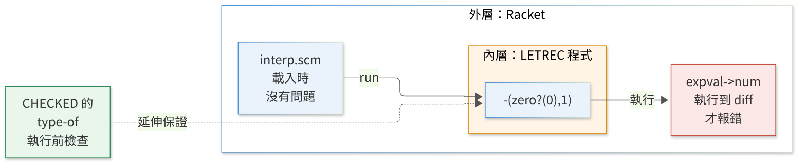
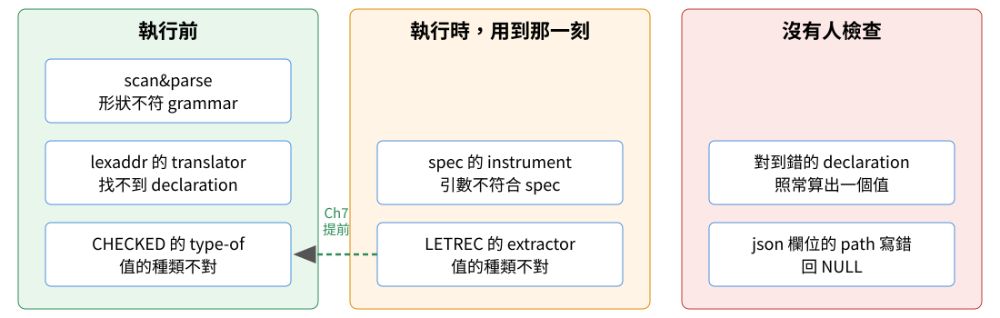
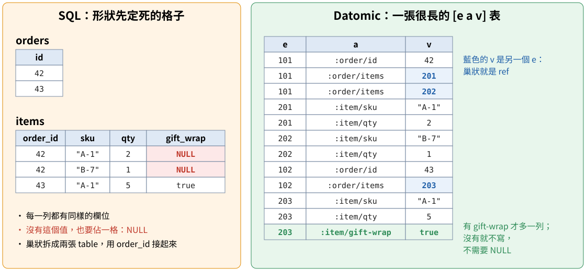

<!-- _class: lead -->

# 程式語言
## Programming Languages — Class 15

政大資碩 115-1　陳家宏

---

# 今天三堂課

| 時段 | 內容 |
|---|---|
| 第 1 堂 | 期末複習 Ch1–Ch3；SICP 的 eval/apply 與 EOPL 的 value-of/apply-X |
| 第 2 堂 | 期末複習 Ch4、§7.1–7.3 |
| 第 3 堂 | 兩句話的對立：Milner 與 Greenspun；SQL 的 json 與 Datalog；期末考說明 |

<!-- 講者備註：
第 1 堂：概念 13 個（十台直譯器、defined/defining language、用 Lisp 寫直譯器的好處、四角度表、歸納定義三寫法、Follow the Grammar 與 context argument、表示法獨立與 cases、等式與分支、lexical/dynamic binding、extend-env-rec、eval/apply、value-of 與 apply-X 的分工、procedure 的兩種表示法）、停下來想 1 處（第 11 張）、約 48 分鐘
第 2 堂：概念 9 個（錯誤的 phase、store 讓共享可觀察、store-passing 與求值順序、Ref 的位置與 newref 四處、四種傳參、value-of-operand、type-of 與 value-of 的差異、sound、check 與 run 的對照）、停下來想 2 處（第 24、29 張）、約 52 分鐘
第 3 堂：概念 13 個（Milner 的 wrong、不保證的事、Greenspun、三樣東西、保證的邊界、兩句話的交會點、spec、押注與代價、json 欄位、datom 與 ref、Datalog 的 join、為什麼不需要 json 型別（我的解讀）、Clojure 與 Datomic 的回應；另有 3 張圖解：第 38、42、48 張）、停下來想 0 處、約 50 分鐘
每張的分鐘數是我的假設，沒有實測。
實測環境：Racket v8.10 + mwand/eopl3；dynamic binding 版是我把 chapter3/proc-lang/ds-rep 複製一份、改 interp.scm 三行；sqlite 3.45.1。Datomic 的程式碼依官方文件的寫法，沒有實測。
week 15 三堂都用來複習：class-14 已經講完 §7.3，HW6 也在 class-14 發布。 -->

---

<!-- _class: small -->

# 這學期做了幾台直譯器？

| # | 語言 | 章節 | repo 資料夾 | 這台多了什麼 |
|---|---|---|---|---|
| 1 | LET | §3.2 | `chapter3/let-lang` | 規格與 `value-of` |
| 2 | PROC | §3.3 | `chapter3/proc-lang` | closure |
| 3 | LETREC | §3.4 | `chapter3/letrec-lang` | `extend-env-rec` |
| 4 | lexaddr | §3.7 | `chapter3/lexaddr-lang` | 執行前的翻譯 |
| 5 | EXPLICIT-REFS | §4.2 | `chapter4/explicit-refs` | store、`newref` |
| 6 | IMPLICIT-REFS | §4.3 | `chapter4/implicit-refs` | 每個變數綁到 location |
| 7 | MUTABLE-PAIRS | §4.4 | `chapter4/mutable-pairs` | 值裡藏著 location |
| 8 | CALL-BY-REFERENCE | §4.5.1 | `chapter4/call-by-reference` | 參數共用 location |
| 9 | CALL-BY-NEED | §4.5.2 | `chapter4/call-by-need` | thunk |
| 10 | CHECKED | §7.3 | `chapter7/checked` | `type-of` |

「這台多了什麼」這一欄是我的整理。

---

# 「直譯器本身也是一支程式」

p.57（改寫）：程式文字先經過 front end 變成 abstract syntax tree，再交給 interpreter；interpreter 看著這個資料結構，依它的結構做事。interpreter 本身也用某個語言寫成。

| 課本用語（p.57） | 這門課 |
|---|---|
| source language／defined language | LET、PROC、……、CHECKED |
| implementation language／defining language | Racket（`#lang eopl`） |

兩條路線畫在 Figure 3.1（p.59）：(a) 直譯器，(b) 編譯器。這門課走 (a)。

為什麼要在意：這學期每一個語言特性，都是 defining language 裡的一段程式，打開看得到、改得動。


---

<!-- _class: small -->

# 為什麼用 Lisp 來寫直譯器？

p.59（改寫）：前端除了用 parser generator、手寫 parser，另一種做法是忽略 concrete syntax 的細節，直接把運算式寫成 list 結構，就像 §2.5 的 `parse-expression` 與 Exercise 2.31。

p.53（改寫）：concrete syntax 是 list 的話，parse 簡單很多；Scheme 的 `read` 已經把字串轉成 list 與 symbol，剩下的是把 list 轉成 AST。

```racket
> (define e (read (open-input-string "(lambda (x) (f (f x)))")))
> (car e)
lambda
> (cadr e)
(x)
> (parse-expression e)                                     ; p.53
#(struct:lambda-exp x
  #(struct:app-exp #(struct:var-exp f)
    #(struct:app-exp #(struct:var-exp f) #(struct:var-exp x))))
```

| 好處 | 出處 |
|---|---|
| 程式本身就是 list，`read` 之後就能用 `car`、`cdr` 拆 | p.53 |
| 前端可以很薄，時間留給語意 | p.59 |
| 寫 AST 與分派的工具就在語言裡：`define-datatype`、`cases` | pp.46–49 |

<!-- 講者備註：read 那三行在 Racket v8.10 跑過；parse-expression 的輸出是 class-04 的實測結果。
Hal Abelson 的 Foreword（p.xi）也說：作者選了 Scheme，它結合了 Lisp 的 uniform syntax 與 data-abstraction 能力，以及 Algol 的 lexical scoping 與 block structure。
回扣 class-01：課程用 #lang eopl，因為 define-datatype／cases 能把語意規則一對一翻成程式，SLLGEN 由文法產生 parser。
第三列是我的整理：p.49 說 define-datatype 是一種 DSL。
Ch3 起課本改用 SLLGEN 當前端（p.67），所以 LET 之後的程式是 "let x = 5 in -(x,3)" 這種字串；p.59 這段說的是另一條可以走的路。 -->
---

<!-- _class: small -->

# 四角度表上，四台直譯器各改了哪一格？

加粗的是每台改動最多的那一格。

| 角度 | PROC | LETREC | IMPLICIT-REFS | CHECKED |
|---|---|---|---|---|
| syntax | 加 `proc`、call（p.75） | 加 `letrec`（p.82） | 加 `set`（p.116） | **參數加型別標註；letrec 加結果型別（pp.240–241）** |
| values | **ExpVal 多 Proc（p.75）** | 不變 | **DenVal = Ref(ExpVal)（p.113）** | 不變 |
| environments | 不變 | **多 `extend-env-rec`（p.83）** | 存進去的是 Ref（p.119） | `run` 不變；`check` 用 tenv（p.244） |
| behavior | closure 與 `apply-procedure`（p.76） | 一條 letrec 等式（p.83） | var-exp 查兩層；call、let 配置 location（pp.117–118） | `run` 不看標註；另加 `type-of`（pp.244–246） |

另外 6 台：EXPLICIT-REFS 在第 23 張，CALL-BY-REFERENCE、CALL-BY-NEED 在第 24–26 張。

<!-- 講者備註：LET、PROC、LETREC 的四角度表在 class-05、06、07；IMPLICIT-REFS 在 class-11 第 3 張；CHECKED 的「run 不看標註」在 class-14 第 13 張。 -->

---

<!-- _class: small -->

# 歸納定義的三種寫法，各拿來做什麼？

p.3：三種寫法說的是同一件事，分別叫 top-down、bottom-up、rules-of-inference。

| 寫法 | 例子（集合 S = 3 的倍數） | 拿來做什麼 |
|---|---|---|
| top-down | n ∈ S 若且唯若 n = 0，或 n − 3 ∈ S | 直接寫成測試程式 `in-S?`（p.2） |
| bottom-up | S 是滿足兩條件的**最小**集合 | 「最小」撐起 structural induction（p.12） |
| rules of inference | 橫線上是前提，橫線下是結論；沒有前提的叫 axiom（p.3） | 這學期寫規則的格式 |

rules of inference 之後出現在：

| 章 | 規則 |
|---|---|
| Ch3 | zero?、if 的規則（p.65） |
| Ch4 | newref、deref、setref 的規則（pp.108–109） |
| Ch7 | `type-of` 的規則（p.239） |

---

# Follow the Grammar 什麼時候寫不下去？

```racket
;; number-elements-from :
;;   Listof(SchemeVal) * Int -> Listof(List(Int, SchemeVal))
;; usage: (number-elements-from '(v0 v1 v2 ...) n)
;;        = ((n v0) (n+1 v1) (n+2 v2) ...)
(define number-elements-from
  (lambda (lst n)
    (if (null? lst)
        '()
        (cons (list n (car lst))
              (number-elements-from (cdr lst) (+ n 1))))))
```

`(number-elements '(b c))` 的答案拿來直接用不了，每個編號都差 1。所以多加一個參數 `n`：context argument（p.22）。usage 要說明所有 `n` 的行為：No Mysterious Auxiliaries（p.23）。

<!-- 講者備註：class-02 第 2 堂。之後 lexaddr 的 senv、CHECKED 的 tenv，都是 context argument（p.94 自己也這樣說 senv）。 -->

---

<!-- _class: small -->

# 換一種表示法，client 要改什麼？

| 介面 | observer | 課本給的表示法 | client 改了嗎 | 出處 |
|---|---|---|---|---|
| 自然數 | `is-zero?` | unary、Scheme number、bignum | `plus` 不改 | pp.32–34 |
| lc-exp | predicate 與 extractor | `(lambda (x) b)`、`(lambda x b)`（Ex 2.16）、自訂兩種（Ex 2.17） | `occurs-free?` 不改 | pp.43–44 |
| **environment** | **`apply-env`** | 資料結構、程序、a-list（Ex 2.5）、ribcage（Ex 2.11）、`define-datatype`（Ex 2.21） | 都得 `(6 7 8)` | pp.38–40、50 |
| **procedure** | **`apply-procedure`** | 程序、`define-datatype`（p.79）；只存自由變數（Ex 3.26） | `value-of` 不改 | pp.79–81 |
| mutable pair | `left`、`right` | 存兩個 reference（Figure 4.9）、只存左格的 reference（Figure 4.13） | `value-of` 不改（p.126） | pp.125–129 |
| store | `deref` | list（Figure 4.1）、Scheme vector（Ex 4.9） | `value-of` 不改 | pp.111–112 |

<!-- 講者備註：p.32：client 只透過介面操作，這段 client 程式碼就是 representation-independent。粗體的兩列是 apply-X：型別只有一個 observer，所以可以用程序表示（p.40）；換成資料結構，就是 defunctionalization（p.41）。define-datatype 也是一種表示法，想換別的存法就得手寫介面（p.49）。
同樣的做法在 Ch5 的 continuation 又出現一次（第 15 張）。
自然數那一列的 observer 不叫 apply-：自然數不是函數，課本也沒有拿它套用。
自然數、environment 在 class-03；lc-exp 在 class-04（Ex 2.17 是 HW2）；procedure 在 class-06；mutable pair 在 class-12；store 在 class-10。environment 的 define-datatype 版是 Ex 2.21（p.50），正文要到 Figure 3.12（p.86）。Ex 2.11、3.26、4.9 沒教過也沒出成作業，只說「課本在習題裡要你換這種表示法」；Ex 4.9 原文還問用 vector 失去了什麼，可以口頭補充。 -->

---

<!-- _class: small -->

# 規格的一條等式，在程式裡是哪一段？

| 等式的左邊（pp.62、65、67） | `value-of` 的分支（pp.71–72） |
|---|---|
| `(value-of (const-exp n) ρ)` | `(const-exp (num) ...)` |
| `(value-of (var-exp var) ρ)` | `(var-exp (var) ...)` |
| `(value-of (diff-exp exp1 exp2) ρ)` | `(diff-exp (exp1 exp2) ...)` |
| `(value-of (zero?-exp exp1) ρ)` | `(zero?-exp (exp1) ...)` |
| `(value-of (if-exp exp1 exp2 exp3) ρ)` | `(if-exp (exp1 exp2 exp3) ...)` |
| `(value-of (let-exp var exp1 body) ρ)` | `(let-exp (var exp1 body) ...)` |

等式的右邊寫成分支的 body，ρ 寫成 `env`。

p.70：「extend the language」指兩件事，先在規格裡加規則，再改直譯器。這學期每一份作業都照這個順序。

---

# 停下來想：closure 存的是哪個環境？

改寫自 Exercise 3.28 的例子（p.82），把一次宣告兩個變數的 `let` 拆成兩層：

```
let a = 3
in let p = proc (x) -(x,a)
   in let a = 5
      in -(a,(p 2))
```

**停下來想**（4 分鐘）：

1. 在 PROC（lexical binding）裡，程式的值是多少？
2. 在 dynamic binding 裡，程式的值是多少？
3. 兩個答案差在 `p` 的 body 裡哪一個 `a`？

<!-- 答案在下一張：6 與 8。p.82：dynamic binding 下，body 的 a 綁到 5。 -->

---

# 對答案：兩種 binding 各得多少？

```racket
;; chapter3/proc-lang/ds-rep
> (run "let a = 3 in let p = proc (x) -(x,a) in let a = 5 in -(a,(p 2))")
(num-val 6)

;; a copy of ds-rep with dynamic binding
> (run "let a = 3 in let p = proc (x) -(x,a) in let a = 5 in -(a,(p 2))")
(num-val 8)
```

dynamic 版只改了 `interp.scm` 的三行：

```diff
-            (apply-procedure proc arg)))
+            (apply-procedure proc arg env)))   ; dynamic: pass the caller's env
-    (lambda (proc1 val)
+    (lambda (proc1 val caller-env)
-          (value-of body (extend-env var val saved-env))))))
+          (value-of body (extend-env var val caller-env))))))
```

<!-- 講者備註：lexical：5 − (2 − 3) = 6；dynamic：5 − (2 − 5) = 8。
p.76：body 在建立程序時存下的 ρ 裡求值。dynamic 版改用呼叫處的 env，saved-env 沒有被用到。
回扣 class-08：bash 是 dynamic scoping，只讀 p 的定義看不出 a 對到誰，local reasoning 做不到。 -->

---

<!-- _class: small -->

# 從 PROC 到 LETREC，改的是哪一層？

`extend-env-rec` 只用 `apply-env` 的兩條規則來規定（p.83），令 ρ1 = `(extend-env-rec proc-name bound-var proc-body ρ)`：

| 查的變數 | `(apply-env ρ1 var)` |
|---|---|
| `proc-name` | `(proc-val (procedure bound-var proc-body ρ1))` |
| 其他 `var` | `(apply-env ρ var)` |

Figure 3.12（p.86）：查到 `p-name` 時，用 `env`（也就是 ρ1）組 closure。改成 `saved-env`，就退回 `let` 的行為，得到 `No binding for double`。

| PROC → LETREC 改了 | 沒有改 |
|---|---|
| grammar、`value-of` 的 letrec 分支、`environment` 的 variant、`apply-env` 的分支 | `proc-exp`、`call-exp` 分支、`apply-procedure`、`proc` datatype |

<!-- 講者備註：class-07 第 2 堂。下一張開始的 SICP 對照，會用到「沒有改」這一欄。 -->

---

# SICP 的 evaluator 由哪兩個程序組成？

課外補充。SICP（Abelson & Sussman）第 4 章的 metacircular evaluator：

| | SICP §4.1.1 |
|---|---|
| `eval` | 依運算式的語法種類分派，交給對應的處理 |
| `apply` | 把 procedure 分成兩種：primitive 交給 `apply-primitive-procedure`；compound 則擴充 procedure 帶著的環境，依序求值 body |
| 兩者的關係 | 互相呼叫，形成 eval–apply 的循環 |

SICP §4.1：這個 evaluator 用它要求值的同一個語言寫成，所以叫 metacircular。

EOPL 的直譯器裡沒有一個叫 `apply` 的程序。下一張看 EOPL 怎麼分工。

---
<!-- _class: small -->

# `value-of` 和 `apply-X` 各負責什麼？

我的解讀：`value-of` 負責「這段語法是什麼意思」，每種 expression 一個 `cases` 分支；`apply-X` 負責「這種執行時的資料怎麼用」。

| 執行時的資料型別 | constructor | observer | 回答的問題 | 頁碼 |
|---|---|---|---|---|
| environment | `empty-env`、`extend-env`、`extend-env-rec` | `apply-env` | 這個名字代表什麼？ | pp.36、83 |
| procedure | `procedure` | `apply-procedure` | 呼叫時要做什麼？ | p.75 |
| store（Ch4） | `newref`；修改用 `setref!` | `deref` | 這個 location 現在放什麼？ | pp.111–112 |
| continuation（Ch5） | `end-cont`、`zero1-cont`、`let-exp-cont`、`if-test-cont` | `apply-cont` | 算完之後接著做什麼？ | pp.146–148 |

```racket
(define apply-cont (lambda (cont v) (cont v)))   ; Figure 5.2 (p.147): procedural representation
```

<!-- 講者備註：value-of 新增一種語法就多一個分支（pp.71–72）；apply-X 是第 2 章的做法，每種資料型別一組 constructor、一個 observer。有了這層介面，environment 換成 procedural 表示法或 a-list，value-of 都不用改（第 9 張）。
class-05 問過 apply- 字首從哪來：p.36（environment 是函數）與 p.41 recipe 的第 2 步。
store 的 observer 叫 deref，不叫 apply-store；apply-store 只出現在 Figure 4.6（p.116）。setref! 修改既有的 location，照 p.33 的定義不算 constructor。
「回答的問題」那一欄是我的說法。p.146 說到這裡共有四個 continuation-builder；Ch5 這門課沒有教，所以附上 Figure 5.2 的 apply-cont；Figure 5.3（p.148）的資料結構版用 cases continuation，口頭補充。
同一個套路還有 apply-senv（p.95）、apply-nameless-env（p.98）、apply-tenv（p.244）。repo 另有 apply-safely，在 drscheme-init.scm，是跑測試用的工具。 -->
---

<!-- _class: small -->

# `apply-procedure` 的兩種實作，差在哪？

p.75：Proc 的介面是 constructor `procedure` 與 observer `apply-procedure`。p.79 給了兩種實作：

```racket
;; procedural representation (p.79)
(define procedure
  (lambda (var body env)
    (lambda (val)
      (value-of body (extend-env var val env)))))
(define apply-procedure
  (lambda (proc1 val) (proc1 val)))

;; data structure representation (p.79)
(define-datatype proc proc?
  (procedure (var identifier?) (body expression?) (saved-env environment?)))
(define apply-procedure
  (lambda (proc1 val)
    (cases proc proc1
      (procedure (var body saved-env)
        (value-of body (extend-env var val saved-env))))))
```

p.41：從 procedural 表示法換到資料結構表示法，這個過程叫 defunctionalization。

---

<!-- _class: small -->

# metacircular evaluator 從 defining language 借了什麼？

class-06 的補充：Reynolds（1972）指出，用 defining language 的 higher-order function 實作 defined language 的 higher-order function，讀者原本不懂這個特性，就很難從這種定義裡得到解釋；直接風格的 interpreter 也會讓 defined language 繼承 defining language 的呼叫方式。

| 借來的東西 | SICP 的 evaluator | EOPL（ds-rep） |
|---|---|---|
| primitive 怎麼套用 | 交給底層 Scheme 的 `apply`（§4.1.4） | 每個 primitive 一個 `value-of` 分支，例如 diff（p.71） |
| procedure 值存了什麼 | 參數、body、環境組成的資料（§4.1.3） | `procedure` 的三個欄位（p.79） |
| operand 的求值順序 | 由底層 Lisp 決定（SICP Ex 4.1） | `let` 的順序，由 Racket 決定（class-10） |

我的解讀：兩本書都把 procedure 值寫成資料。差別在 EOPL 讓 Proc 有自己的介面，`apply-procedure` 是那個介面的 observer。

---

<!-- _class: small -->

# 第 1 堂回顧

1. **直譯器是一支程式**：front end 產生 AST，interpreter 用 defining language 寫成（p.57、Figure 3.1 p.59）；用 Lisp 寫，程式本身就是 list，前端可以很薄（pp.53、59）
2. **四角度表**：PROC 改 values，LETREC 改 environments，IMPLICIT-REFS 改 values，CHECKED 改 syntax（第 6 張）
3. **Ch1**：歸納定義的三種寫法；Follow the Grammar 寫不下去時，加 context argument（pp.2–3、22–23）
4. **Ch2**：client 只透過介面操作，換表示法不必改；只有一個 observer 的型別（environment、procedure）都有程序與資料結構兩種表示法（pp.32、40–41、79）
5. **Ch3**：一條等式對到一個分支；lexical 與 dynamic binding 差在 body 用哪個環境（pp.71–72、76、82）
6. **value-of 與 apply-X**：`value-of` 對語法分派，`apply-X` 是各種執行時資料型別的 observer；SICP 的 `eval`、`apply` 對應這兩邊。這是我的解讀（第 14–17 張）

---

<!-- _class: lead -->

# 第 2 堂
## Ch4 與 §7.1–7.3

---

<!-- _class: small -->

# 錯誤在哪個 phase 被找出來？

class-08 的表（lexaddr-lang 實測）：

| 錯誤 | 例子 | 誰抓到 | 時機 |
|---|---|---|---|
| 形狀不符 grammar | `-(1,` | `scan&parse` | 翻譯前 |
| 找不到 declaration | `if zero?(0) then 1 else foo` | `apply-senv` | 翻譯時 |
| 值的種類不對 | `-(zero?(0),1)` | `expval->num` | 執行時 |
| 對到錯的 declaration | `let x = 1 in let f = proc (x) -(x,x) in (f 10)` | 沒有 | — |

第三列到 Ch3 為止都要等到執行時。Ch7 要把它提前到執行前（本堂後半）。

---

<!-- _class: small -->

# Ch3 的語言為什麼用不到 store？

p.103：binding 是 local 的，variable assignment 可能是 global 的。

我的解讀（class-10）：Ch3 的環境建好後不會被修改，共享和複製分辨不出來；有了 assignment，共享才觀察得到，store 是把這件事記下來的模型。

class-10 的 Ch4 全章總表（節錄）：

| 語言 | Ref 出現在哪裡 | 新 location 在哪裡配置 |
|---|---|---|
| EXPLICIT-REFS | ExpVal（p.104） | 只在 `newref`（p.104） |
| IMPLICIT-REFS | DenVal（p.113） | init env、let、call、letrec（pp.118–119） |
| CALL-BY-REFERENCE | DenVal | 同上，但 call 的 operand 是變數時不配置（p.132） |
| CALL-BY-NEED | DenVal，location 可放 thunk（p.137） | 同 CALL-BY-REFERENCE |

---

# store-passing 規則多規定了什麼？

```
(value-of exp1 ρ σ0) = (val1, σ1)
(value-of exp2 ρ σ1) = (val2, σ2)
------------------------------------------------------
(value-of (diff-exp exp1 exp2) ρ σ0) = (⌈⌊val1⌋ - ⌊val2⌋⌉, σ2)
```

p.107：exp2 從 exp1 留下的 σ1 開始，所以這條規則規定了先求值 exp1、再求值 exp2。

| | Ch3（p.62） | Ch4（p.107） |
|---|---|---|
| store | 沒有 | σ0 → σ1 → σ2 |
| 求值順序 | 規則沒有規定 | exp1 先 |

為什麼要在意：同一支程式換一個求值順序，有 effect 時答案就可能不同。

---

<!-- _class: small -->

# Ref 放在 ExpVal 還是 DenVal？`newref` 藏在哪裡？

```
EXPLICIT-REFS (p.104)              IMPLICIT-REFS (p.113)
ExpVal = Int + Bool + Proc         ExpVal = Int + Bool + Proc
         + Ref(ExpVal)
DenVal = ExpVal                    DenVal = Ref(ExpVal)
```

p.61：expressed value 是運算式可能的值，denoted value 是綁到變數的值。p.113：IMPLICIT-REFS 的 reference 不再是 expressed value，只以變數綁定的形式存在。

| 消失的運算 | 在 IMPLICIT-REFS 裡藏進哪裡（pp.117–119） |
|---|---|
| `newref` | init env、let、procedure call、letrec 四處 |
| `deref` | var-exp |
| `setref` | `set`（assign-exp） |

---

<!-- _class: small -->

# 停下來想：四支程式，三台直譯器各得多少？

```
%% P1 (p.130)                                %% P3 (p.132)
let p = proc (x) set x = 4                   let swap = proc (x) proc (y)
in let a = 3                                              let temp = x
   in begin (p a); a end                                  in begin set x = y; set y = temp end
                                             in let a = 33
%% P2 (p.131)                                   in let b = 44
let f = proc (x) set x = 44                        in begin ((swap a) b); -(a,b) end
in let g = proc (y) (f y)
   in let z = 55                             %% P4 (p.136)
      in begin (g z); z end                  letrec infinite-loop (x) = (infinite-loop -(x,-1))
                                             in let f = proc (z) 11
                                                in (f (infinite-loop 0))
```

**停下來想**（6 分鐘）：每支程式在 `implicit-refs`（call-by-value）、`call-by-reference`、`call-by-need` 各得多少？不終止的寫「不終止」。

<!-- 講者備註：%% 開頭的那幾行是投影片上的標籤，不是程式的一部分；% 在這個語言裡是註解字元（p.94）。 -->

---

<!-- _class: small -->

# 對答案

| # | implicit-refs（call-by-value） | call-by-reference | call-by-need |
|---|---|---|---|
| P1 | 3 | 4 | 4 |
| P2 | 55 | 44 | 44 |
| P3 | −11 | 11 | 11 |
| P4 | 不終止 | 不終止 | 11 |

```
$ cd chapter4/call-by-need && racket -i -t top.scm
> (run "letrec infinite-loop (x) = (infinite-loop -(x,-1)) in let f = proc (z) 11 in (f (infinite-loop 0))")
(num-val 11)
```

P1–P3 的 operand 都是變數，所以 call-by-need 和 call-by-reference 答案相同。差別只出現在 P4：operand 不是變數，存成 thunk，`f` 用不到它。

<!-- 講者備註：12 格都在三個資料夾實跑過。不終止的兩格，我用 timeout 10 秒中斷。 -->

---

<!-- _class: small -->

# `value-of-operand` 怎麼決定配不配置？

```racket
;; call-by-reference (p.132)                  ;; call-by-need (p.137)
(define value-of-operand                      (define value-of-operand
  (lambda (exp env)                             (lambda (exp env)
    (cases expression exp                         (cases expression exp
      (var-exp (var) (apply-env env var))           (var-exp (var) (apply-env env var))
      (else                                         (else
        (newref (value-of exp env))))))               (newref (a-thunk exp env))))))
```

| operand | call-by-reference | call-by-need |
|---|---|---|
| 變數 | 傳它的 location | 傳它的 location |
| 其他 expression | 先求值，放進新 location | 不求值，thunk 放進新 location |

p.132：配置的決定移到 call-exp，因為那裡還看得到 operand 是不是變數。

---

<!-- _class: small -->

# `type-of` 和 `value-of` 差在哪幾個分支？

class-14 的並排表：

| 分支 | `value-of`（chapter3/letrec-lang） | `type-of`（chapter7/checked） |
|---|---|---|
| if | 先算 `exp1`，只算一個分支 | 三個子運算式都算；兩個分支要同型 |
| let | `extend-env` | `extend-tenv` |
| proc | 打包成 closure，不碰 body | 在 `extend-tenv` 裡檢查 body |
| call | `apply-procedure` 執行 body | 只看 rator 的型別，不進 body |
| letrec | `extend-env-rec` | `extend-tenv` 兩次 |

我的解讀：`type-of` 對每個子運算式只走一次，所以程式不終止，檢查仍會結束。規則的每個前提，在程式裡是一行 `check-equal-type!`；結論的型別是回傳值（pp.244–246）。

---

# 分析「接受」一個程式，保證了什麼？


- p.234：分析要 conservative。接受了，就能確定求值是 safe 的；滿足這一點的分析稱為 sound
- p.238 的規格：每個變數的值都屬於 tenv 指定的型別時，結果屬於型別 t、或不終止、或因 type error 以外的錯誤失敗

<!-- 講者備註：圖是 class-13 的 img/venn-sound.svg。藍色環狀區：執行時不會發生 type error，分析仍然拒絕。 -->

---

<!-- _class: small -->

# 停下來想：`check` 接受嗎？`run` 時會不會 type error？

在 `chapter7/checked` 裡：

| # | 程式 | `check` 接受？ | `run` 時有 type error？ |
|---|---|---|---|
| 1 | `proc (x : int) (3 x)` | | |
| 2 | `if zero?(0) then 1 else zero?(1)` | | |
| 3 | `-(zero?(0),1)` | | |
| 4 | `(proc (x : bool) -(x,1) 5)` | | |
| 5 | `letrec int f (x : int) = (f -(x,-1)) in (f 1)` | | |
| 6 | `letrec int double (x : int) = if zero?(x) then 0 else -((double -(x,1)), -2) in (double 6)` | | |

**停下來想**（6 分鐘）：兩欄都填。`run` 不終止的，寫「不終止」。

---

<!-- _class: small -->

# 對答案

| # | `check` | `run` | 落在第 28 張的哪一區 |
|---|---|---|---|
| 1 | 拒絕：`Rator not a proc type` | `(proc-val ...)`，沒有錯 | 藍色環狀區 |
| 2 | 拒絕：`int != bool` | `(num-val 1)` | 藍色環狀區 |
| 3 | 拒絕：`bool != int` | `Looking for a num, found #(struct:bool-val #t)` | 藍圈外 |
| 4 | 拒絕：`bool != int` | `(num-val 4)` | 藍色環狀區 |
| 5 | `int` | 不終止 | 綠圈裡 |
| 6 | `int` | `(num-val 12)` | 綠圈裡 |

被接受的 5、6，`run` 時都沒有 type error。第 5 個跑不停，依定義仍然 safe（p.235）。

<!-- 講者備註：check 的訊息是節錄，完整訊息在 class-13、14。第 5 個的 run 用 timeout 8 秒中斷。 -->

---

<!-- _class: small -->

# 第 2 堂回顧

1. **錯誤在哪個 phase 被找出來**：形狀 → `scan&parse`；找不到 declaration → translator；值的種類 → 執行時的 extractor（第 20 張）
2. **store**：有了 assignment，共享才觀察得到；store-passing 規則因此規定了求值順序（pp.103、107）
3. **Ref 的位置**：EXPLICIT-REFS 放在 ExpVal，IMPLICIT-REFS 放在 DenVal；`newref` 藏進 init env、let、call、letrec 四處（pp.104、113、118–119）
4. **四種傳參方式**：formal parameter 綁到什麼、operand 何時求值，決定同一支程式的值（pp.130–137，第 24–26 張）
5. **`type-of` 與 `value-of`**：同一個結構；if 算幾個分支、proc 的 body 何時處理，兩邊不同（第 27 張）
6. **sound**：接受就保證 safe；代價是會拒絕一些執行時不會出錯的程式；`check` 接受的程式可能不終止（pp.234–238，第 28–30 張）

---

<!-- _class: lead -->

# 第 3 堂
## 兩句話的對立

---

# Milner 1978 年的那句話說了什麼？

> "Well-typed programs cannot go wrong."
> — Robin Milner, *A Theory of Type Polymorphism in Programming* (1978)

課本沒有引用這句話，這張是我加的。

| Milner 的用語 | 這門課的對應 |
|---|---|
| wrong | 執行時的型別錯誤：p.233 五個條件被違反，也就是 extractor 報錯 |
| well-typed | `type-of` 指派得出型別（p.238） |
| cannot go wrong | sound：接受就保證沒有 type error（p.234） |

第 2 堂第 30 張表的 5、6 就是例子：`check` 接受，`run` 時沒有 type error。

---

# cannot go wrong 不保證哪些事？

p.234：除以零、取空 list 的 `car` 這類錯誤不算進 safety；不終止也不算（pp.234–235）。

Definition 7.1.1（p.237）：值屬於 `(t1 → t2)`，給它 t1 的引數時，三件事之一發生：回傳 t2 的值、不終止、因 type error 以外的錯誤失敗。

```
> (check "letrec int f (x : int) = (f -(x,-1)) in (f 1)")
'int
> (run "letrec int f (x : int) = (f -(x,-1)) in (f 1)")
; does not terminate; stopped with Ctrl-C
```

<!-- 講者備註：常見誤讀是「型別對了，程式就對了」。這句話不管不終止、type error 以外的錯誤，也不管業務邏輯。 -->

---

# Greenspun's Tenth Rule 說了什麼？

課外補充。Philip Greenspun（約 1993 年）：任何夠複雜的 C 或 Fortran 程式，都包含

> "an ad hoc, informally-specified, bug-ridden, slow implementation of half of Common Lisp"

| 常見的中文轉述 | 原文的限定詞 |
|---|---|
| 夠複雜的系統最後都會長出 Lisp | ad hoc、沒有正式規格、充滿 bug、很慢，而且只有一半 |

「第十條」本身也是玩笑，前九條並不存在。

---

<!-- _class: small -->

# 決策要移到執行期，需要哪三樣東西？

我的解讀：需求變動比重新編譯、部署還快時，系統要在執行期改決策，就得有下面三樣。這學期每一樣都做過：

| 需要的東西 | 這學期在哪裡做過 |
|---|---|
| 把程式表示成資料 | Ch1 的 s-expression（quote 之後就是資料）；Ch2 的 abstract syntax（p.51） |
| 一個直譯器 | Ch3 起的 `value-of` |
| 動態的資料結構 | environment（Ch2、Ch3）、store（Ch4） |

實務上的例子：設定檔加上樣板引擎、規則引擎與 workflow DSL、遊戲內嵌 Lua 當腳本、到處傳遞的 JSON map。

---

# 宿主語言的保證停在哪裡？

```
$ cd chapter3/letrec-lang
$ racket -e '(require "interp.scm")'          ; loads with no error
$ racket -i -t top.scm
> (run "-(zero?(0),1)")
; expval-extractors: Looking for a num, found #(struct:bool-val #t)
```

| 層 | 誰檢查 | 什麼時候 |
|---|---|---|
| `interp.scm` 這支 Racket 程式 | Racket | 載入時，沒有問題 |
| `-(zero?(0),1)` 這支 LETREC 程式 | `expval->num` | 執行到 diff 時 |

我的解讀：就算宿主語言有型別檢查，它檢查的也只有 `interp.scm`。被直譯的程式要有保證，得在 defined language 這一層另外做，CHECKED 的 `type-of` 就是這樣做的。

---

# 保證停在哪一層？



外層的檢查只看 `interp.scm`，管不到內層的程式；要保護內層，得在內層另外做檢查（虛線）。

<!-- 講者備註：圖是我畫的，原始碼 img/guarantee-boundary.mmd（Mermaid），設定檔 img/config.json。內容依上一張的實測。 -->

---

# 兩句話在哪裡交會？

第 37–38 張：用有型別檢查的語言寫出一個直譯器，第一句的保證停在直譯器的邊界；被直譯的程式照樣會 go wrong。

我的解讀：Greenspun 法則描述的，正是型別系統的保證怎麼被繞過。

| 回應 | 做法 | 這學期的例子 |
|---|---|---|
| 型別陣營 | 替內嵌語言也設計型別系統，把保證延伸過邊界 | CHECKED 的 `type-of` |
| Hickey | 一開始就用設計良好的動態語言，再用 spec 把預期寫回去 | 下一張 |

<!-- 講者備註：型別陣營的做法技術上可行，但成本高；實務上多數系統沒有這樣做（class-15 主軸文件）。 -->

---

<!-- _class: small -->

# Clojure 的 spec 怎麼把預期寫回去？

課外補充。class-02 看過一次 spec 的錯誤訊息，這裡補上它是什麼：`clojure.spec.alpha` 用資料描述「值應該長什麼樣」，需要時才檢查。

```clojure
(require '[clojure.spec.alpha :as s])
(s/def ::email string?)                          ; a spec for one key
(s/def ::user (s/keys :req-un [::email]))        ; a map must have :email

(s/valid? ::user {:name "Amy" :email "amy@nccu.edu.tw"})   ;=> true
(s/explain ::user {:name "Ben"})
;; {:name "Ben"} - failed: (contains? % :email) spec: :user/user
(s/explain ::user {:name "Cat" :email 42})
;; 42 - failed: string? in: [:email] at: [:email] spec: :user/email
```

| | EOPL 的 contract（p.2） | CHECKED 的 `type-of` | spec |
|---|---|---|---|
| 寫在哪裡 | 註解 | 程式裡的型別標註 | 一般的 Clojure 資料 |
| 誰檢查、何時 | 沒有人檢查 | checker，執行前 | 呼叫 `s/valid?`、`s/explain` 時；或用 `instrument` 在函式被呼叫時檢查 |

<!-- 講者備註：babashka v1.12.196 實測。class-02 的例子：(s/fdef domain-of :args (s/cat :user ::user)) 加上 (stest/instrument `domain-of) 之後，(domain-of {:name "Ben"}) 得 Call to user/domain-of did not conform to spec.
p.2：in-S? : N → Bool 這行註解課本稱為 contract。
spec 檢查的是執行時的值，不保證沒被檢查到的路徑；這和 Ch7 的 sound 是不同的承諾（我的解讀）。 -->

---

<!-- _class: small -->

# Milner 與 Greenspun 各押注什麼、付出什麼？

| | Milner | Greenspun |
|---|---|---|
| 押注 | 決策放在編譯期 | 決策終究會移到執行期 |
| 換到 | 型別健全性的保證 | 應對變動需求的彈性 |
| 代價 | 資料形狀必須事先定死 | 自己重造的動態層沒有保證 |

<!-- 講者備註：接下來用資料庫看同一個對立：SQL 的 table 是事先定死的形狀，json 欄位是另開的動態層。 -->

---

# 這學期看過的錯誤，各在什麼時候被抓到？



第 20 張的四列錯誤，加上 spec 與 json 欄位。「值的種類不對」在 LETREC 要等到執行時，Ch7 把它提前到執行前。

<!-- 講者備註：圖是我畫的，img/check-timeline.svg（手寫 SVG）。各格屬於不同的直譯器或系統，彼此沒有先後關係，所以格子之間不畫箭頭。scan&parse、translator、extractor、對到錯的 declaration 四格來自 class-08 的表；type-of 來自 Ch7；spec 的 instrument 見第 40 張；json 欄位見第 44 張。 -->

---

<!-- _class: small -->

# SQL 為什麼要有 json 型別？

class-03 的故事：JSON 的值只有六種，裡面沒有時間，只能靠約定或 context。這裡看反方向：SQL 為什麼要收 JSON。

| SQL 的 table | 遇到每筆欄位不同的資料 |
|---|---|
| 欄位在建 table 時定死 | 有的訂單有包裝顏色，有的有折扣碼，以後還會多出別的 |
| 每一列都有同樣的欄位 | 每多一種就要改 schema；其他列的這一格都是 NULL |

另一種做法是開一個 json 欄位，用 path 運算子取值。PostgreSQL 有 `json`、`jsonb` 型別；sqlite 把 JSON 存成 TEXT，再用 JSON 函式處理。

我的解讀：json 欄位加上 path 運算子，是 SQL 裡面另開的一個小動態語言，可以看成 Greenspun 的一個例子。

---

<!-- _class: small -->

# json 欄位裡的形狀，誰在檢查？

```sql
CREATE TABLE orders (id INTEGER PRIMARY KEY, data TEXT);
INSERT INTO orders VALUES
 (42, '{"gift_wrap":"red"}'),
 (43, '{"coupon":"NEW10"}'),
 (44, '{"gfit_wrap":"blue"}');                    -- typo in the key

SELECT id, data ->> '$.gift_wrap' FROM orders;
-- 42|red
-- 43|NULL
-- 44|NULL

SELECT id FROM orders WHERE data ->> '$.coupon' IS NOT NULL;
-- 43
```

三筆的形狀都不同，全部收下。44 打錯了 key，查出來是 NULL，和 43「沒有包裝」分不出來。

<!-- 講者備註：sqlite 3.45.1 實測，.nullvalue NULL。對照 class-14 第 13 張：run 不看標註。 -->

---

<!-- _class: small -->

# Datomic 怎麼存同樣的訂單？

```clojure
(def schema
  [{:db/ident :order/id        :db/valueType :db.type/long
    :db/cardinality :db.cardinality/one :db/unique :db.unique/identity}
   {:db/ident :order/gift-wrap :db/valueType :db.type/string
    :db/cardinality :db.cardinality/one}
   {:db/ident :order/coupon    :db/valueType :db.type/string
    :db/cardinality :db.cardinality/one}])

@(d/transact conn schema)
@(d/transact conn
   [{:order/id 42 :order/gift-wrap "red"}
    {:order/id 43 :order/coupon "NEW10"}
    {:order/id 44}])
```

- 資料存成 datom：entity、attribute、value，再加上寫入它的交易
- schema 定在 attribute 上，沒有 table；attribute 名稱是 class-08 的 qualified keyword
- 每個 entity 只寫自己有的 attribute；沒有的就不寫

<!-- 講者備註：Datomic Peer API 的寫法，依 docs.datomic.com 的 schema 與 transaction 文件；課堂上沒有實測。attribute 本身也是用交易寫進資料庫的 entity，要先定義才能使用；所以第 44 張那種打錯的 :order/gfit-wrap，Datomic 寫入時就會拒絕（依文件）。 -->

---

<!-- _class: small -->

# Datalog 怎麼查？

```clojure
;; orders with a gift wrap, and its color
(d/q '[:find ?oid ?color
       :where [?o :order/id ?oid]
              [?o :order/gift-wrap ?color]]
     (d/db conn))
;; => #{[42 "red"]}
```

```sql
-- the same question in SQL with a json column (slide 44)
SELECT id, data ->> '$.gift_wrap' FROM orders
 WHERE data ->> '$.gift_wrap' IS NOT NULL;
```

每個 clause 都是 `[e a v]` 的形狀：`[?o :order/gift-wrap ?color]` 只比對到有這個 attribute 的 entity，43、44 自然不會出現，不需要 `IS NOT NULL`。

<!-- 講者備註：查詢結果是 Peer API 回傳的 set，順序不固定。共用的變數 ?o 把兩個 clause 接起來。 -->

---

<!-- _class: small -->

# Datalog 為什麼不需要 json 型別？

我的解讀：json 欄位要解決的事，在 datom 的資料模型裡已經有了。

| | SQL | Datomic |
|---|---|---|
| 每筆資料的欄位不同 | table 的欄位事先定死，另開 json 欄位 | entity 可以帶任意 attribute（Datomic 文件：同一個 entity 可以同時有 customer 與 employee 的 attribute） |
| 沒有這個值 | 一格 NULL | 不寫那一個 datom |
| 查詢語言 | SQL 加上 json path，兩套 | Datalog 一套 |

---

# 同樣的訂單，SQL 和 Datomic 各存成什麼形狀？



<!-- 講者備註：圖是我畫的，img/sql-vs-datomic.svg（手寫 SVG）。資料與第 45 張相同；第 44 張的訂單 44 打錯了 key，這裡當成沒有包裝也沒有折扣碼。
左邊畫的是不用 json 欄位、直接把每種欄位開成一欄的做法；第 44 張的 json 欄位是另一種做法。
右邊的 101、102、103 等 entity id 是我編的；Datomic 的 datom 另外記寫入它的交易，這裡省略。虛線那一列的 :order/note 要先加進 schema 才能寫入。
「一張很長的表」是我的比喻：Datomic 的 index 依 e、a、v 的不同順序排序，查詢時不必真的掃這張表。 -->
---

<!-- _class: small -->

# Hickey 的回應，三段各指什麼？

| Hickey 的說法 | SQL 這條路 | Clojure／Datomic 這條路 |
|---|---|---|
| 與其事後長出半套 Lisp | table 的形狀先定死；需求變動後，才在裡面另開 json 欄位、path 運算子、json 函式（第 43–44 張） | — |
| 一開始就用設計良好的動態語言 | — | 程式本身就是資料；map 可以帶任意 key；Datomic 的 entity 可以帶任意 attribute，query 本身是一個 vector |
| 再用 spec 把預期寫回去 | json 欄位裡的形狀沒人檢查 | Clojure：spec（第 40 張）；Datomic：attribute 的 `valueType`、entity spec 加 `:db/ensure` |

我的解讀：兩條路都有彈性。差別在彈性是事後補上的另一套語言，還是一開始就在語言與資料模型裡；檢查則在需要時再加上去。

<!-- 講者備註：Hickey 的立場依 class-15 主軸文件的轉述。Datomic 的部分依官方文件（schema、entity specs），沒有實測。
query 是資料的例子：(def base '[:find ?oid :where [?o :order/id ?oid]])，再用 (d/q (conj base '[?o :order/coupon "NEW10"]) db) 組出新的 query，不用拼字串。 -->
---

<!-- _class: small -->

# 期末考考什麼、怎麼考？

| 項目 | 內容 |
|---|---|
| 範圍 | Ch1–Ch4、§7.1–7.3；上課投影片，含補充教材；數位學習影片 *The Value of Values* |
| 時間 | 2 小時 50 分 |
| 小抄 | 可攜帶 A4 手寫小抄一張，雙面不限 |
| 題型 | 選擇、填充、問答／計算 |
| HW6 | week 16 上課前，上傳 Moodle |

---

<!-- _class: small -->

# 本日結論

1. **Ch1–Ch3**：直譯器是一支程式；四台代表性的直譯器各改了四角度表的一格；lexical 與 dynamic binding 差在 body 用哪個環境（第 4–13 張）
2. **value-of 與 apply-X**：`value-of` 對語法分派，`apply-X` 是各種執行時資料型別的 observer。這是我的解讀（第 14–17 張）
3. **Ch4**：formal parameter 綁到什麼、operand 何時求值，決定同一支程式的值（第 24–26 張）
4. **Ch7**：`check` 接受的程式，執行時沒有 type error，但可能不終止；sound 的代價是拒絕一些不會出錯的程式（第 27–30、34 張）
5. **Milner 與 Greenspun**：保證停在直譯器的邊界；被直譯的程式要另外檢查；Hickey 的回應是用 spec 把預期寫回去（第 33–42 張）
6. **json 與 Datalog**：json 欄位是 SQL 裡另開的動態層；datom 的資料模型本身就容得下每筆欄位不同的資料。Clojure 與 Datomic 一開始就把 Greenspun 的三樣東西設計進去。這是我的解讀（第 43–49 張）

---

<!-- _class: lead -->

# 問題時間

1. Email: laurence@replware.dev
2. Office Hour: 週四下午 1:00~2:00，請先跟我約
3. 助教：邵振皓 (負責改作業、監考)
4. 助教信箱：114971020@nccu.edu.tw
5. 作業一律上傳 Moodle
